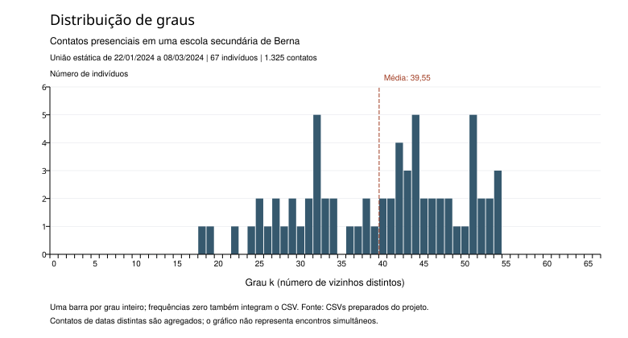

# Caracterização estrutural da escola de Berna

Análise da projeção estática disponível em `../contatos.csv`, com o cadastro completo de `../individuos.csv`. A rede une os contatos válidos observados de 22/01 a 08/03/2024. Os valores abaixo foram calculados em 21/11/2026 com os algoritmos do simulador, antes de qualquer intervenção ou execução epidemiológica.

| Indicador | Valor |
| --- | ---: |
| Indivíduos (N) | 67 |
| Contatos não direcionados únicos (M) | 1.325 |
| Grau médio | 39,5522 |
| Grau mínimo | 18 |
| Grau máximo | 54 |
| Densidade | 0,599276 (59,93%) |
| Componentes conexas | 1 |
| Indivíduos na maior componente | 67 (100%) |
| Indivíduos sem contatos (grau zero) | 0 |
| Soma dos graus | 2.650 |

O grau conta vizinhos distintos, sem considerar a duração ou a quantidade de encontros entre o mesmo par. A média é `2M/N`; a densidade é `2M/[N(N−1)]`. Há 2.211 pares possíveis entre os 67 estudantes, dos quais 1.325 aparecem na preparação. Os IDs locais 25, 34 e 47 têm grau 54, correspondendo aos códigos anonimizados N36, N97 e P93. O menor grau é 18, do ID 63 (S7).

A componente única indica que existem caminhos estruturais entre todos os estudantes na projeção. Como as arestas reúnem datas diferentes, esses caminhos não garantem uma sequência de encontros compatível com o tempo. A densidade tampouco representa contatos simultâneos ou probabilidade de transmissão. Não foram estimadas eficácia de isolamento nem diferenças epidemiológicas entre topologias.

## Arquivos produzidos

| Arquivo | Conteúdo |
| --- | --- |
| [resumo.csv](resumo.csv) | Indicadores sem arredondamento de apresentação. |
| [graus.csv](graus.csv) | Grau de cada indivíduo, com ID local e código original anonimizado. |
| [distribuicao_graus.csv](distribuicao_graus.csv) | Frequência absoluta e fração de indivíduos para cada grau de 0 a 66, incluindo frequências zero. |
| [componentes.csv](componentes.csv) | Tamanho e IDs de cada componente, em ordem crescente. |
| [distribuicao_graus.pdf](distribuicao_graus.pdf) e [SVG](distribuicao_graus.svg) | Gráfico vetorial da distribuição; uma barra por grau inteiro e linha tracejada na média. |
| [caracterizacao.json](caracterizacao.json) | Valores, ambiente Python, hashes de entradas, código e saídas e indicação de que nenhuma epidemia foi executada. |



## Reproduzir

Execute a partir da raiz do repositório, depois da preparação da base:

```bash
# Cálculos e CSVs: biblioteca padrão e implementação nativa do projeto.
PYTHONPATH=src python3 scripts/caracterizar_rede_real.py

# Acrescenta PDF e SVG com ReportLab, se disponível no ambiente.
PYTHONPATH=src python3 scripts/caracterizar_rede_real.py --graficos

# Gravar em outra pasta para comparar os resultados.
PYTHONPATH=src python3 scripts/caracterizar_rede_real.py --saida /tmp/caracterizacao-escola
```

O [script](../../../../../scripts/caracterizar_rede_real.py) verifica os hashes dos CSVs contra o manifesto antes de importar. Reutiliza `resumir_rede()`, `RedeContatos.grau()` e `componentes_conexas()`; esta última percorre a rede com BFS. O cálculo não depende de bibliotecas de grafos. ReportLab é usado somente na exportação opcional do desenho, sem alteração das dependências da aplicação.

Os CSVs são determinísticos. O horário do JSON muda em novas execuções. PDF e SVG foram reproduzidos com hashes idênticos no ambiente registrado. A [conferência independente](../../evidencias/caracterizacao-estrutural.json) conta os extremos dos CSVs e calcula componentes por união de conjuntos, além de verificar os arquivos exportados. Os 53 testes existentes de análise estrutural passaram.

Esta entrega conclui a caracterização da **projeção atual**. Caso o grupo altere a janela de agregação ou os critérios que definem uma aresta, será necessário preparar e caracterizar a rede novamente. A [configuração-base da campanha](../../../experimentos/README.md) já foi definida por delegação do usuário; a geração dos controles e as execuções permanecem pendentes.
