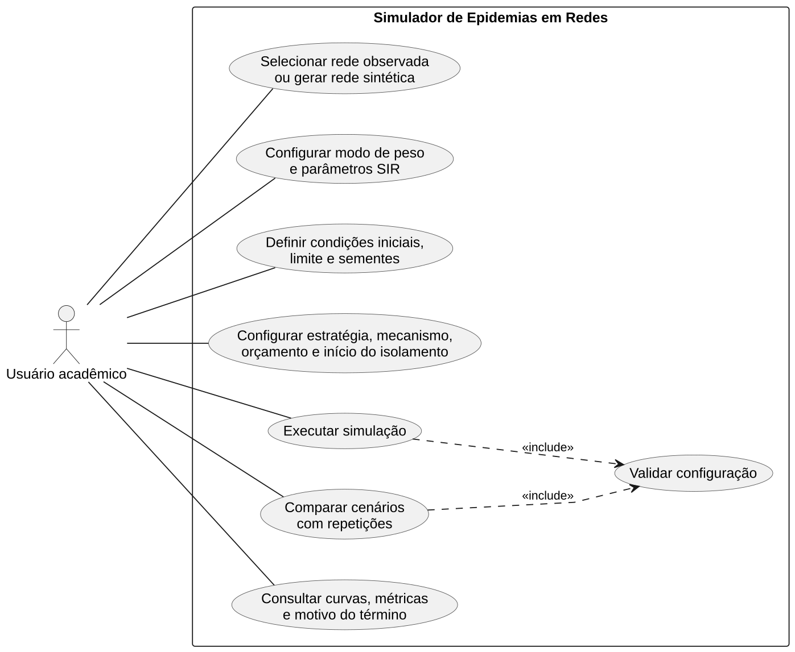
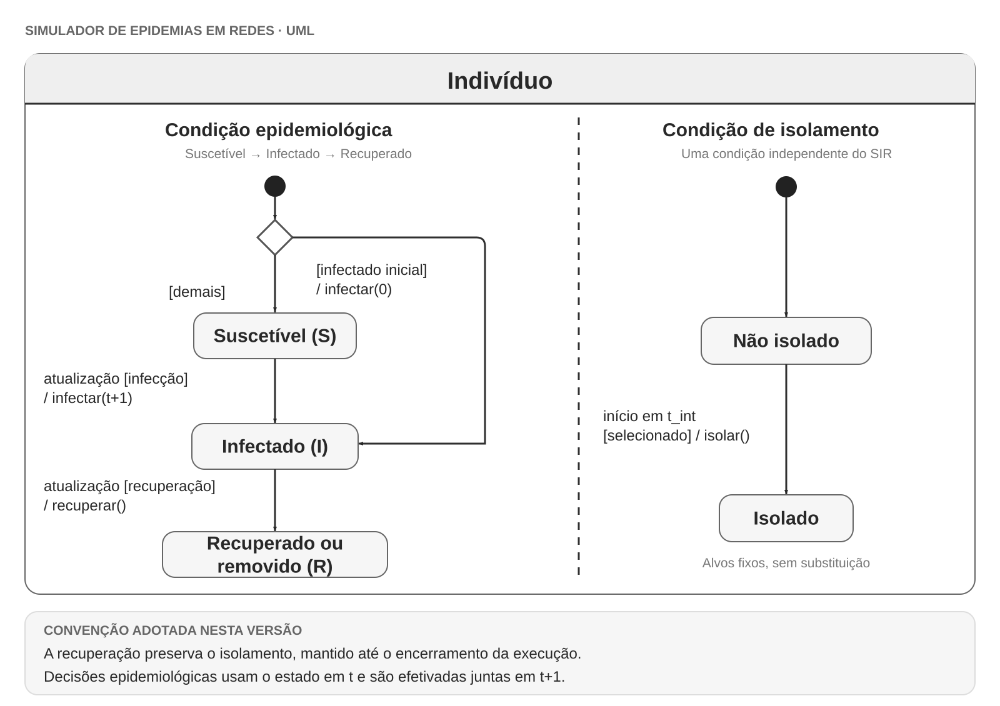
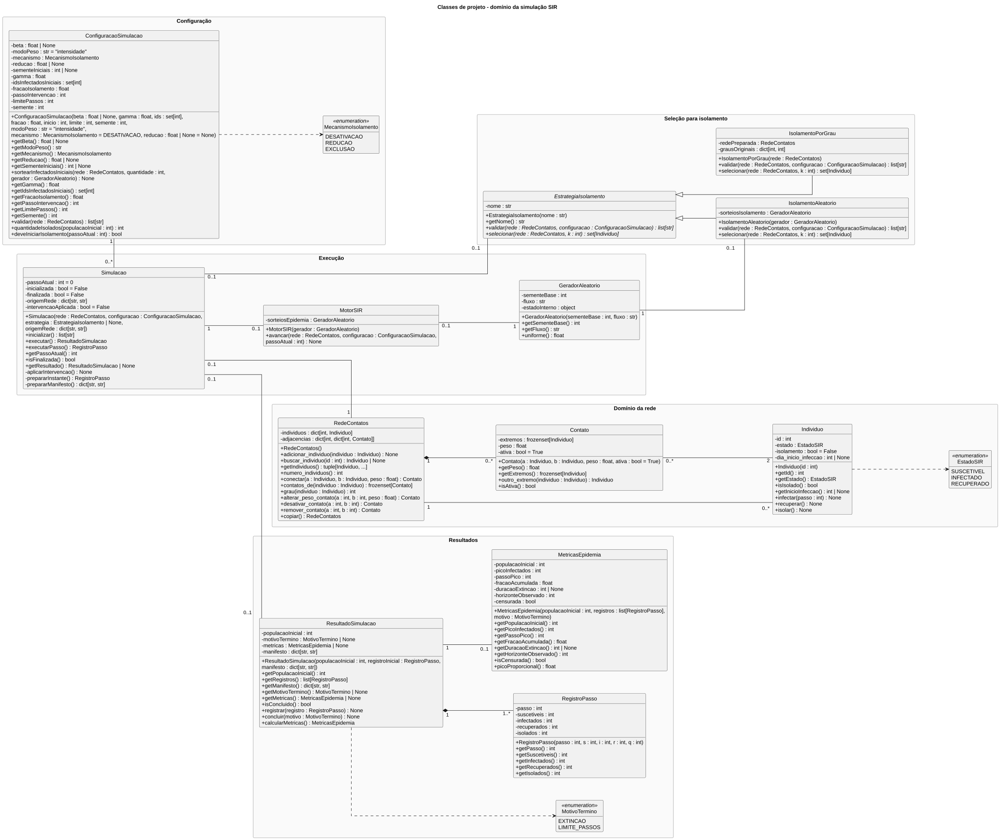

<!-- pagina: retrato -->
# Simulador de Epidemias em Redes

## Etapa 1 — Problema, modelagem e plano de desenvolvimento

**Trabalho Prático de Grafos · PUC Minas**  
**Integrantes:** João Vitor Calixto, Luis Gustavo de Souza Xavier e Wesley Domingos.  
**Data:** 22 de novembro de 2026.

### Sumário

| Conteúdo | Página |
| --- | --- |
| 1. Descrição do problema | 1 |
| 2. Justificativa da modelagem | 3 |
| 3. Plano de desenvolvimento | 9 |

## 1. Descrição do problema

A transmissão de uma doença depende das oportunidades de contato entre as pessoas. Algumas mantêm muitos contatos; outras se relacionam principalmente dentro de um grupo. Uma representação que considera apenas o tamanho da população perde essas diferenças. O grafo explicita quais pares podem interagir e permite examinar como a estrutura dos contatos participa da propagação simulada [1, 2].

**Pergunta do trabalho:** como a estrutura da rede influencia uma epidemia simulada e, sob o mesmo número de pessoas isoladas, como a seleção aleatória e a seleção por grau alteram o pico de infectados e a fração acumulada em relação à ausência de intervenção?

O objetivo geral é desenvolver um simulador acadêmico com estrutura própria de grafos e modelo SIR, capaz de configurar execuções, comparar intervenções e produzir resultados identificados e reproduzíveis. Os objetivos específicos são implementar cadastro e adjacências, importação e geração de redes, análise estrutural, dinâmica síncrona, isolamento por orçamento, histórico, métricas e uma interface que permita acompanhar esse fluxo.

A ferramenta trabalha com população fechada, estados SIR e contatos sem agenda temporal. Incubação, reinfecção, vacinação, entradas e saídas demográficas ficam fora do recorte. Os parâmetros não foram calibrados para uma doença específica; os resultados têm finalidade exploratória.

<!-- pagina: retrato -->
### 1.1. Dados para desenvolvimento e avaliação

### Base observada

A base adotada contém proximidade observada numa escola secundária de Berna, coletada entre 22/01 e 08/03/2024 e documentada por Banholzer et al. [5, 6]. A preparação utiliza a versão 1 de contact-duration-acc-based-att-65.csv com as regras de filtragem e os arquivos de origem registrados no manifesto da base.

A união dos pares de contato positivo resulta em **67 indivíduos e 1.325 contatos**, com peso unitário. A rede tem grau médio 39,5522, densidade aproximada de 59,93% e uma componente. O importador recebe contatos.csv e individuos.csv; o mapa de IDs e as durações permanecem como auditoria.

A projeção reúne encontros de datas diferentes e perde sua ordem temporal. Peso 1 identifica a presença da ligação na preparação; não estabelece duração igual nem transmissão certa no modo intensidade. Os parâmetros não reproduzem os diagnósticos ou a análise clínica do estudo. O nó OSF consultado não declara licença específica para os dados; a licença do artigo não foi atribuída automaticamente aos CSVs.

### Redes sintéticas de controle

| Família | Condições do bloco de topologias |
| --- | --- |
| Escola | Uma rede observada, N = 67, M = 1.325, peso 1. |
| Erdős–Rényi — G(N,p) | Dez sementes, 1000–1009; N = 67; p = 1325/2211. A implementação usa inclusão independente de cada par [3]. |
| Barabási–Albert | Dez sementes, 2000–2009; N = 67; m = 24 e núcleo completo com 25 pessoas [4]. Cada realização tem 1.308 contatos. |

As densidades são próximas, sem serem idênticas. Grau, distribuição de graus, densidade e componentes foram registrados para cada realização. Redes BA pequenas e densas não demonstram, por si, uma lei de potência.

### Condições de comparação

O protocolo-base utiliza intensidade, β = 0,005, γ = 0,10, três iniciais, limite 200 e sementes-base 10000, 20000 e 30000 para iniciais, epidemia e seleção. Compara referência sem intervenção, seleção aleatória e por grau, com fração 0,20, início 5 e desativação. Dentro de cada repetição, os cenários partem das mesmas condições e de cópias independentes.

Em 22/11/2026, o bloco de topologias possui **21 lotes e 6.300 trajetórias**. Os blocos de mecanismos, orçamento/início e sensibilidade a β, além do benchmark, permanecem pendentes.

<!-- pagina: retrato -->
## 2. Justificativa da modelagem

O grafo G = (V, E) representa a população e seus contatos. Cada vértice corresponde a uma pessoa; cada aresta liga um par que pode oferecer uma oportunidade de transmissão. A presença de uma aresta não comprova que houve contágio. A direção possível da transmissão depende dos estados epidemiológicos dos extremos.

| Decisão | Justificativa e consequência |
| --- | --- |
| Grafo simples | Cada par não ordenado tem no máximo um contato. Laços e duplicações, inclusive invertidas, são recusados. |
| Não direcionado | O contato é uma relação simétrica. Os dois extremos compartilham o mesmo objeto Contato. |
| Ponderado | O peso permite representar intensidade normalizada ou probabilidade direta, conforme a configuração. Peso e disponibilidade são atributos distintos. |
| Referência estática | A rede não possui agenda de encontros. A intervenção pode desativar, reduzir ou excluir contatos; a exclusão altera a topologia da rede de trabalho. |
| Listas de adjacência próprias | Dicionários associam IDs aos vizinhos e aos contatos. Essa estrutura dá acesso direto à vizinhança e usa espaço proporcional a N + M. |
| Cadastro independente das arestas | Uma pessoa sem contatos continua na população e pode formar uma componente unitária. Isolar não reduz o denominador das métricas. |

### 2.1. Entidades e invariantes

**Individuo** mantém um identificador inteiro estável, o estado SIR, a condição de isolamento e o instante da primeira infecção. O construtor inicia em S, sem isolamento e sem instante de infecção. IDs zero e negativos são aceitos; booleanos não substituem inteiros.

**Contato** referencia duas pessoas distintas da rede e mantém peso finito entre 0 e 1 e disponibilidade explícita. Na adjacência de u e na de v, a ligação u–v aponta para o mesmo contato. Alterar seu peso ou disponibilidade afeta a relação compartilhada; remover a aresta atualiza os dois lados.

**RedeContatos** controla cadastro, unicidade, adjacências e alterações estruturais. As transições S → I e I → R pertencem ao indivíduo. A rede conserva a identidade das pessoas e não mantém um segundo conjunto de objetos epidemiológicos.

### Análise estrutural

Grau, BFS, DFS e componentes consultam os contatos cadastrados, inclusive os inativos ou com peso zero. Desativação e redução preservam essas propriedades estruturais; exclusão pode alterá-las. O motor consulta a disponibilidade e o peso para decidir exposições. Portanto, conectividade estrutural e possibilidade de transmissão não são a mesma consulta.

As adjacências próprias atendem à implementação nativa exigida. A escola é densa; o custo de percorrer seus contatos permanece.

<!-- pagina: retrato -->
### 2.2. Dinâmica SIR e intervenção

### Regras de transmissão e recuperação

Cada pessoa pertence a S, I ou R. Só ocorrem S → I e I → R; R não retorna a S. O isolamento é independente e pode coexistir com qualquer desses estados. Em todos os registros, **S(t) + I(t) + R(t) = N**; a quantidade de isolados Q(t) não se soma a essa população.

No modo intensidade, a probabilidade por contato ativo é **p(u,v) = β × w(u,v)**. No modo de probabilidade direta, **p(u,v) = w(u,v)** e β não se aplica. Os pesos ficam em [0, 1]. Para um suscetível exposto a vários infectados do início do passo, a hipótese de independência condicional resulta em **P(v) = 1 − ∏(1 − p(u,v))**. Um sorteio decide sua infecção. Um infectado presente no início recupera com probabilidade γ, inclusive quando isolado.

O motor guarda os estados do início e aplica as decisões em conjunto. Recém-infectados não transmitem nem se recuperam no mesmo passo. O passo é um índice abstrato de tempo, sem equivalência estabelecida com um dia da coleta.

### Seleção e mecanismo

O orçamento é **k = piso(f × N)**. A seleção aleatória amostra sem reposição e usa um fluxo próprio. A seleção por grau conserva os graus anteriores à intervenção, ordena do maior para o menor e desempata pelo menor ID. Ambas podem selecionar S, I ou R e usam o mesmo orçamento quando comparadas.

| Mecanismo | Efeito nos contatos incidentes às pessoas selecionadas |
| --- | --- |
| Desativação | Torna os contatos indisponíveis, preservando pesos e adjacências. |
| Redução | Multiplica cada peso por (1 − r), uma única vez por contato abrangido, mesmo com os dois extremos selecionados. Preserva a disponibilidade anterior. |
| Exclusão | Retira as ligações das duas adjacências, mantendo as pessoas e seus estados no cadastro. |

Uma marca de isolamento não bloqueia adicionalmente o motor: os efeitos vêm do mecanismo. Essa separação permite transmissão residual na redução. A política aplica uma intervenção por cenário, com alvos fixos, sem reposição nem liberação automática ao recuperar.

### Ordem temporal e término

Ao chegar a t, a simulação verifica extinção e limite. Se ainda pode continuar, aplica a intervenção agendada e registra o instante antes da próxima transição. Assim, uma intervenção em t = 5 já aparece em Q(5); um instante terminal não recebe nova intervenção. Em t = 0 sem infectados, registra-se o estado e encerra-se a execução.

A parada preserva os estados encontrados. Se o limite for atingido com I positivo, o resultado é censurado: o horizonte permanece informado e a duração de extinção fica ausente. O pico usa a primeira ocorrência do máximo; a fração acumulada observada é (I final + R final) / N.

<!-- pagina: retrato -->
### 2.3. Casos de uso

O usuário acadêmico carrega ou gera a rede, configura o ensaio, executa ou compara cenários e consulta os resultados. As duas execuções incluem validação.

| Necessidade | Requisitos de origem |
| --- | --- |
| Selecionar a rede e preparar a configuração | RF01 a RF04 |
| Validar e executar o motor síncrono | RF05 e RF06 |
| Comparar cenários com repetições | RF07 |
| Registrar e consultar curvas, métricas e término | RF08 a RF10 |

<!-- pagina: retrato -->
### 2.4. Estados do indivíduo

O diagrama utiliza regiões independentes para a condição epidemiológica e a condição de isolamento. Uma pessoa infectada e isolada continua sendo contabilizada em I e continua sujeita à recuperação. A recuperação conserva o isolamento na política adotada.

As transições de infecção e recuperação representam decisões tomadas sobre o estado em t e aplicadas juntas em t + 1. A inicialização permite um conjunto manual de infectados ou uma quantidade para sorteio, sempre sem duplicar pessoas. O conjunto vazio é válido.

O evento de isolamento marca a condição individual; o mecanismo atua sobre os contatos. O isolamento não constitui outro compartimento epidemiológico e não retira a pessoa da população. A política mantém os alvos até o encerramento, sem entrada diária por probabilidade q ou liberação automática.

O efeito temporal é preparado pelo controlador antes do registro do instante agendado, desde que a execução possa prosseguir. O término tem precedência sobre uma intervenção ainda não aplicada.

<!-- pagina: retrato -->
### 2.5. Classes e responsabilidades

O diagrama de classes do Anexo A organiza o domínio em rede, configuração, execução, estratégias e resultados. A tabela apresenta as responsabilidades dos componentes da aplicação.

| Elemento | Responsabilidade |
| --- | --- |
| RedeContatos, Individuo e Contato | Cadastro, adjacências, identidade, estados e contatos compartilhados. |
| ConfiguracaoSimulacao | Parâmetros, condições iniciais, sementes, limite, modo de peso e revisão da rede. A configuração é imutável. |
| ConfiguracaoIntervencao | Estratégia, fração de pessoas, início, mecanismo e redução opcional. É uma configuração própria, referenciada pela simulação. |
| EstrategiaIsolamento | Contrato de seleção, implementado por IsolamentoAleatorio e IsolamentoPorGrau. As implementações devolvem IDs em tupla. |
| GeradorAleatorio e MotorSIR | Fluxos de sorteio e uma transição síncrona. O motor não incrementa o relógio nem cria o histórico. |
| Simulacao e RegistroPasso | Inicialização, relógio, agendamento e contagens imutáveis por instante. |
| ResultadoSimulacao e MetricasEpidemia | Configuração efetiva, histórico, indicadores, população e motivo de término. O resultado é construído ao concluir. |

### Organização das responsabilidades

Os nomes conceituais de consultas no UML podem corresponder a propriedades Python, sem exigir métodos duplicados. A configuração da intervenção foi separada da configuração geral; os graus originais ficam na estratégia, enquanto o orçamento é resolvido pela configuração.

O resultado de domínio não recebe uma rede mutável e não armazena o manifesto HTTP. O adaptador acrescenta o manifesto; o manipulador da sessão acrescenta o identificador. As métricas são calculadas a partir do histórico, em vez de serem incrementadas por cada chamada do motor.

<!-- pagina: retrato -->
### 2.6. Arquitetura e interação entre módulos

O núcleo Python reúne a estrutura de contatos, o motor SIR, as estratégias, o controlador temporal e os indicadores. A API HTTP local conecta esse núcleo à interface React com TypeScript. A interface está organizada em quatro telas: rede, configuração, simulação e resultados.

| Etapa do fluxo | Responsabilidade |
| --- | --- |
| Tela 01 — Rede | Importar contatos e cadastro de indivíduos ou gerar ER/BA; inspecionar, visualizar e confirmar a revisão. |
| Tela 02 — Configuração | Definir parâmetros, iniciais, sementes e intervenção; validar a receita vinculada à rede. |
| Tela 03 — Simulação | Solicitar o cálculo e reproduzir o histórico concluído, com avanço, pausa e reinício visual. |
| Tela 04 — Resultados | Selecionar execução, cenário e repetição; consultar indicadores e histórico; exportar CSV, JSON, SVG e PNG. |

A API conclui o cálculo antes de devolver o histórico. A pausa da Tela 03 atua na reprodução; não envia uma ordem de parada ao motor. O serviço conserva a rede de referência e cada execução cria uma rede de trabalho independente. A sessão HTTP mantém até 32 resultados em memória; exportações preservam as saídas fora dela.

### Interação durante a execução

A execução começa pela validação da rede e dos parâmetros. A simulação prepara a rede de trabalho e os geradores, aplica as condições iniciais e registra o instante zero. A cada transição, o motor calcula e aplica os eventos; o controlador avança o relógio e cria o registro seguinte. Ao término, o resultado reúne histórico, métricas e motivo de parada.

Os diagramas de sequência do Anexo B apresentam inicialização, ciclo temporal e obtenção dos resultados. No código, MotorSIR.avancar() retorna None, e a criação de RegistroPasso cabe a Simulacao. ResultadoSimulacao é construído ao concluir a execução, em vez de ser atualizado a cada passo.

<!-- pagina: retrato -->
## 3. Plano de desenvolvimento

O desenvolvimento é dividido por área de domínio e pelas telas correspondentes. A organização mantém cada integrante responsável pela lógica e pela interface de sua área, com integração entre os módulos.

### 3.1. Divisão de responsabilidades

| Integrante | Responsabilidade principal de desenvolvimento |
| --- | --- |
| Wesley Domingos — A | Estrutura da rede, CSV, geradores ER/BA, BFS/DFS, componentes, graus, carga e Tela 01. Mecanismos sobre os contatos e apoio à análise de desempenho da rede. |
| Luis Gustavo de Souza Xavier — B | Configuração, condições iniciais, geradores aleatórios, motor SIR, seleção de pessoas para isolamento, comparação com repetições e Tela 02. |
| João Vitor Calixto — C | Relógio, intervenção agendada, histórico, métricas, Telas 03/04, resultados, gráficos, exportações e conexão das execuções à API. |

Na modelagem, Luis produziu casos de uso, estados e classes; Wesley trabalhou o grafo e as histórias; João produziu arquitetura, requisitos, sequência e planejamentos, além de contribuir com a preparação da base escolar. Os módulos receberam contribuições compartilhadas durante a integração.

O fluxo de colaboração prevê branches por área, commits com autoria individual e revisão por outro integrante antes da integração. As contribuições são registradas no histórico do repositório.

<!-- pagina: retrato -->
### 3.2. Marcos e dependências

| Marco | Entrega e dependência | Andamento em 22/11 |
| --- | --- | --- |
| Modelagem e planejamento | Problema, escolhas do grafo, regras SIR, UML e divisão de módulos; base para o desenvolvimento. | Problema, representação da rede, regras SIR e UML definidos. |
| Núcleo e telas | Domínio e testes, seguidos das telas conectadas aos contratos; integração depende das três áreas. | Núcleo e fluxo de quatro telas disponíveis. |
| Preparação experimental | Dados, controles, parâmetros e sementes identificados; depende de execução integrada. | Escola e vinte controles preparados e caracterizados; protocolo-base definido. |
| Avaliação e entrega | Baterias completas, análise, medições e revisão do relatório; depende da preparação e das saídas verificadas. | Topologias concluídas; demais baterias e benchmark pendentes. |

O prazo comum das três partes é **22/11/2026**. Os marcos seguem as dependências entre definição do domínio, implementação, integração e avaliação.

### 3.3. Riscos e ações previstas

| Risco | Ação de prevenção ou mitigação |
| --- | --- |
| Divergência entre módulos e diagramas | Explicitar contratos e diferenças de projeto; conferir a integração da validação ao resultado antes de atualizar documentos. |
| Custo de redes ou lotes extensos | Evitar cópias redundantes, guardar pacotes compactados e separar medições de desempenho das saídas científicas. |
| Perda de reprodução | Preservar fonte, transformação, rede, sementes, configurações, ambiente, revisão e hashes; identificar mudanças de protocolo. |
| Comparações confundidas | Manter condições comuns e orçamento igual; distinguir repetições epidemiológicas de realizações da rede; preservar censura e valores ausentes. |

### 3.4. Avaliação e entregas finais

Na avaliação, Wesley é responsável por dados e topologias; Luis, por comparações estocásticas e análise; e João, por visualização, regressões e integração do relatório. Os parâmetros são revistos pelo grupo. Restam doze lotes experimentais planejados, com 3.600 trajetórias, além do benchmark.

As entregas finais incluem o relatório técnico, o vídeo de demonstração e a apresentação presencial, com participação dos três integrantes.

<!-- pagina: retrato -->
## Referências

[1] KERMACK, W. O.; MCKENDRICK, A. G. Contributions to the mathematical theory of epidemics—I. Bulletin of Mathematical Biology, 53, p. 33–55, 1991. Republicação do trabalho de 1927. [DOI: 10.1007/BF02464423](https://doi.org/10.1007/BF02464423).

[2] NEWMAN, M. E. J. Spread of epidemic disease on networks. Physical Review E, 66, 016128, 2002. [DOI: 10.1103/PhysRevE.66.016128](https://doi.org/10.1103/PhysRevE.66.016128).

[3] GILBERT, E. N. Random Graphs. The Annals of Mathematical Statistics, 30(4), p. 1141–1144, 1959. [DOI: 10.1214/aoms/1177706098](https://doi.org/10.1214/aoms/1177706098).

[4] BARABÁSI, A.-L.; ALBERT, R. Emergence of scaling in random networks. Science, 286(5439), p. 509–512, 1999. [DOI: 10.1126/science.286.5439.509](https://doi.org/10.1126/science.286.5439.509).

[5] BANHOLZER, N.; MUNDAY, J. D.; JENT, P. et al. The relative contribution of close-proximity contacts, shared classroom exposure and indoor air quality to respiratory virus transmission in schools. Nature Communications, 16, 11678, 2025. [DOI: 10.1038/s41467-025-66719-3](https://doi.org/10.1038/s41467-025-66719-3).

[6] BANHOLZER, N. et al. Respiratory virus transmission in schools: A longitudinal study of molecular, physical proximity and air quality data. OSF, 2025. [Repositório de dados e código](https://osf.io/naut4/).

<!-- pagina: ampliada -->
## Anexo A — Diagrama completo de classes

O diagrama apresenta a organização das classes de projeto. Na implementação, a intervenção possui configuração própria, as estratégias retornam IDs e o resultado é construído ao final da execução, conforme a seção 2.5.

### Anexo B — Diagramas de sequência

Os diagramas de sequência apresentam a inicialização e validação, o ciclo por passos e a obtenção dos resultados. O motor aplica as transições e o controlador produz os registros; o resultado reúne o histórico ao término, conforme a seção 2.6.
