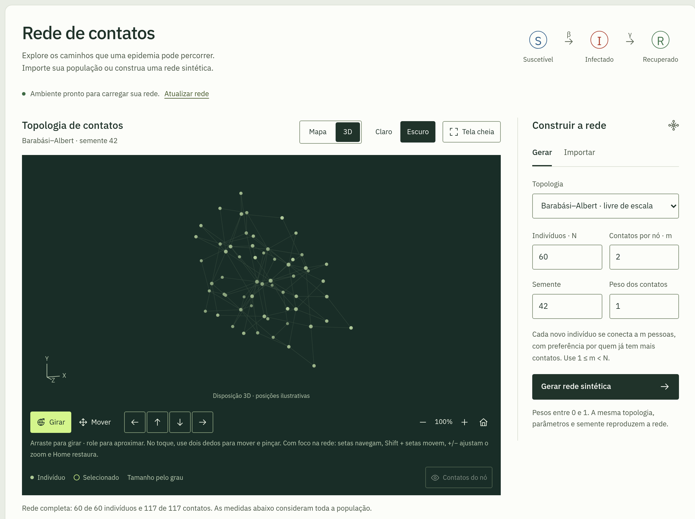
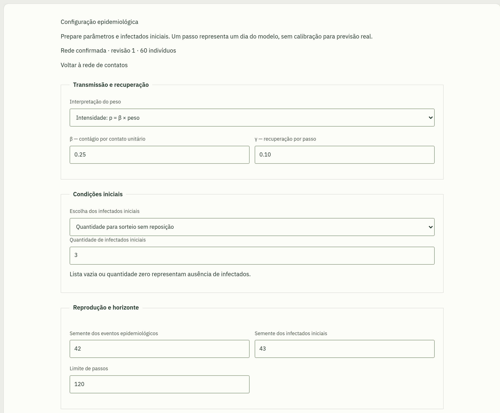
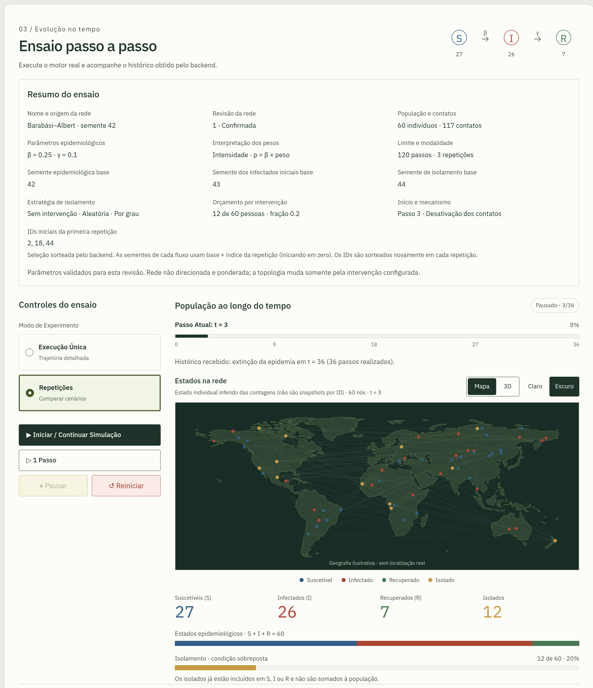
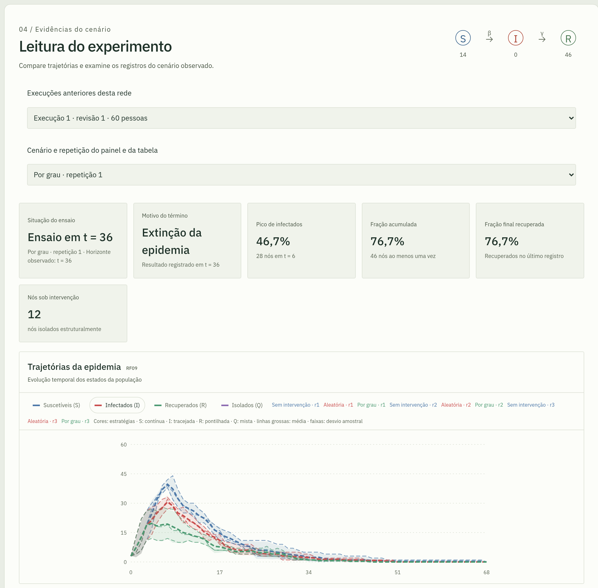

<!-- pagina: retrato -->
# Simulador de Epidemias em Redes

## Etapa 2 — Implementação da aplicação

**Trabalho Prático de Grafos · PUC Minas**  
**Integrantes:** João Vitor Calixto, Luis Gustavo de Souza Xavier e Wesley Domingos.  
**Data:** 22 de novembro de 2026.

### Sumário

| Conteúdo | Página |
| --- | --- |
| 1. Aplicação entregue | 1 |
| 2. Arquitetura e integração | 2 |
| 3. Rede, importação e geração | 3 |
| 4. Configuração e reprodução | 5 |
| 5. Motor, isolamento e ciclo temporal | 7 |
| 6. Comparação, métricas e exportação | 9 |
| 7. Verificação da implementação | 11 |
| 8. Execução, contribuições e limites | 12 |

## 1. Aplicação entregue

A aplicação permite importar ou gerar uma rede de contatos, configurar a dinâmica SIR, executar cenários de isolamento e consultar os resultados. O fluxo reúne quatro telas: rede, configuração, simulação e resultados. O núcleo foi implementado em Python e a interface em React com TypeScript, sob o nome Observatório.

A implementação utiliza uma estrutura própria de grafo e algoritmos nativos de busca, análise, geração e transmissão. As funcionalidades incluem seleção aleatória ou por grau, três mecanismos de isolamento, comparação com repetições, histórico por instante, indicadores epidemiológicos e exportação dos dados e gráficos.

As figuras deste documento são capturas da aplicação em um mesmo caso funcional. A rede Barabási–Albert possui 60 indivíduos; a comparação utiliza três repetições e produz nove trajetórias. Esse caso permite acompanhar o funcionamento integrado. A análise das baterias experimentais pertence à Etapa 3.

<!-- pagina: retrato -->
## 2. Arquitetura e integração

A interface recebe as entradas e apresenta os resultados. A API local converte os pedidos em operações do domínio, que mantém as regras da rede, a validação epidemiológica e a execução. O navegador não calcula transmissão nem substitui o orçamento de isolamento definido pelo núcleo.

| Camada | Implementação e responsabilidade |
| --- | --- |
| Domínio Python | Grafo, CSV, geradores ER/BA, percursos, configuração, aleatoriedade, motor, isolamento, comparação e métricas. Usa a biblioteca padrão, sem bibliotecas prontas de grafos. |
| Serviço de carga | ServicoCargaRede conserva a referência, publica uma nova revisão após carga válida e fornece cópias confirmadas para a execução. |
| API HTTP local | api_local.py utiliza ThreadingHTTPServer, sessões por cookie e uma trava por sessão. Serializa pedidos e resultados em JSON. |
| Interface | React, TypeScript, Vite e Tailwind CSS. Páginas, componentes, hooks, contratos e serviços HTTP ficam separados. |

### Operações da API

Os caminhos abaixo usam o prefixo comum **/api/rede**. A confirmação vincula a receita à revisão inspecionada. O contexto também distingue redes de sessões ou cargas diferentes, mesmo quando o número da revisão coincide.

| Método e caminho | Operação |
| --- | --- |
| POST /gerar; POST /importar | Preparar e publicar uma rede válida. |
| GET /; POST /confirmar | Inspecionar a rede e confirmar a revisão. O GET usa o próprio prefixo, sem barra final. |
| GET /previa; /individuo; /individuos; /contatos | Consultar desenho, pessoa por ID e registros paginados. |
| POST /configuracao; /comparacao/validar | Validar a execução individual ou o lote, sem calcular trajetórias. |
| POST /simulacao/executar; /comparacao/executar | Calcular o resultado completo e devolvê-lo à interface. |
| GET /resultados; /resultados/{id} | Listar e recuperar resultados da sessão. |

IDs e sementes são serializados como texto para preservar inteiros que excedem a precisão do JavaScript. Erros de validação retornam diagnóstico por campo; uma revisão divergente exige atualizar a rede. Uma carga inválida preserva a última referência válida.

<!-- pagina: retrato -->
## 3. Rede, importação e geração

RedeContatos mantém um cadastro de indivíduos e dicionários de adjacência. Para a ligação u–v, as duas adjacências apontam para o mesmo Contato. A inclusão recusa laços e pares duplicados, inclusive invertidos; a remoção atualiza os dois extremos. Indivíduos sem contatos permanecem na população.

Cada Individuo possui ID inteiro, estado SIR, isolamento e instante da primeira infecção. Contato armazena peso finito em [0, 1] e disponibilidade. Peso zero e indisponibilidade não removem a aresta da topologia. A marca de isolamento também não altera, por si só, os estados epidemiológicos ou as adjacências.

### Entradas disponíveis

| Entrada | Regras implementadas |
| --- | --- |
| Contatos CSV | Cabeçalho com origem e destino; peso é opcional e assume 1 quando ausente ou explicitamente vazio. Usa UTF-8, ponto decimal e delimitador informado. |
| Cadastro CSV | Arquivo opcional com cabeçalho id. Preserva pessoas sem contatos; quando fornecido, deve incluir todos os extremos. |
| Erdős–Rényi | G(N,p), com sorteio independente para cada par não ordenado. Recebe população, probabilidade, peso uniforme e semente. Não força conectividade. |
| Barabási–Albert | Começa com um núcleo completo de m + 1 pessoas. Cada novo indivíduo escolhe m alvos distintos com preferência por grau. Recebe N, m, peso e semente. |

O importador informa arquivo, linha, campo e causa do problema. Não agrega eventos repetidos, normaliza pesos ou entrega uma rede parcial. Os geradores registram parâmetros e versão do algoritmo; os metadados permitem reconstruir a rede nas condições suportadas.

### Análise estrutural

BFS usa fila, e DFS usa uma pilha explícita de iteradores. Ambas evitam recursão. A análise calcula componentes, conectividade, graus e distribuição de graus, considerando os contatos cadastrados e as pessoas de grau zero. Desativação e redução preservam essas propriedades; exclusão pode modificá-las.

A rede ocupa O(N + E). BFS e DFS custam O(Nc + Ec) na componente alcançada; componentes conexas custam O(N + E). A consulta de grau reutiliza o tamanho da adjacência. ER percorre os pares em O(N²) quando p é positivo; BA também depende dos sorteios rejeitados até obter alvos distintos.

<!-- pagina: retrato -->
### 3.1. Tela 01 — Carga e inspeção

A tela permite importar os CSVs ou gerar uma rede ER/BA. Após uma carga válida, apresenta resumo estrutural, distribuição de graus, consulta por ID e tabelas paginadas. A confirmação libera a revisão para a configuração epidemiológica.



No caso apresentado, **N = 60, m = 2, semente 42 e peso 1** produzem 117 contatos, grau médio 3,9 e uma componente. A geração não define infectados; essa escolha é feita na tela seguinte.

O desenho oferece mapa e 3D, seleção de nós, filtro de contatos, zoom, deslocamento e tela cheia. O 3D também permite rotação. Há controles por teclado e botões alternativos aos gestos. O tema global e o tema do grafo podem ser ajustados separadamente.

A prévia desenha até 180 indivíduos e 1.200 contatos. As métricas e as consultas usam a rede completa. As posições no mapa e em 3D são ilustrativas: não representam coordenadas dos indivíduos nem interferem na propagação.

<!-- pagina: retrato -->
## 4. Configuração e reprodução

ConfiguracaoSimulacao reúne parâmetros, iniciais, sementes, limite e revisão. ConfiguracaoIntervencao define estratégia, fração, início, mecanismo e redução opcional. As configurações são imutáveis; a preparação devolve os IDs iniciais resolvidos quando a entrada utiliza sorteio.

| Campo | Comportamento |
| --- | --- |
| Modo intensidade | A probabilidade por contato ativo é p = β × w; β e os pesos ficam em [0, 1]. |
| Probabilidade direta | A probabilidade por contato ativo é p = w. β não se aplica e deve estar ausente. |
| Recuperação | γ é uma probabilidade finita em [0, 1] por passo. |
| Condição inicial | IDs existentes, sem duplicatas, ou quantidade para sorteio sem reposição. Zero infectados é válido. |
| Limite | Número inteiro positivo de transições. O passo é abstrato, sem equivalência clínica definida. |
| Intervenção | Fração f em [0, 1]; início inteiro entre zero e limite − 1; redução obrigatória apenas no mecanismo correspondente. |

A validação ocorre antes da execução. A configuração precisa pertencer a uma rede não vazia e confirmada. A API aceita ponto ou vírgula nos campos decimais do formulário; o CSV usa ponto. Alterar a receita invalida o resumo anteriormente validado.

### Fluxos aleatórios

A geração da rede tem sua própria semente. Na simulação, três fluxos independentes controlam infectados iniciais, eventos epidemiológicos e seleção aleatória do isolamento. O motor percorre pessoas e vizinhos em ordem de ID, permitindo reproduzir trajetórias com a mesma entrada na implementação e no ambiente compatíveis.

Na comparação, a repetição de índice zero usa as sementes base; as seguintes usam **base + índice**. Cada repetição resolve os iniciais uma vez e os reutiliza nos três cenários. A mesma semente epidemiológica não obriga resultados iguais após as intervenções: as condições de transmissão passam a ser diferentes.

O manifesto registra a receita efetiva, sementes e IDs iniciais, origem, revisão, contexto e identificação do algoritmo. Os arquivos de rede continuam necessários para reproduzir uma importação; o manifesto não incorpora automaticamente todo o grafo.

<!-- pagina: retrato -->
### 4.1. Tela 02 — Parâmetros e intervenção

A tela organiza transmissão, recuperação, iniciais, sementes, horizonte e isolamento. O usuário pode validar uma execução individual ou uma comparação. O resumo devolvido pelo núcleo informa os IDs efetivos e a quantidade de pessoas isoladas.



O caso funcional utiliza **intensidade, β = 0,25, γ = 0,10, três infectados sorteados e limite de 120 passos**. As sementes base são 42 para epidemia, 43 para iniciais e 44 para isolamento. A intervenção desativa contatos de 20% da população em t = 3: **piso(0,20 × 60) = 12 pessoas**.

Foram escolhidas três repetições por cenário, totalizando nove trajetórias. Após validar, o link de encaminhamento prepara a Tela 03 na modalidade selecionada. A navegação preserva a receita e não inicia o cálculo automaticamente.

<!-- pagina: retrato -->
## 5. Motor, isolamento e ciclo temporal

MotorSIR captura os estados no início de t, calcula infecções e recuperações e aplica as decisões em conjunto em t + 1. Recém-infectados só passam a transmitir e a recuperar no passo seguinte. Para um suscetível exposto a vários infectados, a probabilidade combinada é **P = 1 − ∏(1 − p)**. Exposições 0,2 e 0,4 resultam em 0,52. Infectados isolados continuam sujeitos à recuperação.

### Seleção e efeito sobre os contatos

O orçamento é k = piso(f × N), em pessoas. A seleção aleatória amostra sem reposição; a seleção por grau prioriza os maiores graus da referência e desempata pelo menor ID. Ambas podem selecionar S, I ou R. A função aplicar_isolamento() recebe os IDs e executa o mecanismo.

| Mecanismo | Efeito implementado |
| --- | --- |
| Desativação | Torna indisponíveis os contatos incidentes, preservando pesos e adjacências. |
| Redução | Aplica w novo = w anterior × (1 − r), uma vez por contato, mesmo com ambos os extremos selecionados. Preserva a disponibilidade anterior. |
| Exclusão | Remove contatos das duas adjacências, conservando as pessoas e seus estados. |

A marca individual não bloqueia adicionalmente a transmissão: o motor lê os contatos resultantes do mecanismo. Isso preserva a transmissão residual na redução parcial. Há uma intervenção por cenário, sem reposição nem liberação automática após a recuperação.

### Registro e término

Simulacao cria uma rede de trabalho independente, prepara os iniciais e mantém o relógio. Ao chegar a t, verifica extinção e limite; se ainda pode continuar, aplica a intervenção devida e registra S, I, R e isolados antes da próxima transição. Assim, a intervenção em t = 3 aparece em Q(3). Um instante terminal não recebe nova intervenção.

Cada registro conserva **S + I + R = N**. Isolamento é uma condição sobreposta, não um quarto compartimento. A parada ocorre por I = 0 ou limite, preservando os estados encontrados. O reinício do domínio restaura contatos, pesos, disponibilidade, iniciais e geradores; resultados anteriores permanecem independentes.

O motor reutiliza a ordenação da topologia e invalida o índice quando ela muda. Após o preparo, cada transição custa O(N + E); o histórico de T transições possui T + 1 registros.

<!-- pagina: retrato -->
### 5.1. Tela 03 — Execução e reprodução

O resumo apresenta rede, receita efetiva, sementes, iniciais e intervenção. Antes da resposta, os contadores mostram “—”. A API calcula o histórico completo; iniciar, pausar e avançar controlam sua reprodução no navegador.



Na primeira repetição por grau, **S = 27, I = 26, R = 7 e Q = 12** em t = 3. Os estados SIR somam 60. A barra usa apenas S/I/R; o isolamento possui um indicador separado. As cores por nó são ilustradas a partir das contagens e não reconstituem estados reais por ID.

Sem histórico, o primeiro clique em “1 Passo” solicita o cálculo e mantém a reprodução em zero. Reiniciar limpa a apresentação e conserva a receita; cancelar a espera não garante interromper o cálculo já iniciado no servidor.

<!-- pagina: retrato -->
## 6. Comparação, métricas e exportação

O comparador executa referência sem intervenção, seleção aleatória e seleção por grau. Com r repetições, produz 3r trajetórias em redes de trabalho independentes. Dentro de cada repetição, os cenários partem da mesma rede, parâmetros e infectados iniciais. Os dois isolamentos compartilham fração, início e mecanismo.

### Indicadores e agregação

| Indicador | Regra |
| --- | --- |
| Pico e instante do pico | Maior contagem de infectados e primeira ocorrência desse valor. Pico proporcional = pico/N. |
| Fração acumulada | (I final + R final)/N, incluindo infectados iniciais. Não soma I ao longo dos passos. |
| Recuperados finais | R final/N. Pode diferir da fração acumulada quando ainda existem infectados. |
| Horizonte e extinção | Horizonte é o último passo observado. A duração de extinção fica ausente se o limite for atingido com I positivo. |

O backend consolida n, ausentes, média e desvio-padrão amostral por cenário. Métricas ausentes não viram zero; com menos de duas observações, o desvio permanece ausente. O domínio também calcula diferenças e reduções pareadas, mas o resumo HTTP atual não publica esses campos.

O gráfico agrupa somente repetições do mesmo cenário. Para alinhar trajetórias extintas, conserva o último estado até o horizonte comum, sem alterar o histórico original. As faixas usam um desvio amostral por instante; uma observação tem faixa visual zero. Esse desvio não equivale ao desvio dos picos do lote.

### Arquivos disponíveis

| Exportação | Conteúdo |
| --- | --- |
| CSV do histórico | Todos os registros da execução selecionada, com cenário e repetição. |
| CSV de trajetórias | Históricos de todas as execuções do lote. |
| CSV agregado | Métricas recebidas do backend: cenário, métrica, n, ausentes, média e desvio. |
| JSON | Resultado carregado, manifestos e seleção visual. |
| SVG e PNG | Gráfico atual, com identificação, estilos, legenda e parâmetros. O PNG usa escala 2×. |

Os downloads são preparados no navegador. Paginação não recorta o arquivo de histórico. Ocultar séries altera o gráfico exportado; CSV e JSON conservam os dados completos de seu escopo. O CSV de resultado não é uma entrada para o importador de contatos.

<!-- pagina: retrato -->
### 6.1. Tela 04 — Consulta dos resultados

A página reúne execução anterior, cenário, repetição, indicadores, curvas e histórico. O painel e a tabela acompanham a seleção; o gráfico comparativo preserva o conjunto do lote, com controles para ocultar estados.



Na primeira repetição por grau, o pico foi **28 infectados em t = 6**, ou 46,7% da população. A extinção ocorreu em **t = 36**, com **14 suscetíveis, zero infectados e 46 recuperados**. A fração acumulada foi 76,7%; os 12 selecionados continuaram isolados. Esses valores descrevem uma execução do caso funcional, sem demonstrar superioridade geral de uma estratégia.

A tabela apresenta até 50 registros por página. A consulta de resultados anteriores recupera o item da sessão sem recalcular a trajetória. Ao entrar diretamente sem resultado salvo, uma receita válida da rede atual pode solicitar uma nova execução.

A API conserva até 32 resultados por sessão, em memória. Trocar de sessão, reiniciar o servidor ou expirar a sessão pode exigir nova carga. A exportação permite conservar as saídas fora desse armazenamento temporário.

<!-- pagina: retrato -->
## 7. Verificação da implementação

Em **22/11/2026**, a árvore local passou por **821 testes Python**, em Python 3.13.3, e **56 testes do frontend**, em Node.js 24.22.1, sem falhas ou casos ignorados. A suíte frontend inclui fluxos reais em Chrome com React/Vite e API Python. O build TypeScript/Vite e o ESLint também passaram.

| Requisitos | Comportamentos exercitados pelos testes |
| --- | --- |
| RF01 e RNF01 | CSV, ER/BA, adjacências compartilhadas, cópias, laços, duplicatas e análise estrutural nativa. |
| RF02, RF03 e RF05 | Parâmetros, iniciais, campos inválidos, confirmação, revisão e preservação da referência em falhas. |
| RF04, RF06 e RF08 | Atualização síncrona, mecanismos, orçamento, instante do isolamento, parada, reinício e contagens. |
| RF07 e RNF02 | Iniciais comuns, fluxos de sementes, independência das execuções, reprodução e agregação. |
| RF09, RF10 e RNF03 | Contadores, navegação, seleção, indicadores, curvas, histórico e exportações. |

### Casos que verificam as regras

Um oráculo independente de Floyd–Warshall confere alcance, componentes e níveis BFS nos **1.100 grafos simples rotulados com até cinco vértices**. Caminhos longos verificam os percursos iterativos. Arquivos temporários reais exercitam o importador, os diagnósticos e a preservação de pessoas sem contatos.

No motor, sorteios controlados verificam a combinação de probabilidades e o limiar estrito da infecção. Na cadeia I–S–S com transmissão e recuperação certas, uma transição produz R–I–S: a pessoa recém-infectada não transmite no mesmo intervalo.

As regressões de isolamento abrangem os três mecanismos, aplicação no próprio instante, ausência em instantes terminais e restauração da rede. Os casos de integração também verificam IDs grandes, revisão, sessões, resposta cancelada, recuperação de resultados e conteúdo dos arquivos exportados.

O caso das quatro figuras foi reproduzido no adaptador Python: 60 indivíduos, 117 contatos e nove trajetórias, com os registros e indicadores apresentados neste documento. As capturas existentes mostram esse percurso da interface; não são protótipos.

### Alcance da verificação

As contagens indicam testes aprovados, não um percentual de cobertura nem validação científica do modelo. A execução registrada utilizou Python 3.13.3; a declaração de suporte a 3.10 não substitui executar a suíte nessa versão. A auditoria integral de acessibilidade e a avaliação experimental completa são verificações próprias.

<!-- pagina: retrato -->
## 8. Execução, contribuições e limites

### Preparação local

O pacote declara Python 3.10 ou superior. Para reproduzir o ambiente desta conferência, foram utilizados Python 3.13.3 e Node.js 24.22.1. Na raiz do repositório:

```bash
python3 -m venv .venv
.venv/bin/python -m pip install -e '.[dev]'
.venv/bin/python -m simulador.api_local
```

Em outro terminal:

```bash
cd frontend
npm ci
npm run dev
```

Abra o endereço informado pelo Vite. O proxy encaminha /api para 127.0.0.1:8000. A API aceita acesso local. Para verificar o código: execute pytest no ambiente Python e, em frontend, npm test, npm run build e npm run lint.

### Contribuições na implementação

| Integrante | Área de responsabilidade e entregas |
| --- | --- |
| Wesley Domingos — A | Estrutura da rede, CSV, ER/BA, percursos, componentes, graus, carga, Tela 01 e mecanismos que alteram os contatos. |
| Luis Gustavo de Souza Xavier — B | Configuração, iniciais, aleatoriedade, MotorSIR, estratégias de seleção, comparação com repetições e Tela 02. |
| João Vitor Calixto — C | Ciclo temporal, intervenção agendada, histórico, métricas, Telas 03/04, gráficos, exportações e integração das execuções à API. |

A integração e as correções posteriores tiveram contribuições compartilhadas. O histórico Git e CONTRIBUICOES.md registram a autoria dos commits; a tabela identifica as áreas de trabalho e não atribui autoria exclusiva de cada arquivo.

### Limites da versão entregue

O modelo mantém população fechada, SIR e contatos sem agenda temporal. Não contempla vacinação, reinfecção ou incubação. As posições gráficas são ilustrativas e o histórico agregado não permite reconstruir estados por pessoa. As operações do servidor são síncronas, os resultados ficam em memória e os limites da prévia não constituem limites de tamanho da simulação.

### Documentação técnica

A implementação detalhada está em [EstruturaGrafo.md](../implementacao/EstruturaGrafo.md), [ImportacaoRedes.md](../implementacao/ImportacaoRedes.md), [GeracaoRedes.md](../implementacao/GeracaoRedes.md), [CargaInspecao.md](../implementacao/CargaInspecao.md), [Isolamento.md](../implementacao/Isolamento.md) e [SimulacaoResultados.md](../implementacao/SimulacaoResultados.md). Os requisitos constam em [Requistos-G.pdf](Requistos-G.pdf). Código e testes permanecem nas pastas src/simulador, tests e frontend do repositório.
