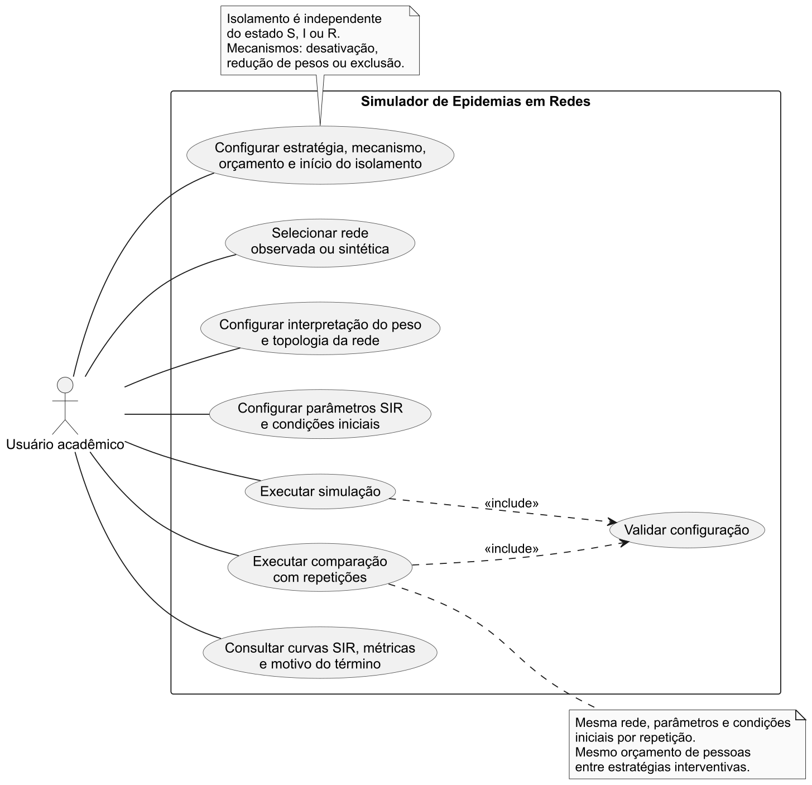
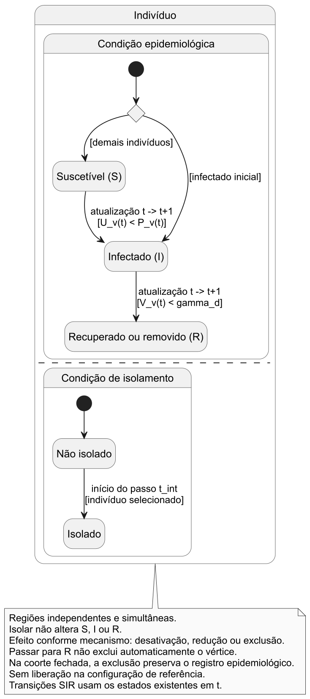
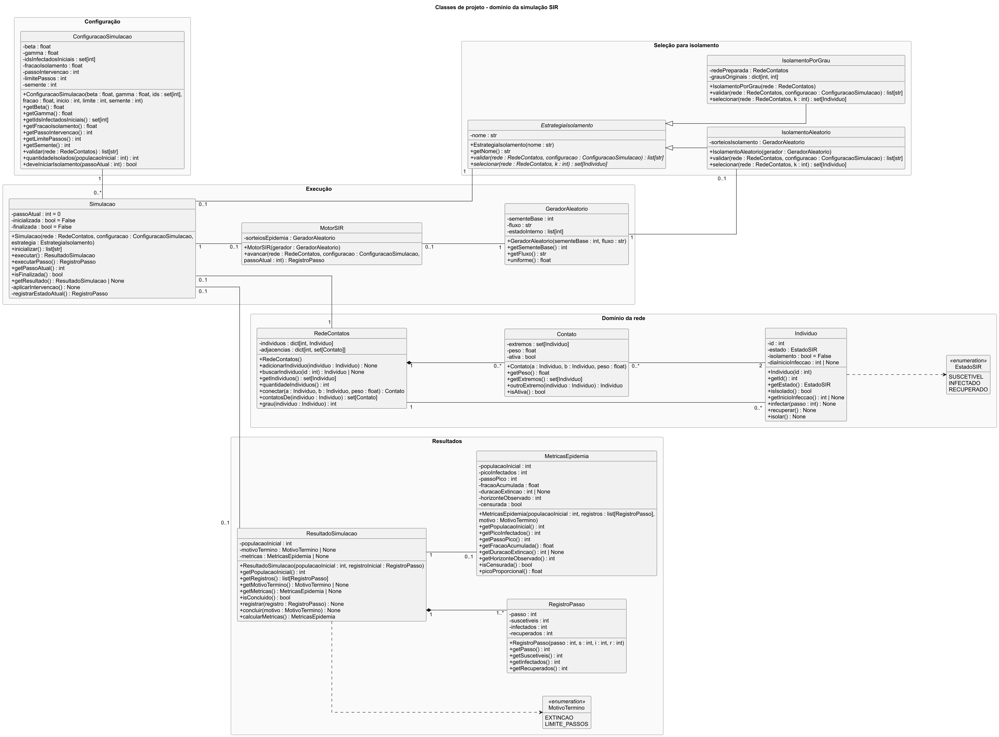

# Etapa 1 - problema e epidemiologia

> Este texto registra a proposta de estudo e comparação elaborada anteriormente. A referência operacional vigente no repositório é [Modelagem do grafo](../modelagem/ModelagemGrafo.md). As diferenças abaixo permanecem explícitas para revisão coletiva; a importação deste documento não substitui as regras já registradas nem afirma equivalência com a implementação existente. Os exemplos são didáticos, sem calibração com uma doença real.

## Situação da proposta em relação ao repositório

| Aspecto | Regra registrada na modelagem do grafo | Proposta desenvolvida neste documento |
|---|---|---|
| Tempo | Cada passo corresponde a um dia do modelo. | Passo abstrato, sem equivalência temporal confirmada. |
| Peso | Intensidade finita não negativa, inclusive acima de 1; probabilidade min(1, β × peso). | Intensidade normalizada em [0,1] e probabilidade β × peso; modo de probabilidade pronta discutido como alternativa. |
| Isolamento | A cada dia, infectados elegíveis entram com probabilidade q; recuperação desencadeia liberação explícita pelo motor. | Intervenção única por orçamento de pessoas, seleção aleatória ou por grau e manutenção até o término. |
| Disponibilidade do contato | Indicador ativa próprio da aresta, preservado durante o isolamento; motor também consulta os extremos. | No projeto de classes proposto, ativa é recalculada a partir do isolamento dos extremos. |

A pergunta de pesquisa, o levantamento de dados e as métricas podem apoiar a integração. Já o protocolo de isolamento e o diagrama de classes representam uma proposta alternativa a compatibilizar. Não se deve implementar simultaneamente os dois significados de isolamento ou de atividade de contato sem uma decisão explícita.

## 1. Introdução e contextualização

A propagação de uma doença transmissível depende das oportunidades de contato entre indivíduos. Essas oportunidades não se distribuem uniformemente: algumas pessoas mantêm muitos contatos, outras interagem principalmente em um mesmo grupo e determinados contatos conectam regiões pouco relacionadas da população.

Grafos permitem representar indivíduos como vértices e contatos potencialmente transmissores como arestas. Essa representação explicita quais pares podem interagir e permite incorporar diferenças de intensidade dos contatos. O estudo de modelos epidemiológicos em redes oferece uma base para investigar a relação entre a organização dessas conexões e a propagação [1].

A estrutura da rede pode modificar as oportunidades de exposição. Indivíduos com muitos vizinhos podem alcançar mais pessoas; agrupamentos podem concentrar a circulação; e conexões entre grupos podem permitir a chegada da infecção a outras regiões. Entretanto, essas propriedades não determinam isoladamente o resultado, que também depende dos parâmetros, dos infectados iniciais e dos eventos aleatórios.

Comparar estratégias de isolamento permite investigar se critérios diferentes de seleção de pessoas produzem comportamentos distintos sob um mesmo orçamento de intervenção. O isolamento aleatório constitui uma referência simples. A seleção por grau utiliza a estrutura da rede para priorizar indivíduos com maior número de contatos.

Propõe-se um **simulador acadêmico exploratório**, destinado à compreensão desses mecanismos e à aplicação de teoria dos grafos. O projeto não terá calibração com uma doença específica, validação clínica ou capacidade demonstrada de prever epidemias reais. Mesmo utilizando contatos observados, os resultados expressarão consequências das hipóteses do simulador sobre a representação adotada.

## 2. Problema de pesquisa e objetivos

### 2.1. Definição do problema

O problema consiste em representar uma população por uma rede de contatos e planejar uma simulação da evolução dos estados epidemiológicos dos indivíduos. A ferramenta deverá permitir comparar cenários com e sem isolamento, preservando condições que tornem a comparação interpretável.

Conforme a modelagem estabelecida, o grafo é **simples, não direcionado e ponderado**. Cada vértice representa um indivíduo e cada aresta representa um contato pelo qual o vírus pode ser transmitido. Não existem laços nem múltiplas arestas entre o mesmo par de indivíduos. A ausência de direção representa o contato sem orientação; a transmissão depende dos estados dos extremos.

A **lista de adjacência** é a representação principal. Matriz de adjacência e lista de arestas são representações alternativas previstas na modelagem, sem pressupor que todas serão implementadas nesta versão. Os campos `origem` e `destino` identificam os extremos de uma aresta, sem lhe atribuir direção.

O peso poderá expressar probabilidade de transmissão ou intensidade do contato, em configurações alternativas. A topologia poderá ser estática ou dinâmica; o isolamento poderá utilizar remoção do vértice ou intervenção lógica sobre os contatos. Essas possibilidades não serão confundidas com uma única configuração já escolhida.

Para especificar os procedimentos epidemiológicos e as comparações de forma verificável, este documento mantém como **configuração de referência proposta** a população fechada, topologia estática e isolamento lógico por desativação. Ela não exclui as alternativas apresentadas na modelagem do grafo. As adaptações necessárias para outras configurações são explicitadas adiante.

### 2.1.1. Atributos compartilhados com a modelagem do grafo

| Elemento | Atributos estabelecidos | Interpretação epidemiológica |
|---|---|---|
| Vértice | `id`, `estado`, `isolamento`, `diaInicioInfeccao` | Identificação única, estado S/I/R, condição booleana de isolamento e início da infecção. |
| Aresta | `peso`, `ativa`, `origem`, `destino` | Valor de contato com interpretação declarada, disponibilidade booleana e referências aos dois extremos. |

O atributo `diaInicioInfeccao` será mantido com o nome definido na modelagem. Como o passo ainda é abstrato, propõe-se armazenar nele o índice do passo de início da infecção: zero para infectados iniciais e t+1 para uma transição S → I concluída nesse instante. Antes da infecção, será não aplicável. O nome do campo não estabelece, por si só, equivalência com um dia real.

`estado` e `isolamento` serão independentes. O atributo `ativa` indica disponibilidade do contato e não o estado epidemiológico de seus extremos. Um indivíduo infectado poderá estar isolado, e uma aresta ativa poderá ter probabilidade de transmissão zero, conforme o peso.

### 2.2. Pergunta central

**Como a estrutura de uma rede de contatos influencia a propagação de uma epidemia simulada e, sob igual número de pessoas isoladas, como as estratégias de isolamento aleatório e por grau alteram o pico de infectados e a fração acumulada de indivíduos infectados em comparação com a ausência de isolamento?**

A comparação entre estruturas será um eixo complementar, com redes sintéticas controladas. Uma estratégia por posição estrutural poderá ser incorporada após definição do critério na modelagem dos algoritmos.

### 2.3. Objetivo geral

Planejar um simulador estocástico SIR em redes de contatos para investigar a influência da estrutura da rede e comparar estratégias de isolamento por meio de indicadores definidos e reproduzíveis.

### 2.4. Objetivos específicos

1. Definir os estados epidemiológicos e as regras de transmissão, recuperação e atualização.
2. Especificar parâmetros configuráveis e seus domínios válidos.
3. Definir o efeito do isolamento sobre os contatos, independentemente do estado SIR.
4. Levantar bases candidatas e critérios de preparação.
5. Definir métricas de evolução, magnitude e duração da epidemia simulada.
6. Propor comparações entre ausência de isolamento, isolamento aleatório e por grau.
7. Planejar repetições para avaliar a variabilidade dos resultados.
8. Representar as interações do usuário e os estados do indivíduo por UML.

Esses objetivos serão verificáveis pela presença das especificações na Etapa 1 e, posteriormente, pela correspondência entre o funcionamento implementado e as regras documentadas.

### 2.5. Escopo e limitações

A configuração de referência terá população fechada, sem nascimentos, mortes ou entrada de indivíduos. Não haverá incubação explícita, reinfecção, vacinação, heterogeneidade individual de suscetibilidade ou transmissão fora da rede.

Nessa configuração, a topologia permanecerá fixa, embora contatos possam ser desativados logicamente. A alternativa dinâmica apresentada na modelagem permite atualizar vértices e arestas, incluindo novos indivíduos ou excluindo vértices conforme a configuração. Adotá-la exigirá definir regras de entrada, saída, contatos e contagem antes dos experimentos. A possibilidade de excluir falecidos não estabelece uma regra de mortalidade: essa regra não foi fornecida e não será inferida do SIR.

As conclusões serão condicionadas às redes e aos parâmetros estudados. Uma única configuração ou execução não permitirá afirmar superioridade universal de uma estratégia.

### 2.6. Isolamento de pessoas e bloqueio de contatos

- **Isolar um indivíduo** significa impedir ou reduzir seus contatos. A modelagem admite excluir o vértice e suas arestas ou manter o vértice e desativar contatos/reduzir pesos. Na comparação de referência, propõe-se desativação lógica completa.
- **Bloquear um contato** significa selecionar uma aresta e impedir somente aquela interação.
- **Ponto de articulação** é um vértice cuja remoção aumenta o número de componentes conexas.
- **Ponte** é uma aresta cuja remoção aumenta o número de componentes conexas.

Pontos de articulação podem fundamentar uma política de isolamento de pessoas; pontes fundamentam bloqueio de contatos. Não são intervenções equivalentes. A comparação principal terá orçamento em número de pessoas isoladas. Uma comparação com bloqueio de arestas exigirá definir outro custo, como quantidade de contatos ou soma dos pesos desativados, e discutir suas limitações.

## 3. Modelo epidemiológico SIR

### 3.1. Estados e hipóteses

| Estado | Significado |
|---|---|
| Suscetível (S) | Pode adquirir a infecção por contato ativo com um infectado. |
| Infectado (I) | Pode transmitir a infecção e está sujeito à recuperação. |
| Recuperado ou removido (R) | Deixou de participar da transmissão. Na regra epidemiológica de referência, representa recuperação com imunidade durante a execução. |

O modelo adotado é **SIR**, com transições **S → I → R**, sem retorno de R para S. O termo removido em R designa a retirada do processo de transmissão; **passar para R e excluir o vértice são operações distintas**. A exclusão física depende da configuração da rede e não ocorre automaticamente pela transição epidemiológica. A estrutura compartimental e a imunidade após a infecção se relacionam à tradição dos modelos de Kermack e McKendrick [2]. As regras discretas abaixo são uma proposta operacional do projeto, não uma reprodução integral do modelo histórico.

Inicialmente, todos serão suscetíveis, exceto os infectados iniciais; portanto, R(0) = 0. Os parâmetros epidemiológicos serão iguais para todos. A heterogeneidade decorrerá da rede e dos pesos.

### 3.2. Tempo e condições iniciais

O tempo será t = 0, 1, 2, ... Cada passo representará **uma unidade abstrata de tempo simulado**, sem equivalência automática com um dia real. O instante t = 0 contém os estados iniciais; o primeiro passo produz os estados em t = 1.

Serão escolhidos n₀ infectados iniciais, sem repetição. A proposta principal é seleção uniforme entre os vértices. Uma lista manual poderá apoiar verificações ou estudos específicos, devendo ser registrada.

O conjunto inicial será idêntico entre estratégias na mesma repetição. Não haverá substituição de infectado inicial que também seja escolhido para isolamento.

### 3.3. Pesos e transmissão por contato

Considere G = (V, E), com N = |V| indivíduos na configuração fechada. Cada aresta {u,v} terá peso simétrico wᵤᵥ = wᵥᵤ. A interpretação deverá ser escolhida para cada configuração; não se poderá tratar simultaneamente o mesmo peso como intensidade e probabilidade pronta.

**Modo 1 - peso como intensidade.** Propõe-se normalizar wᵤᵥ em [0,1] e calcular a probabilidade-base por contato e passo por:

**pᵤᵥ = βd · wᵤᵥ**, com **0 ≤ βd ≤ 1**.

βd é a probabilidade de transmissão por passo de um contato de peso 1; wᵤᵥ é a intensidade relativa; pᵤᵥ ∈ [0,1] é a probabilidade efetiva por contato e passo. Esta relação linear é uma hipótese simplificadora proposta, sem calibração empírica.

Para duração observada, uma transformação candidata é:

**wᵤᵥ = min(1, dᵤᵥ / dref)**.

dᵤᵥ > 0 é a duração acumulada na janela escolhida e dref > 0 é uma referência, ambas na mesma unidade. O exemplo dref = 900 segundos é didático. A saturação em 1 reduz a distinção entre contatos acima da referência e deverá ser documentada.

**Modo 2 - peso como probabilidade.** Se o arquivo ou a configuração fornecer diretamente a probabilidade de transmissão por contato e por passo, será exigido wᵤᵥ ∈ [0,1] e adotado **pᵤᵥ = wᵤᵥ**. Nesse modo, βd não será aplicado novamente; deverá ficar não aplicável na configuração. Uma probabilidade referente a outro intervalo de tempo exigirá conversão explicitada antes do uso.

Zero significa ausência de transmissão naquele contato, mas não exige alterar `ativa` para falso nem excluir a aresta. Disponibilidade e probabilidade são atributos distintos. Duração ou proximidade brutas não serão interpretadas diretamente como probabilidade.

Comparações entre redes exigirão janelas de agregação e escalas compatíveis. Normalizar cada rede por seu próprio maior peso poderia alterar a escala de transmissão e confundir efeitos estruturais. No caso de pesos unitários usados como aproximação estrutural, recomenda-se o modo intensidade; no modo probabilidade, peso 1 significaria transmissão certa por exposição elegível antes do isolamento.

### 3.4. Exposição a múltiplos infectados

Seja Jᵥ(t) o conjunto de vizinhos infectados no início do passo com contato ativo com o suscetível v. Seja p_eff,uv(t) a probabilidade efetiva por contato, após aplicar o modo de peso e a intervenção da seção 3.7. Admitindo tentativas independentes, condicionadas aos estados e contatos do início do passo:

**Pᵥ(t) = 1 − ∏[u ∈ Jᵥ(t)] (1 − p_eff,uv(t))**.

O produto representa a probabilidade de nenhuma exposição transmitir. O complemento representa pelo menos uma transmissão. Sem vizinhos elegíveis, o produto vazio vale 1 e Pᵥ(t) = 0.

Um sorteio uniforme Uᵥ(t) ∈ [0,1) determinará a infecção: se Uᵥ(t) < Pᵥ(t), v será marcado para transição S → I. Cada pessoa terá no máximo uma infecção no passo.

Duas exposições de probabilidade 0,10, por exemplo, resultam em 1 − (1 − 0,10)² = 0,19. A regra não será somar diretamente probabilidades.

### 3.5. Recuperação probabilística

A regra principal será **recuperação probabilística por passo**:

**P(Xᵥ(t+1) = R | Xᵥ(t) = I) = γd**, com **0 ≤ γd ≤ 1**.

Xᵥ(t) é o estado do indivíduo v. Cada infectado no início do passo terá um sorteio independente Vᵥ(t) ∈ [0,1): se Vᵥ(t) < γd, recupera-se ao final do passo; caso contrário, permanece infectado.

Para γd > 0, a quantidade de passos infecciosos tem distribuição geométrica com média 1/γd, conforme esta convenção. Com γd = 0 não há recuperação; com γd = 1 todos os infectados do início do passo recuperam-se ao final. Os recém-infectados desse passo não participam desse sorteio.

Uma duração fixa de infecção seria uma alternativa de modelagem, mas não integra a proposta principal.

βd, quando aplicável no modo intensidade, e γd são probabilidades discretas adimensionais, vinculadas ao passo. O peso do modo probabilidade também deverá se referir a esse intervalo. Esses valores não são taxas contínuas em unidades de tempo inverso. Atribuir outra duração física ao passo exigiria rever os parâmetros. A razão βd/γd não será apresentada automaticamente como número reprodutivo da rede.

### 3.6. Atualização simultânea

Cada passo seguirá a ordem conceitual:

1. Aplicar a intervenção, quando for seu instante de início.
2. Preservar os estados epidemiológicos existentes em t.
3. Calcular e sortear infecções usando somente os infectados existentes em t.
4. Sortear a recuperação desses mesmos infectados.
5. Aplicar simultaneamente as transições e registrar os estados em t+1.

O recém-infectado aparecerá em I somente em t+1. Não transmitirá nem se recuperará no passo em que adquirir a infecção. Um infectado que se recuperar ao final ainda poderá transmitir durante esse passo.

Essa convenção será igual para todas as estratégias e impedirá que a ordem de visita aos vértices produza cadeias artificiais de contágio dentro de uma unidade de tempo.

Se a alternativa dinâmica for adotada, propõe-se aplicar suas alterações em um ponto definido antes da captura dos estados, mantendo uma fotografia coerente de vértices, arestas e estados durante cada passo. Regras para essas alterações ainda precisam ser especificadas. Eventos de exclusão não substituirão o registro das transições SIR.

### 3.7. Isolamento independente de SIR

Cada pessoa terá uma condição qᵥ(t) ∈ {0,1}, correspondente ao atributo `isolamento`: zero significa não isolada e um significa isolada. O estado SIR permanece em `estado`. A modelagem admite três mecanismos operacionais:

**Isolamento lógico por desativação, configuração de referência proposta.** O indivíduo permanece no grafo e seus contatos ficam indisponíveis. Seja bᵤᵥ ∈ {0,1} a disponibilidade original da aresta, antes da intervenção. O valor efetivo de `ativa` será:

**aᵤᵥ(t) = bᵤᵥ · (1 − qᵤ(t))(1 − qᵥ(t))**.

Nesse caso, **p_eff,uv(t) = aᵤᵥ(t) · pᵤᵥ**. A disponibilidade original deverá ser preservada para que uma intervenção não reative contatos previamente inativos.

Assim, o isolado não transmitirá nem receberá transmissão pelos contatos da rede. Se já estiver infectado, continuará recuperando-se normalmente. Isolar não produz recuperação ou imunidade.

**Isolamento lógico por redução dos pesos, alternativa.** Propõe-se um fator residual ρ ∈ [0,1]. Para cada pessoa, defina cᵥ(t) = 1 quando não isolada e cᵥ(t) = ρ quando isolada. A probabilidade efetiva candidata será **p_eff,uv(t) = bᵤᵥ · pᵤᵥ · cᵤ(t)cᵥ(t)**. Portanto, um extremo isolado reduz o contato pelo fator ρ; dois extremos, pelo fator ρ². Zero representa bloqueio completo e um ausência de redução. Trata-se de uma regra operacional proposta, ainda a confirmar, aplicada ao peso efetivo de intensidade ou probabilidade, sem sobrescrever a referência original. Nesse mecanismo, `ativa` pode continuar verdadeira e o isolado ainda pode transmitir se ρ > 0.

**Isolamento por remoção do vértice, alternativa.** O indivíduo e suas arestas são retirados do grafo de contatos. Isso modifica sua topologia e exige uma configuração que permita essa alteração, ou sua aplicação antes do início de uma execução estática. A exclusão não produz transição para R. Para comparações de uma mesma população inicial, propõe-se preservar o cadastro epidemiológico e o histórico fora do grafo: um infectado isolado por exclusão continua sujeito à recuperação nesse cadastro. Excluir também seu registro das métricas produziria uma redução artificial dos indicadores. Essa separação deverá ser alinhada antes de utilizar o mecanismo.

Pessoas em S, I ou R poderão ser selecionadas. A proposta prevê uma intervenção única no início de t_int, antes dos sorteios, mantida até o término, sem liberação após recuperação nem substituição de alvos. Se t_int = 0, o isolamento ocorrerá antes da primeira atualização epidemiológica.

O bloqueio completo e a permanência até o término pertencem à configuração de referência; não caracterizam obrigatoriamente todas as alternativas nem representam adesão real a medidas de saúde. O mecanismo de isolamento deverá ser registrado separadamente da estratégia que escolhe os indivíduos.

### 3.8. Término

A execução de referência terminará quando I(t) = 0 ou após completar T_max passos. Se I(T_max) > 0, será registrada como encerrada pelo limite, sem afirmar extinção. Caso haja exclusão por isolamento, I(t) deverá incluir os infectados do cadastro epidemiológico, e não apenas os vértices ainda no grafo.

Na alternativa com entrada de novos indivíduos, I(t) = 0 só caracteriza término definitivo se não houver futuras entradas infectadas ou outra fonte prevista de infecção. Até definir essas regras, o limite de passos permanece um critério de encerramento, e uma extinção transitória não será confundida com fim definitivo.

A ausência de novas infecções em um único passo não será suficiente para encerrar: os infectados remanescentes poderão transmitir posteriormente.

## 4. Parâmetros

Todos os exemplos são didáticos, sem calibração com uma doença real. N será determinado pela rede preparada.

| Parâmetro | Símbolo | Significado | Domínio válido | Exemplo |
|---|---|---|---|---|
| Unidade do passo | Δt | Intervalo entre atualizações | Uma unidade abstrata; interpretação constante | 1 unidade simulada |
| Modo de peso | — | Interpretação antes de calcular transmissão | Intensidade ou probabilidade | Intensidade |
| Contágio base | βd | Probabilidade por contato de intensidade 1 e por passo | [0,1]; não aplicável no modo probabilidade | 0,10 |
| Recuperação | γd | Probabilidade de I → R por passo | [0,1]; principal > 0 | 0,20 |
| Peso do contato | wᵤᵥ | Intensidade normalizada ou probabilidade por passo | [0,1] na regra operacional; modo explícito | 0,50 |
| Duração de referência | dref | Conversão de duração para intensidade | Real positivo; não aplicável a probabilidade pronta | 900 s |
| Topologia | — | Regra de atualização de vértices e arestas | Estática ou dinâmica; dinâmica exige regras adicionais | Estática, referência proposta |
| Mecanismo de isolamento | — | Como a intervenção altera contatos | Desativação, redução de pesos ou remoção de vértice | Desativação lógica |
| Fator residual | ρ | Multiplicador por extremo isolado | [0,1]; aplicável à redução de pesos | 0,20 |
| Infectados iniciais | n₀ | Quantidade em I no instante zero | Inteiro de 0 a N; principal: 1 ≤ n₀ < N | 3, se N > 3 |
| Seleção inicial | — | Critério para escolher infectados | Uniforme sem reposição ou lista válida | Uniforme |
| Estratégia | σ | Critério de isolamento | Nenhuma, aleatória, grau; estrutural pendente | Grau |
| Fração de isolamento | f | Parcela solicitada da população | [0,1] | 0,10 |
| Orçamento realizado | k | Pessoas isoladas | k = piso(fN) | 24, se N = 242 |
| Início da intervenção | t_int | Instante anterior aos sorteios | Inteiro: 0 ≤ t_int < T_max | 5, se T_max > 5 |
| Limite de passos | T_max | Horizonte máximo | Inteiro positivo | 200 |
| Semente | s | Inicialização pseudoaleatória | Inteiro aceito pelo gerador | 2026 |
| Repetições | M | Execuções por cenário | Inteiro positivo; principal M ≥ 2 | 50 |

A fração efetiva será k/N, que pode diferir de f por arredondamento. No cenário sem isolamento, k = 0.

## 5. Métricas

As métricas a seguir referem-se à **mesma população inicial fechada**, com N fixo. Em cada instante serão registrados S(t), I(t) e R(t), com **S(t) + I(t) + R(t) = N**. Os isolados permanecem contados em seu estado epidemiológico; a exclusão de um vértice de contato não apagará seu histórico dessa coorte. Seja H o último instante observado, por extinção ou limite.

| Métrica | Definição | Unidade ou denominador | Interpretação |
|---|---|---|---|
| Curvas SIR | S(t), I(t), R(t) | Pessoas; proporções divididas por N | Evolução dos compartimentos |
| Pico | I_pico = máximo de I(t), de 0 a H | Pessoas; relativo: I_pico/N | Maior número simultâneo, incluindo isolados |
| Momento do pico | Primeiro t com I(t) = I_pico | Passos | Primeiro máximo observado |
| Fração acumulada | A(t) = [N − S(t)]/N = [I(t) + R(t)]/N | Toda a população original N | Pessoas que já estiveram infectadas, incluindo n₀ |
| Novas infecções acumuladas | C_novas(t) = N − S(t) − n₀ | Pessoas | Infecções adquiridas após a inicialização |
| Duração até extinção | D = primeiro t com I(t) = 0 | Passos desde t = 0 | Tempo até não haver infectados |
| Diferença para referência | ΔQ = média(Q₀) − média(Qσ) | Mesma unidade de Q | Alteração média perante ausência de isolamento |
| Redução relativa | 100 · [média(Q₀) − média(Qσ)] / média(Q₀) | Percentual; exige média(Q₀) > 0 | Redução proporcional média |

Q é o indicador comparado; o índice 0 identifica o cenário sem isolamento e σ a estratégia. Redução negativa significa aumento. Se a referência for zero, a redução percentual será indefinida e será apresentada a diferença absoluta.

Como R(0) = 0 e não há reinfecção, A(t) conta cada pessoa uma vez. Após extinção, A(D) = R(D)/N. Com infectados presentes, usar apenas R(t)/N subestima o acumulado.

Opcionalmente, a fração de infecções novas entre os inicialmente suscetíveis será [N − S(t) − n₀]/(N − n₀), válida para n₀ < N. Seu nome e denominador serão explícitos para não confundi-la com A(t).

### 5.1. Execuções que atingem o limite

Se I(T_max) > 0, A(T_max) será o acumulado **até o horizonte**, não necessariamente final. O pico será identificado como observado até T_max; o máximo de toda a trajetória ainda poderá ser maior. A duração será registrada como **D > T_max**, sem imputar T_max como se houvesse extinção.

O momento do pico será o do máximo observado, sem garantia de ser definitivo. A proporção de execuções ainda com infectados ao final será informada.

As comparações principais utilizarão horizonte comum. Em execuções extintas antes dele, as curvas poderão ser prolongadas com I = 0, mantendo S e R constantes.

A duração média calculada apenas entre execuções concluídas pode ser enviesada. Se apresentada, será identificada como condicionada à extinção observada e acompanhada da proporção de execuções censuradas pelo limite.

A redução relativa será priorizada para pico e fração acumulada. Para momento do pico, será preferível informar atraso ou antecipação em passos. Duração menor, isoladamente, não significará melhor resultado.

### 5.2. Contagem na alternativa dinâmica

Se forem incluídas entradas ou saídas da população epidemiológica, N deixará de ser constante e as identidades da tabela não poderão ser aplicadas diretamente aos vértices presentes. Será necessário distinguir o cadastro histórico da população em observação, registrar entradas e saídas com estado e instante, e definir os denominadores antes dos experimentos.

Para contagens restritas aos presentes, S_pres(t) + I_pres(t) + R_pres(t) = N_pres(t). Esses valores não substituem o acumulado histórico de infecções. Deverão ser separados casos importados e infecções produzidas dentro da rede, sem concluir que a exclusão de recuperados diminuiu o total de casos. Não se fará comparação direta de frações calculadas com populações diferentes ou de durações que usem regras incompatíveis de término.

As avaliações numéricas propostas neste documento permanecem vinculadas à coorte fechada até que as regras dinâmicas sejam definidas; isso não altera a possibilidade de topologia dinâmica prevista na modelagem.

## 6. Proposta de comparação

### 6.1. Cenários

O protocolo abaixo utiliza a configuração de referência proposta: topologia estática, população fechada e isolamento lógico por desativação. A modelagem do grafo estabelece a estrutura do grafo, mas não confirma, por si só, as estratégias aleatória, por grau ou estrutural; elas permanecem propostas de avaliação.

| Cenário | Regra proposta |
|---|---|
| Sem isolamento | Manter todos os contatos disponíveis. |
| Isolamento aleatório | Selecionar uniformemente k pessoas, sem reposição. |
| Isolamento por grau | Selecionar as k pessoas de maior grau na rede original; desempatar por identificador. |
| Estrutural, pendente | Definir um critério de seleção por vértices, caso permaneça o orçamento em pessoas. |

Grau significa número de vizinhos distintos, não soma de pesos. Essa soma, ou força do vértice, é outra medida.

Todos os vértices serão elegíveis, inclusive infectados iniciais e recuperados. Trata-se de uma política baseada na rede, sem pressupor diagnóstico. Os alvos serão definidos na rede original e mantidos fixos, sem recálculo após o isolamento.

Uma estratégia por pontos de articulação exigirá ordenar candidatos e definir o procedimento se seu número for menor que k. Não será incluída antes dessa definição.

### 6.2. Controle das condições

Cada bloco experimental manterá a mesma rede e pesos, βd, γd, unidade temporal, T_max, conjunto inicial, instante de intervenção e regras de atualização. Entre estratégias interventivas, será usado o mesmo k.

Serão mantidos também o modo de peso, o mecanismo de isolamento e, quando aplicável, o fator ρ. βd só será comparado no modo intensidade. Alternar remoção, desativação e redução de pesos constituirá outra dimensão experimental, não uma troca implícita dentro da comparação entre estratégias. Na alternativa dinâmica, a política de entradas e saídas também precisará ser controlada entre cenários.

Ausência de isolamento é a referência de orçamento zero. Igual número de pessoas não implica igual quantidade ou intensidade de contatos bloqueados; essas diferenças poderão ser registradas como informação auxiliar.

### 6.3. Repetições e sementes

Propõe-se iniciar com 50 repetições por cenário, sujeito ao custo computacional posterior. Em cada repetição, o conjunto inicial será sorteado e reutilizado nas estratégias. As sementes variarão entre repetições e serão registradas.

A seleção do isolamento aleatório terá sequência própria, separada da seleção inicial e dos eventos epidemiológicos. Para maior controle, propõe-se associar os sorteios epidemiológicos à repetição, instante, indivíduo e tipo de evento, compartilhando números aleatórios para eventos correspondentes.

Repetir somente a semente de um gerador sequencial não garante esse pareamento se os cenários consumirem quantidades diferentes de sorteios.

Serão apresentados média, desvio-padrão e, quando útil, mediana e intervalo interquartil. Diferenças pareadas por repetição também poderão ser examinadas. A variabilidade não será confundida com falha de implementação e uma única execução não comprovará superioridade.

### 6.4. Estrutura da rede

Primeiro, as intervenções serão comparadas dentro de cada rede. Depois, poderão ser comparadas estruturas sintéticas com mesmo N, densidade semelhante e critérios compatíveis para pesos e condições iniciais.

Serão necessárias várias realizações de cada estrutura, separando a variabilidade da geração da rede da variabilidade epidemiológica. A escolha dos geradores dependerá da definição dos algoritmos de geração. Diferenças entre bases de tamanhos, pesos e períodos distintos não serão atribuídas automaticamente à topologia.

## 7. Levantamento de dados

Foram consultadas documentações e publicações originais. Duas candidatas representam contatos presenciais e uma representa relações digitais. A busca incluiu Kaggle, mas a preferência pela plataforma não substitui a adequação dos dados.

### 7.1. Bases candidatas

| Base e origem | Representação e dados confirmados | Adequação e preparação | Limitações e condições |
|---|---|---|---|
| **Primary school: cumulative networks, SocioPatterns** [4] | Pessoas e proximidade presencial. Dois arquivos GEXF diários, anunciados com cerca de 44 e 57 KB. Atributos: turma, gênero, duração acumulada em segundos e contagem de contatos. | Alta adequação à rede estática ponderada. Escolher um dia e converter os atributos para a estrutura própria. | Agregação perde ordem temporal e não cobre contatos externos. CC BY-NC-SA; citar estudo e reconhecer SocioPatterns. |
| **High school contact and friendship networks, SocioPatterns, Marselha, 2013** [6] | Na camada de sensores: estudantes e proximidade presencial. Lista de cinco dias em intervalos de 20 s, tempo, IDs e turmas, cerca de 653 KB; metadados separados. | Agregar uma janela definida, padronizar pares e acumular duração. Separar sensores das camadas de diários e amizade. | Perda de sequência temporal; participação e cobertura limitadas. Página informa CC BY-NC-SA e pede citação de Mastrandrea et al. |
| **Social circles: Facebook, SNAP** [7]; coleção relacionada no **Kaggle** [9] | Usuários e amizade digital. Versão combinada do SNAP: 4.039 vértices e 88.234 arestas, TXT compactado. Coleção contém perfis anonimizados, círculos e redes egocêntricas. | Caso estrutural de maior porte. Usar pesos unitários ou sintéticos, identificados como tais. | Não mede exposição presencial. Página SNAP consultada fornece citação, sem licença explícita de dados; verificar condições antes de redistribuir. |

O estudo da escola primária envolveu 242 participantes: 232 crianças e 10 professores [3]. Esse é o universo observado, não uma garantia de que cada arquivo diário contenha todos os vértices. A contagem deve ser conferida na preparação.

O artigo de Marselha informa 327 estudantes e 5.818 arestas na rede agregada de todo o período [5]. Esses números não devem ser atribuídos a uma agregação de somente um dia.

Os números da terceira candidata pertencem à versão combinada do SNAP. O pacote do Kaggle não será tratado como idêntico. A página dos autores relaciona a coleção à competição [8], mas o arquivo escolhido precisará ser identificado e conferido.

### 7.2. Contato presencial e aproximação social

Sensores de proximidade oferecem uma relação mais direta com exposição presencial que amizade digital. Ainda assim, proximidade não comprova transmissão, e a medição pode omitir pessoas, ambientes e períodos.

Redes digitais poderão apoiar estudos estruturais, apresentadas como aproximações. Não será atribuída às suas arestas uma intensidade epidemiológica observada. A comparação entre formas de medir relações em Marselha evidencia que amizade e contato presencial não são intercambiáveis [5].

### 7.3. Preparação prevista

1. Registrar fonte, versão, arquivo, janela observada e condições de uso.
2. Validar IDs e preservar seu mapeamento para identificadores internos.
3. Remover autoarestas e tratar duplicações sem eliminar registros temporais legítimos.
4. Agregar pares não ordenados e durações, quando necessário.
5. Validar pesos e documentar a transformação.
6. Preservar pessoas sem contatos quando houver cadastro que as identifique.
7. Conferir vértices, arestas e componentes após a preparação.
8. Registrar filtragens e amostragens.

Não se recomenda restringir automaticamente à maior componente: isso altera a população e os denominadores. A preparação alimentará a estrutura própria do grupo, respeitando o enunciado.

### 7.4. Dados observados e redes sintéticas

| Aspecto | Dados observados | Redes sintéticas |
|---|---|---|
| Contribuição | Preservam contatos registrados em contexto específico. | Controlam tamanho, densidade e organização. |
| Limitação | Recorte temporal, cobertura incompleta e interpretação dos pesos. | Dependem das hipóteses do gerador e dos pesos escolhidos. |
| Papel proposto | Caso aplicado e demonstração. | Verificação e investigação controlada da estrutura. |
| Alcance | Restrito ao conjunto preparado e às hipóteses. | Restrito às famílias e configurações geradas. |

**Recomendação a deliberar:** iniciar com uma rede diária da escola primária, já estática, ponderada e de porte reduzido, complementada por redes sintéticas. Marselha é alternativa com maior preparação. Facebook pode ser um caso estrutural adicional, sem substituir contatos presenciais.

## 8. Diagramas UML

Os diagramas representam a proposta, sem indicar implementação concluída. A sintaxe segue a documentação oficial do PlantUML [10,11]. As fontes editáveis acompanham a entrega na pasta `../modelagem/simulador-epidemias/diagramas`.

### 8.1. Casos de uso

O ator é o usuário acadêmico que configura e executa a ferramenta. O retângulo delimita o sistema. A configuração inclui o modo de peso, a topologia e o mecanismo de isolamento, além dos parâmetros epidemiológicos. A configuração dinâmica dependerá da definição das regras correspondentes. Tanto a simulação individual quanto a comparação incluem a validação. Os resultados incluem curvas, métricas e motivo de término. A organização das telas dependerá do projeto da interface.

### 8.2. Estados do indivíduo

As regiões separadas representam condições simultâneas e independentes. São possíveis suscetível isolado, infectado isolado e recuperado isolado. Na região epidemiológica, Uᵥ(t) sorteia infecção e Vᵥ(t) sorteia recuperação; ambos são uniformes em [0,1). A permanência quando uma transição não ocorre está implícita.

R é absorvente na dinâmica epidemiológica especificada. A exclusão do vértice é uma operação sobre o grafo, não uma nova transição SIR. No protocolo de coorte fechada, o registro individual permanece disponível para as métricas. O efeito do isolamento depende do mecanismo escolhido; o diagrama não o restringe à desativação. A configuração de referência não prevê liberação.

### 8.3. Classes de projeto

A rede especializada utiliza Individuo e Contato, com mapas de cadastro e adjacências. A busca por ID preserva a consulta a pessoas sem contatos. adicionarIndividuo(), contatosDe() e grau() pertencem à rede porque operam sobre suas coleções estruturais.

As classes apresentam construtores e métodos de consulta com tipos Python. Valores ausentes são representados por None. Os estados iniciais, os geradores independentes e o mapa de graus são preparados antes das atualizações. O motor distingue a semente inicial do estado interno do gerador.

O atributo privado ativa em Contato é recalculado por isAtiva() a partir do isolamento dos extremos. As duas estratégias mostram selecionar(). A configuração retorna mensagens de validação e calcula o orçamento e o instante da intervenção. O resultado mantém os registros e constrói suas métricas com a própria população inicial. picoProporcional() utiliza esse denominador, sem receber outra população.

O recorte continua proposto com população fechada, topologia estática, intensidade normalizada e desativação lógica completa. As regras de transmissão e recuperação permanecem simultâneas. O motivo de término distingue extinção e limite com infectados, e a duração não observada permanece None.

A imagem é uma visão geral. O [diagrama vetorial](../modelagem/simulador-epidemias/diagramas/classes-dominio/classes-dominio.svg) permite ampliar. A explicação consolidada está em [Modelagem de classes](../modelagem/simulador-epidemias/modelagem-de-classes.md), com todas as classes, atributos, métodos, inicialização, restrições, multiplicidades e fonte PlantUML. A convenção de tipos pressupõe Python 3.10 ou posterior.

## 9. Verificações futuras

Antes dos experimentos da configuração de referência, deverão ser verificadas:

- Conservação de S + I + R = N.
- Monotonicidade: S não aumenta; R e A não diminuem.
- Ausência de novas infecções quando βd = 0 no modo intensidade, ou quando todos os pesos forem zero no modo probabilidade.
- Ausência de transmissão em rede sem arestas ou com todos isolados desde t = 0.
- Com γd = 1, recuperação dos infectados do início do passo, sem recuperar recém-infectados nesse mesmo passo.
- Impossibilidade de transmissão pelo recém-infectado no passo em que adquiriu a infecção.
- Reprodutibilidade com configuração, implementação e sementes idênticas.
- Ausência de transmissão entre componentes desconectadas; componente sem infectado inicial permanece sem infecção na ausência de contatos externos.

Essas verificações avaliam a correspondência com a especificação, não constituindo validação clínica.

Nas alternativas, deverão ser verificadas também a aplicação única da probabilidade pronta, a distinção entre `ativa` e peso zero, a redução por ρ sem alteração do peso original, a independência entre R e exclusão de vértice e a preservação do histórico epidemiológico. Não se exigirá bloqueio completo do isolamento por redução quando ρ > 0.

## 10. Conclusão parcial

A modelagem estabelecida adota SIR e grafo simples, não direcionado e ponderado, representado principalmente por lista de adjacência. Os atributos definidos permitem separar estado epidemiológico, isolamento e disponibilidade dos contatos. Peso como probabilidade e peso como intensidade são interpretações alternativas, com regras de transmissão distintas.

As possibilidades de topologia estática ou dinâmica e de isolamento lógico ou por remoção foram incorporadas sem tratá-las como uma única escolha. A referência operacional proposta mantém população fechada e desativação lógica para tornar parâmetros e métricas comparáveis. Sua seleção final e as regras das demais configurações ainda precisam ser confirmadas.

A comparação por número de pessoas isoladas oferece um procedimento viável para avaliar seleção aleatória e por grau. Repetições, sementes e tratamento explícito do limite permitirão discutir variabilidade e limitações.

Foram estabelecidas definições e procedimentos futuros. Implementação, verificação e resultados experimentais permanecem como atividades posteriores. A aprovação das propostas, a definição dos algoritmos e a integração com a interface permanecem pendentes de alinhamento coletivo.

## Referências

[1] NEWMAN, M. E. J. Spread of epidemic disease on networks. **Physical Review E**, v. 66, n. 1, 016128, 2002. DOI: 10.1103/PhysRevE.66.016128. Disponível em: [https://doi.org/10.1103/PhysRevE.66.016128](https://doi.org/10.1103/PhysRevE.66.016128). Acesso em: 7 nov. 2026.

[2] KERMACK, W. O.; MCKENDRICK, A. G. Contributions to the mathematical theory of epidemics—I. 1927. **Bulletin of Mathematical Biology**, v. 53, n. 1-2, p. 33-55, 1991. DOI: 10.1007/BF02464423. Disponível em: [https://pubmed.ncbi.nlm.nih.gov/2059741/](https://pubmed.ncbi.nlm.nih.gov/2059741/). Acesso em: 7 nov. 2026.

[3] STEHLÉ, J. et al. High-resolution measurements of face-to-face contact patterns in a primary school. **PLOS ONE**, v. 6, n. 8, e23176, 2011. DOI: 10.1371/journal.pone.0023176. Disponível em: [https://doi.org/10.1371/journal.pone.0023176](https://doi.org/10.1371/journal.pone.0023176). Acesso em: 7 nov. 2026.

[4] SOCIOPATTERNS. **Primary school: cumulative networks**. 27 ago. 2011. Conjunto de dados. Disponível em: [https://sociopatterns.org/datasets/primary-school-cumulative-networks/](https://sociopatterns.org/datasets/primary-school-cumulative-networks/). Acesso em: 7 nov. 2026.

[5] MASTRANDREA, R.; FOURNET, J.; BARRAT, A. Contact patterns in a high school: a comparison between data collected using wearable sensors, contact diaries and friendship surveys. **PLOS ONE**, v. 10, n. 9, e0136497, 2015. DOI: 10.1371/journal.pone.0136497. Disponível em: [https://doi.org/10.1371/journal.pone.0136497](https://doi.org/10.1371/journal.pone.0136497). Acesso em: 7 nov. 2026.

[6] SOCIOPATTERNS. **High school contact and friendship networks**. 15 jul. 2015. Conjunto de dados. Disponível em: [https://sociopatterns.org/datasets/high-school-contact-and-friendship-networks/](https://sociopatterns.org/datasets/high-school-contact-and-friendship-networks/). Acesso em: 7 nov. 2026.

[7] STANFORD NETWORK ANALYSIS PROJECT (SNAP). **Social circles: Facebook**. [s. d.]. Conjunto de dados. Disponível em: [https://snap.stanford.edu/data/egonets-Facebook.html](https://snap.stanford.edu/data/egonets-Facebook.html). Acesso em: 7 nov. 2026.

[8] MCAULEY LAB. **Social circles**. [s. d.]. Coleção de dados públicos. Disponível em: [https://mcauleylab.ucsd.edu/public_datasets/amazon_demo/](https://mcauleylab.ucsd.edu/public_datasets/amazon_demo/). Acesso em: 7 nov. 2026.

[9] JOYCENV; JULIANMCAULEY; CUKIERSKI, Will. **Learning social circles in networks**. Kaggle, 2014. Competição. Disponível em: [https://www.kaggle.com/competitions/learning-social-circles](https://www.kaggle.com/competitions/learning-social-circles). Acesso em: 7 nov. 2026.

[10] PLANTUML. **Use case diagram**. [s. d.]. Documentação. Disponível em: [https://plantuml.com/use-case-diagram](https://plantuml.com/use-case-diagram). Acesso em: 7 nov. 2026.

[11] PLANTUML. **State diagram**. [s. d.]. Documentação. Disponível em: [https://plantuml.com/state-diagram](https://plantuml.com/state-diagram). Acesso em: 7 nov. 2026.

## Fontes dos diagramas

- [Casos de uso - PlantUML](../modelagem/simulador-epidemias/diagramas/casos-de-uso/casos-de-uso.puml) e [imagem vetorial](../modelagem/simulador-epidemias/diagramas/casos-de-uso/casos-de-uso.svg).
- [Estados do indivíduo - PlantUML](../modelagem/simulador-epidemias/diagramas/estados-individuo/estados-individuo.puml) e [imagem vetorial](../modelagem/simulador-epidemias/diagramas/estados-individuo/estados-individuo.svg).
- [Classes de projeto - PlantUML](../modelagem/simulador-epidemias/diagramas/classes-dominio/classes-dominio.puml) e [imagem vetorial](../modelagem/simulador-epidemias/diagramas/classes-dominio/classes-dominio.svg).

O código completo do diagrama de classes também integra a explicação de sua modelagem. As fontes PlantUML são os arquivos de referência para alterações nos diagramas.
