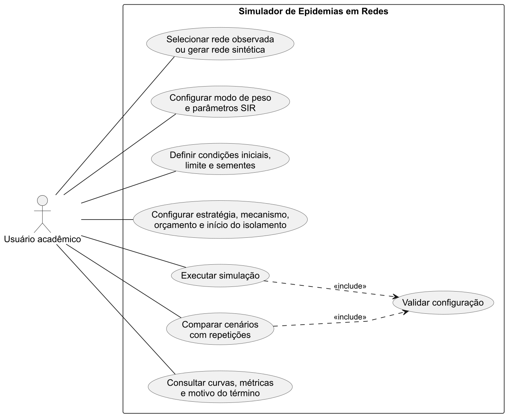
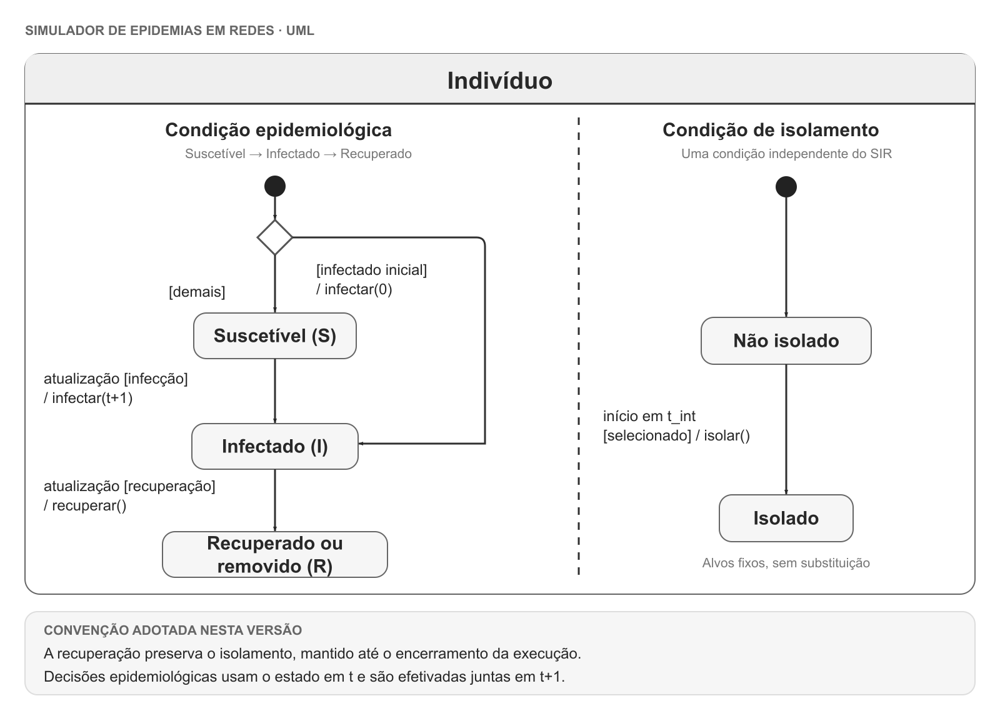
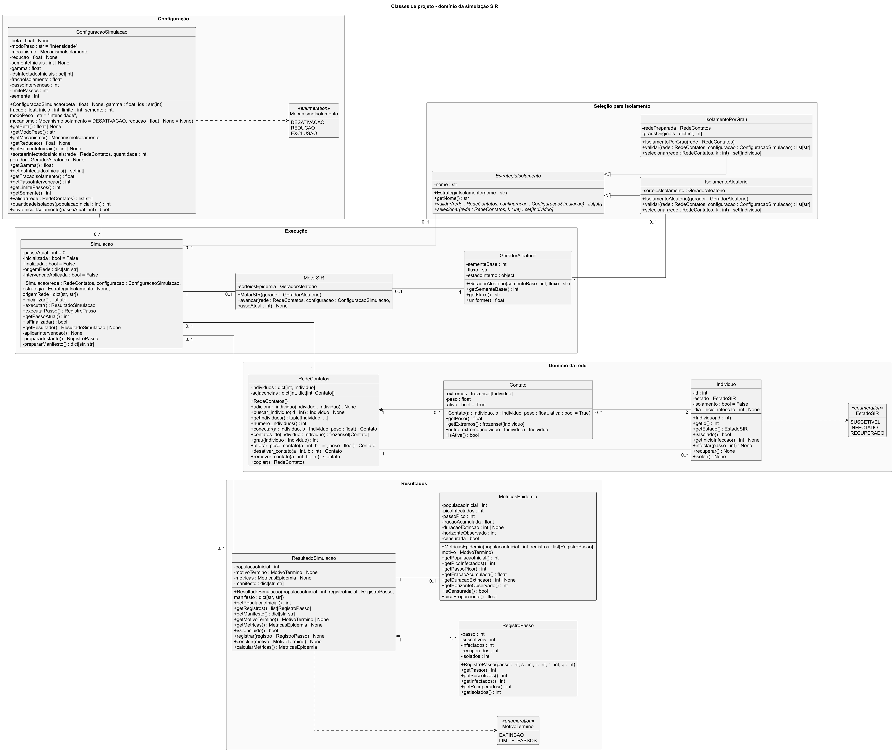

# Problema e epidemiologia do simulador

**Atualização: 22 de novembro de 2026.** Este documento, iniciado na Etapa 1, descreve o modelo implementado e as condições experimentais já executadas. A conferência considera os módulos Python, os contratos da API e os registros do bloco A da Etapa 3.

A aplicação oferece importação CSV e geração ER/BA, configuração epidemiológica, comparação entre cenários, reprodução dos históricos e exportações. A base escolar foi preparada e conferida na interface; o bloco de topologias concluiu **21 lotes e 6.300 trajetórias**. Os blocos de mecanismos, orçamento/início e sensibilidade a β e o benchmark permanecem pendentes, conforme o [estado atual da etapa](../../dados/dados/experimentos/estado-etapa3.json).

## 1. Introdução e contextualização

A propagação de uma doença transmissível depende das oportunidades de contato entre indivíduos. Essas oportunidades não se distribuem uniformemente: algumas pessoas mantêm muitos contatos, outras interagem principalmente em um mesmo grupo e determinados contatos conectam regiões pouco relacionadas da população.

Grafos permitem representar indivíduos como vértices e contatos potencialmente transmissores como arestas, uma abordagem também discutida por [Codeço e Coelho (2008)](../referencias/REFERENCIAS.md#codeco2008). Essa representação explicita quais pares podem interagir e permite incorporar diferenças de intensidade dos contatos. O estudo de modelos epidemiológicos em redes oferece uma base para investigar a relação entre a organização dessas conexões e a propagação [Newman (2002)](../referencias/REFERENCIAS.md#newman2002).

A estrutura da rede pode modificar as oportunidades de exposição. Indivíduos com muitos vizinhos podem alcançar mais pessoas; agrupamentos podem concentrar a circulação; e conexões entre grupos podem permitir a chegada da infecção a outras regiões. Entretanto, essas propriedades não determinam isoladamente o resultado, que também depende dos parâmetros, dos infectados iniciais e dos eventos aleatórios.

Comparar estratégias de isolamento permite investigar se critérios diferentes de seleção de pessoas produzem comportamentos distintos sob um mesmo orçamento de intervenção. O isolamento aleatório constitui uma referência simples. A seleção por grau utiliza a estrutura da rede para priorizar indivíduos com maior número de contatos.

A aplicação é um **simulador acadêmico exploratório**, destinado à compreensão desses mecanismos e à aplicação de teoria dos grafos. Os parâmetros utilizados não foram calibrados para uma doença específica, e os experimentos não constituem validação clínica ou previsão de epidemias reais. Mesmo com contatos observados, os resultados descrevem consequências das hipóteses do simulador sobre a representação adotada. A discussão de hipóteses e cenários em [Sofonea, Cauchemez e Boëlle (2022)](../referencias/REFERENCIAS.md#sofonea2022) apoia essa delimitação.

## 2. Problema de pesquisa e objetivos

### 2.1. Definição do problema

O problema consiste em representar uma população e seus contatos e simular a evolução estocástica dos estados epidemiológicos. A ferramenta compara ausência de isolamento, seleção aleatória e seleção por grau sob condições controladas.

Cada vértice representa um indivíduo; cada aresta representa um contato potencialmente transmissor. O grafo é simples, sem laços nem contatos duplicados por par não ordenado, não direcionado e ponderado. A ausência de direção descreve o contato; a possibilidade de transmissão depende dos estados dos extremos. As listas de adjacência são implementadas por dicionários de vizinhos que compartilham o mesmo objeto `Contato` nos dois extremos. A fundamentação de grau, componentes e representação de redes também pode ser consultada em [Gomes (2024)](../referencias/REFERENCIAS.md#gomes2024).

O cadastro inclui indivíduos sem contatos. Na estrutura Python existente, RedeContatos, Contato e Individuo correspondem à rede, ao contato e à pessoa. Os nomes origem e destino identificam extremos, sem direção. O projeto reutiliza essas classes; não introduz outra estrutura paralela de grafo ou aresta.

### 2.2. Pergunta central

**Como a estrutura de uma rede de contatos influencia a propagação de uma epidemia simulada e, sob igual número de pessoas isoladas, como as estratégias aleatória e por grau alteram o pico de infectados e a fração acumulada em relação à ausência de isolamento?**

A comparação entre estruturas compõe o bloco A executado, com a escola e redes sintéticas controladas. Uma estratégia adicional por posição estrutural exigiria justificativa, critério e orçamento próprios; ela permanece fora da comparação disponível.

### 2.3. Objetivo geral

Desenvolver e avaliar um simulador estocástico SIR em rede para investigar a influência da estrutura e comparar estratégias de isolamento por indicadores definidos e reproduzíveis.

### 2.4. Objetivos específicos

1. Implementar transmissão e recuperação com atualização síncrona.
2. Validar parâmetros, condições iniciais, revisão da rede e intervenção.
3. Separar seleção de pessoas, efeito sobre contatos e estado epidemiológico.
4. Preparar uma base observada e controles sintéticos com procedência registrada.
5. Produzir históricos e métricas com população fixa e tratamento da censura.
6. Comparar cenários em repetições com condições e sementes identificadas.
7. Documentar as interações, os estados e as responsabilidades por UML.

A implementação e a primeira bateria de topologias estão registradas no repositório. A avaliação experimental completa ainda depende dos blocos restantes; os objetivos de análise não devem ser considerados encerrados apenas pela existência dos módulos.

### 2.5. Escopo, alternativas e prioridades

A execução mantém uma população fechada e uma rede sem agenda temporal de contatos. A intervenção pode modificar disponibilidade, peso ou existência das ligações. Incubação, reinfecção, vacinação e transmissão fora da rede permanecem fora do modelo.

| Dimensão | Disponível na implementação | Condição usada no bloco A |
| --- | --- | --- |
| Entrada da rede | Importação CSV, com cadastro opcional de indivíduos; geração Erdős–Rényi e Barabási–Albert | Escola de Berna e dez realizações de cada gerador |
| Topologia | Referência estática; alterações de contatos pelo mecanismo de intervenção | União dos contatos escolares de todo o período; controles estáticos |
| Política de isolamento | Uma intervenção por cenário, sem reposição ou liberação | Início em t=5, se a execução ainda pode continuar |
| Seleção por orçamento | Aleatória ou por grau original; comparação com referência sem intervenção | Mesma fração e mesmo início nas duas seleções |
| Infectados iniciais | IDs manuais ou quantidade para sorteio sem reposição na interface | Três sorteados por repetição e reutilizados nos cenários |
| Interpretação dos pesos | Intensidade ou probabilidade direta | Intensidade, com peso 1 |
| Mecanismo | Desativação, redução ou exclusão de contatos | Desativação |

Topologia dinâmica e entrada diária de infectados em isolamento com probabilidade q são propostas de menor prioridade, sem suporte no executor atual. Sua inclusão exigiria outro protocolo, atualizações nos contratos e testes próprios. Os três mecanismos por orçamento já estão integrados ao fluxo configurado; a bateria comparativa entre mecanismos continua pendente.

### 2.6. Isolamento de pessoas e bloqueio de contatos

Isolar uma pessoa atua sobre seus contatos incidentes conforme o mecanismo. Bloquear uma aresta atua somente sobre aquela interação. O indicador ativa pode representar uma indisponibilidade própria do contato; sua presença não exige uma interface adicional de bloqueio de arestas. Ponto de articulação é vértice cuja remoção aumenta o número de componentes; ponte é uma aresta com esse efeito. Uma comparação entre essas intervenções exigiria outro critério de custo. O orçamento aqui é número de pessoas, não número de arestas afetadas.

## 3. Modelo epidemiológico SIR

### 3.1. Estados e hipóteses

| Estado | Significado |
|---|---|
| Suscetível (S) | Pode adquirir infecção pelos contatos permitidos com infectados. |
| Infectado (I) | Pode transmitir e está sujeito à recuperação, inclusive quando isolado. |
| Recuperado (R) | Não transmite nem volta a S durante a execução. Representa remoção epidemiológica, sem excluir a pessoa do grafo. |

O ciclo é S → I → R. O trabalho de [Kermack e McKendrick (1991, republicação de 1927)](../referencias/REFERENCIAS.md#kermack1991) fundamenta a organização compartimental SIR; as regras discretas implementadas são escolhas operacionais do projeto. Todos têm os mesmos parâmetros epidemiológicos; a heterogeneidade resulta da rede e dos pesos. Estado e isolamento são condições independentes.

### 3.2. Tempo e condições iniciais

t = 0,1,2,... é um índice inteiro; cada transição t → t+1 corresponde a um **passo abstrato da simulação**. O protocolo executado não associa esse passo a um dia de coleta ou à duração de uma doença real. T_max é o número máximo de transições. O nome legado `dia_inicio_infeccao` armazena esse índice, sem estabelecer uma unidade de calendário.

Os infectados iniciais são um conjunto explícito de IDs existentes, sem repetição; n₀ é seu tamanho, 0 ≤ n₀ ≤ N. Todos os demais começam em S, R(0)=0 e inicialmente não há isolados antes da intervenção. O conjunto vazio é permitido e produz extinção em t=0. A interface oferece duas opções: informar IDs manualmente ou informar quantidade n₀ e semente para sorteio uniforme sem reposição. O sorteio ocorre na preparação, usa fluxo próprio e mostra os IDs antes da execução. O conjunto resultante fica registrado e é reutilizado nos cenários da mesma repetição; não se sorteia novamente para cada estratégia. A escolha não depende de ferramenta externa à interface.

O campo dia_inicio_infeccao armazena None para quem nunca foi infectado, 0 para infectados iniciais e t+1 para novas infecções. Isolar um infectado inicial não o substitui nem o recupera.

### 3.3. Pesos e probabilidade por contato

Seja G=(V,E), N=|V|>0. O peso simétrico wᵤᵥ=wᵥᵤ é finito em [0,1], com interpretação identificada por configuração. **Intensidade é o modo padrão.** Nesse modo, β é probabilidade por passo em contato de peso 1, com 0 ≤ β ≤ 1. Para contato permitido entre I e S:

**pᵤᵥ = β · wᵤᵥ**.

A relação linear é uma hipótese simplificadora, sem calibração empírica. Peso zero impede transmissão, mas não significa isolamento. Ausência de peso pode ser preparada como intensidade unitária, com essa escolha registrada; não se interpreta peso 1 como transmissão certa quando β<1.

Para duração acumulada dᵤᵥ ≥ 0 em janela declarada, uma transformação candidata é **wᵤᵥ = min(1, dᵤᵥ/dref)**, com dref>0 na mesma unidade. O exemplo dref=900 segundos é didático, não decisão ou calibração. A saturação perde distinção entre durações acima da referência. Essa transformação não foi usada na base escolar: a preparação mantém peso unitário e preserva as durações em arquivo separado. A escala e a janela devem permanecer iguais em comparações; normalizar separadamente pelo máximo de cada rede pode confundir intensidade e estrutura. Valores brutos acima de 1 exigem preparação antes do cadastro nessa referência.

**Modo alternativo: probabilidade direta.** Quando o peso já expressa probabilidade de transmissão por contato e por passo, adota-se pᵤᵥ=wᵤᵥ. β fica não aplicável, representado por None; não multiplicar novamente. Peso 1 significa transmissão certa em uma exposição permitida nesse modo, mas não no modo intensidade com β<1. Probabilidades referentes a outro intervalo exigem conversão documentada antes da entrada. A escala deve ser comum entre cenários; interpretação não pode mudar silenciosamente durante a execução.

### 3.4. Múltiplas exposições

Seja bᵤᵥ(t)∈{0,1} o indicador ativa do contato existente em t, independente do estado SIR e do isolamento. Um contato ausente ou inativo contribui probabilidade zero. Para contato ativo entre um I e um S do snapshot, aplicar p=βw(t) no modo intensidade ou p=w(t) no modo probabilidade direta. O mecanismo de intervenção modifica disponibilidade, peso ou existência antes desses sorteios.

O motor **não bloqueia adicionalmente pelo booleano isolamento**: a desativação já bloqueou os contatos, a redução deve permitir transmissão residual e a remoção já retirou as interações. Um filtro automático por pessoa isolada anularia incorretamente a redução parcial.

Para suscetível v, Jᵥ(t) reúne os vizinhos infectados no início do passo com contato permitido. Sob independência condicional das tentativas, dados os estados e contatos:

**Pᵥ(t) = 1 − ∏[u ∈ Jᵥ(t)] (1 − pᵤᵥ)**.

O produto vazio vale 1: sem vizinhos elegíveis, Pᵥ=0. Um sorteio uniforme Uᵥ(t) em [0,1) causa S → I se Uᵥ(t)<Pᵥ(t). Há no máximo uma nova infecção por pessoa no passo. Exposições 0,2 e 0,4 dão 1−0,8×0,6=0,52; não se somam as probabilidades.

### 3.5. Recuperação probabilística

Para cada indivíduo v em I no início do passo, um sorteio uniforme Vᵥ(t) em [0,1), independente dos sorteios de transmissão, decide a recuperação se Vᵥ(t)<γ, com γ finito em [0,1]. A transição é aplicada ao final, inclusive para isolados. Recém-infectados não participam desse sorteio no mesmo passo.

γ=0 impede recuperação; γ=1 recupera todos os infectados iniciais do passo ao final, sem impedir sua transmissão anterior quando permitida. Para γ>0, a quantidade de passos infecciosos tem média 1/γ sob essa convenção. Duração fixa não é usada conjuntamente.

β, quando aplicável, e γ são probabilidades discretas adimensionais por passo, não taxas contínuas em tempo inverso. Mudar a duração representada pelo passo exigiria rever os parâmetros. β/γ não será apresentado automaticamente como número reprodutivo da rede.

### 3.6. Ordem das operações e histórico

Simulacao é a única responsável pelo relógio e pelo histórico. MotorSIR calcula e aplica exatamente uma transição por chamada, sem laço próprio, incremento de t ou registro. A preparação de cada instante segue esta convenção:

1. Inicializar S,I,R em t=0 e validar tudo antes de alterar a rede ou consumir sorteios.
2. Ao chegar a um instante t, verificar extinção e limite. Se a execução pode avançar, aplicar a intervenção programada para t, uma única vez.
3. Registrar t,S(t),I(t),R(t),Q(t) exatamente uma vez. Q(t) é o número de isolados **após a intervenção devida nesse instante e antes dos sorteios**. Se o instante é terminal, concluir sem nova transição ou intervenção.
4. Capturar valores dos estados epidemiológicos em t; guardar somente referências a objetos mutáveis não constitui snapshot.
5. Calcular e sortear infecções dos suscetíveis e recuperação dos infectados presentes nesse snapshot. Guardar decisões separadamente.
6. Aplicar conjuntamente as transições pelo motor. Somente Simulacao incrementa t para t+1 e retorna à preparação do novo instante.

Assim, intervenção em t=0 já aparece em Q(0). Em t_int>0, o registro daquele instante inclui seus efeitos, sem gerar um segundo registro com o mesmo índice. Se I(t)=0 ou t=T_max ao chegar ao instante, registrar o término sem aplicar uma intervenção que não teria outra transição a afetar. Não se altera retroativamente um registro já publicado.

Uma execução com H transições produz H+1 registros. O recém-infectado só transmite e pode recuperar a partir do passo seguinte. O infectado que recupera ao final pode ter transmitido naquele passo. A recuperação não libera isolamento nesta referência.

### 3.7. Estratégia, mecanismo e orçamento

**Estratégia** escolhe as pessoas; **mecanismo** aplica o efeito sobre seus contatos. `IsolamentoAleatorio` e `IsolamentoPorGrau` implementam a seleção, enquanto `aplicar_isolamento()` implementa os três mecanismos de `isolamento.py`. O fluxo de `Simulacao` e da API aceita DESATIVACAO, REDUCAO e EXCLUSAO; os [testes de isolamento](../../tests/test_isolamento.py), de [simulação](../../tests/test_simulacao.py) e da [API de comparação](../../tests/test_comparacao_api.py) exercitam esses caminhos. A desativação é o mecanismo do protocolo-base.

Depois de validar toda a intervenção, o coordenador entrega IDs selecionados, mecanismo, orçamento e redução quando aplicável à função aplicar_isolamento(). Ela enumera contatos afetados uma única vez, aplica o efeito e marca as pessoas como isoladas. A seleção e o agendamento não são repetidos nessa função.

Para fração f finita em [0,1], o orçamento é **k=piso(fN)**, sendo N a população inicial. A fração realizada k/N pode diferir de f. A seleção ocorre uma única vez no início de t_int, inteiro com 0 ≤ t_int < T_max, se a execução ainda pode avançar. Não há reposição de alvos ou liberação até o término.

Todos os indivíduos, S,I ou R, são elegíveis. A seleção aleatória amostra k IDs distintos uniformemente sem reposição. A seleção por grau ordena pelo número de vizinhos da rede original, em ordem decrescente, com desempate por ID crescente; não usa pesos nem recalcula graus após cada isolamento. Pessoas de grau zero continuam elegíveis.

O cenário sem intervenção usa k=0, sem sorteios de seleção. Se a extinção ocorre antes ou no instante agendado, a intervenção não é realizada; o histórico permite conferir a ausência de novos isolados. Com k=N, intervenção em t=0 e mecanismo DESATIVACAO ou EXCLUSAO, nenhum contato transmite, mas os infectados continuam sujeitos à recuperação. Em REDUCAO, o bloqueio total por redução dos pesos exige r=1; uma redução parcial pode conservar transmissão residual.

### 3.7.1. Redução, exclusão e propostas de extensão

**Redução parcial:** o parâmetro r (reducao) é a fração retirada, finita em [0,1]. Cada contato incidente a pelo menos uma pessoa selecionada recebe **w_novo=w_anterior×(1−r)** uma única vez, mesmo se ambos os extremos foram selecionados. Sua atividade é preservada, inclusive se já era False. Com peso 0,8 e r=0,5, o resultado é 0,4 em ambos os casos. r=0 preserva o peso e r=1 o zera, sem necessariamente mudar ativa. Não se aplica um segundo fator por extremo. Se for usada a notação residual ρ, ela significa ρ=1−r; não é a fração retirada.

O motor utiliza o peso resultante: p=βw_novo no modo intensidade e p=w_novo no modo direto, sem reaplicar β no segundo. Não combina essa redução com bloqueio automático por isolamento. A fórmula de múltiplas exposições usa os contatos ainda existentes e ativos.

**Remoção dos contatos (EXCLUSAO na API):** remover as ligações incidentes, mantendo o indivíduo cadastrado, com grau zero, e seu estado epidemiológico. Não é exclusão do vértice, recuperação ou morte. N e S,I,R,Q continuam relativos à mesma população; infectados desconectados recuperam normalmente. Remoção de vértices é outra operação, não representada por esse mecanismo.

A intervenção é aplicada uma única vez e permanece até o término. A referência da rede, incluindo pesos e ativa, fica preservada por cópia para iniciar cenários independentes. O manifesto da API identifica a receita e a origem, mas não incorpora automaticamente uma cópia completa do grafo; os arquivos preparados e os registros experimentais complementam a reprodução. A referência não oferece liberação; se futuramente adicionada, será necessário restaurar seletivamente a condição anterior, sem reativar contatos bloqueados por outro motivo.

**Política diária q, proposta não implementada:** no início de cada passo, cada infectado ainda não isolado teria chance q∈[0,1] de entrar em isolamento, com sorteio próprio. q não seria fração populacional e não garantiria k fixo. A proposta inicial também considerou liberação na recuperação, em protocolo separado. Nesse caso Q poderia diminuir, e seria necessário definir como restaurar contatos sem reativar ligações indisponíveis por outro motivo. O agendamento único por orçamento não substitui esses eventos diários; os contratos e os testes precisariam ser adaptados.

**Topologia dinâmica, proposta não implementada:** permite contatos aparecerem/desaparecerem entre instantes; mudança de estado SIR ou bloqueio lógico não constitui, por si só, mudança estrutural. Será necessário definir agenda/regra das mudanças, captura consistente por passo e significado do grau no momento da seleção. Se admitir entrada/saída de pessoas, definir também população de referência e denominadores; as fórmulas da coorte fechada não se transferem automaticamente. Essas regras ainda não foram fechadas.

### 3.8. Término

Extinção ocorre no primeiro instante com I(t)=0, incluindo t=0. Caso contrário, concluir ao completar T_max transições. Se I(T_max)=0, prevalece EXTINCAO; se I(T_max)>0, registrar LIMITE_PASSOS e censura. Ausência de novas infecções em um passo não basta para encerrar enquanto houver infectados.

## 4. Parâmetros

Os domínios são validados por `ConfiguracaoSimulacao` e `ConfiguracaoIntervencao`. A coluna final registra a configuração-base executada no bloco A; os valores são escolhas experimentais, sem calibração com doença real. O número de repetições pertence ao lote, e não ao motor de um passo.

| Parâmetro | Símbolo | Domínio e significado | Bloco A |
| --- | --- | --- | --- |
| Unidade temporal | Δt | Uma transição; passo abstrato, sem unidade clínica definida | Passo abstrato |
| Contágio | β | Real finito em [0,1] no modo intensidade; `None` no modo direto | 0,005 |
| Recuperação | γ | Probabilidade de I → R por passo, finita em [0,1] | 0,10 |
| Modo de peso | — | `intensidade` ou `probabilidade` | Intensidade |
| Peso | wᵤᵥ | Real finito em [0,1], interpretado conforme o modo | 1 |
| Atividade própria | bᵤᵥ | Disponibilidade booleana, independente do estado SIR | Ativa antes da intervenção |
| Referência de duração | dref | Escala positiva para uma eventual preparação de durações | Não utilizada; 900 s na seção 3.3 é apenas exemplo didático |
| População | N | Cadastro completo, inclusive indivíduos sem contatos; positiva para executar | 67 |
| Infectados iniciais | IDs₀; n₀ | IDs distintos existentes ou sorteio; 0 ≤ n₀ ≤ N | Três sorteados sem reposição |
| Estratégia | σ | Referência sem intervenção, aleatória ou grau original | Os três cenários |
| Mecanismo | — | Desativação, redução ou exclusão dos contatos | Desativação |
| Redução | r | Fração retirada em [0,1], exigida somente em REDUCAO | `None` |
| Fração | f | Parcela solicitada da população, finita em [0,1] | 0,20 nas intervenções |
| Orçamento | k | piso(fN), entre 0 e N | 13 pessoas nas intervenções |
| Início | t_int | Instante inteiro com 0 ≤ t_int < T_max | 5 |
| Limite | T_max | Máximo de transições; inteiro positivo, excluindo bool | 200 |
| Sementes-base | s | Inteiros para os fluxos separados | Iniciais 10000; epidemia 20000; isolamento 30000 |
| Repetições | m | Inteiro positivo; m≥2 para desvio amostral | 100 por rede e cenário |

O cenário de referência possui `intervencao=None`, sem seleção de pessoas. Fração zero nas intervenções produz orçamento zero. A validação rejeita valores não finitos, IDs ausentes ou repetidos, parâmetros incompatíveis, limite inválido e revisão desatualizada da rede. Alterar a receita ou a rede exige validá-las novamente.

As faixas adicionais de mecanismos, orçamento, início e β estão definidas no [protocolo etapa3-base-v1](../../dados/dados/experimentos/protocolo-etapa3-v1.json), mas sua execução ainda não está concluída. O [estado da etapa](../../dados/dados/experimentos/estado-etapa3.json) registra o progresso; os indicadores de pendência do protocolo original foram preservados como parte do planejamento anterior à bateria.

## 5. Métricas

N é sempre a população inicial do próprio resultado, fixa e positiva. Isolamento não reduz N. Seja H o último instante observado.

| Métrica | Definição | Unidade/denominador | Interpretação |
|---|---|---|---|
| Curvas | S(t),I(t),R(t), t=0,...,H | Pessoas; proporções divididas por N | S+I+R=N |
| Isolados | Q(t), contado após intervenção de t | Pessoas; 0 ≤ Q ≤ N | Sobrepõe os estados SIR; não somar aos compartimentos |
| Pico | I_pico=max I(t), de 0 a H | Pessoas; relativo I_pico/N | Inclui infectados isolados |
| Momento do pico | Primeiro t com I(t)=I_pico | Passos abstratos | Primeiro máximo em caso de empate |
| Acumulado | A_H=[N−S(H)]/N=[I(H)+R(H)]/N | População inicial N | Pessoas já infectadas, incluindo n₀ |
| Novas infecções | N−S(H)−n₀ | Pessoas | Infecções posteriores à inicialização |
| Duração | D=primeiro t com I(t)=0 | Passos abstratos | None se não observada |
| Horizonte | H | Passos abstratos | Último instante registrado |
| Diferença média | ΔZ=média(Z_ref−Z_σ) | Mesma unidade de Z | Comparação em repetições correspondentes |
| Redução relativa por par | 100×(Z_ref,r−Z_σ,r)/Z_ref,r | Percentual; referência positiva em cada par | Calculada por repetição; média e desvio somente dos valores definidos |

O domínio calcula diferenças e reduções por pares em `comparacao.py`. A média das reduções por par é diferente de **100×[média(Z_ref)−média(Z_σ)]/média(Z_ref)**, que expressa uma redução entre médias. Ambas podem ser informadas se forem nomeadas corretamente. O resumo HTTP atual serializa métricas e censura, mas não as coleções de diferenças e reduções do domínio; o executor experimental salva os contrastes pareados separadamente.

Z é o indicador comparado, não a contagem Q de isolados. Redução negativa significa aumento. Com referência zero, apresentar diferença absoluta e redução não aplicável. Como R(0)=0 e não há reinfecção, o acumulado conta cada pessoa uma única vez; ΣI(t) não é total de pessoas distintas. N=10 e I=[2,4,4,0] dão pico 4, proporção 0,4 e primeiro instante 1.

### 5.1. Censura e comparação no horizonte

Se I(H)>0 ao atingir o limite, A_H e pico são observados até H, não necessariamente finais. D permanece None e a apresentação informa D>H. Não substituir por zero ou T_max. Sem infectados iniciais, H=D=0, pico=0, instante do pico=0 e acumulado=0.

Usar horizonte T_max comum. Históricos extintos antes dele podem ser prolongados apenas para alinhamento visual, com I=0 e S,R,Q constantes sob a política permanente; identificar esse prolongamento. Históricos censurados não podem ser completados com I=0.

Apresentar quantidade e proporção de execuções censuradas. Média da duração somente entre extinções deve ser identificada como condicional, com número de observações, pois pode ser enviesada. Diferenças pareadas de duração exigem pares completos e indicação das exclusões. Para momento do pico, preferir diferença em passos; duração menor isoladamente não comprova melhor intervenção.

## 6. Comparação e reprodutibilidade

### 6.1. Cenários e condições controladas

`executar_comparacao()` organiza referência sem intervenção, seleção aleatória e seleção por grau. Nas duas intervenções, mantém k, t_int, mecanismo e redução quando aplicável. Dentro da repetição, os três cenários compartilham rede, pesos, β, γ, IDs iniciais e T_max. O lote compara as estratégias de seleção; comparar mecanismos ou parâmetros exige outros pedidos.

Cada execução usa uma rede de trabalho independente, sem reaproveitar os estados finais das anteriores. Na desativação, as arestas permanecem cadastradas e o grau estrutural é preservado, embora os contatos fiquem indisponíveis para transmissão. Na exclusão, as arestas incidentes são removidas e os graus da rede de trabalho mudam. A seleção por grau utiliza os valores capturados antes da intervenção, sem recalculá-los entre os alvos.

A população não muda em nenhum dos três mecanismos. Orçamento em pessoas não equivale a orçamento em arestas ou duração: duas seleções de mesmo k podem afetar quantidades diferentes de contatos.

### 6.2. Execução, consolidação e apresentação

O executor de comparações organiza cenários e repetições e reutiliza `Simulacao`; as regras de transmissão e recuperação permanecem no motor. A consolidação calcula média e desvio-padrão amostral, registra observações ausentes e conta a censura. Com uma observação, o desvio amostral é `None`; duração de extinção não é imputada a uma execução censurada.

A interface distingue a execução do cálculo e a reprodução do histórico. A Tela 03 solicita o resultado completo ao backend e depois percorre seus registros. Pausar ou avançar nessa tela controla a reprodução; cancelar a espera HTTP não envia um comando de parada do motor Python. A Tela 04 oferece seleção de cenário e repetição, curvas, métricas, tabela e exportações. A cor dos nós na prévia da Tela 03 é ilustrativa, distribuída pelas contagens; não representa um histórico real de estados por ID.

Na agregação visual, trajetórias extintas mantêm o último estado somente para alinhar as curvas. As médias e faixas por instante diferem da média e do desvio dos picos individuais. Atribuições dos integrantes são registradas nos planos e no [histórico de contribuições](../../CONTRIBUICOES.md).

### 6.3. Sementes, manifestos e ambiente

`GeradorAleatorio` encapsula instâncias de `random.Random`, cujo núcleo é Mersenne Twister. Há fluxos separados para iniciais, isolamento e eventos epidemiológicos; a geração da rede possui sua própria semente. Pessoas e vizinhos são processados em ordem de ID. Os sorteios de infecção e recuperação consomem o fluxo epidemiológico; ele não é reinicializado a cada passo.

Na repetição r, contada a partir de 1, o lote utiliza **semente efetiva = semente-base + r − 1** para cada fluxo. A preparação sorteia os IDs iniciais uma vez e os reutiliza nos três cenários. No protocolo executado, as bases são 10000, 20000 e 30000; as 100 repetições usam, respectivamente, 10000–10099, 20000–20099 e 30000–30099.

O mesmo valor de semente não garante pareamento de um evento por pessoa após as trajetórias divergirem: mudanças nos estados alteram o consumo dos sorteios. Um ID sintético também não identifica o mesmo estudante de uma rede observada. Reproduzir depende de entradas, receita, IDs, sementes, código, ordem de processamento e ambiente compatíveis; mudar apenas a semente pode produzir resultados iguais por acaso ou em casos determinísticos.

Os registros têm escopos diferentes:

| Camada | O que preserva |
| --- | --- |
| `ResultadoSimulacao`, no domínio | Configuração efetiva, histórico em tupla, métricas, população, motivo de término e eventual repetição |
| Manifesto da API | Projeto, data, origem/contexto/revisão da rede, configuração com IDs e sementes efetivos, identificação do gerador e regra de derivação |
| Preparação dos dados | Fonte e arquivo, janela, critérios, mapeamento de IDs, transformações e hashes dos originais e dos CSVs |
| Registros experimentais | Protocolo usado, pedidos e resultados completos, ambiente Python, revisão e hashes do código, assinaturas e verificações das entradas e saídas |

O manifesto HTTP não contém automaticamente todos os arquivos da rede, hashes do código ou versões do ambiente. Esses dados complementares estão nos manifestos de preparação e em [execucao.json](../../dados/dados/experimentos/topologia-v1/execucao.json). Resultados da sessão HTTP ficam em memória; exportações e pacotes experimentais preservam o material fora da sessão.

### 6.4. Controles sintéticos e níveis de variabilidade

Os controles usam geradores nativos, documentados em `geracao.py`. A família de redes aleatórias de [Erdős e Rényi (1959)](../referencias/REFERENCIAS.md#erdos1959) orienta o controle denominado ER na interface. A implementação usa **G(N,p)**: inclui cada par de indivíduos com probabilidade independente p, construção também associada a [Gilbert (1959)](../referencias/REFERENCIAS.md#gilbert1959). O controle BA utiliza crescimento e ligação preferencial, conforme [Barabási e Albert (1999)](../referencias/REFERENCIAS.md#barabasi1999).

O bloco A mantém N=67 e peso 1. Em ER, **p=1325/2211≈0,5992763455**, com sementes 1000–1009; 1.325 é o número esperado de arestas, não uma contagem imposta. Em BA, **m=24**, núcleo completo com 25 indivíduos e sementes 2000–2009; cada realização tem 1.308 arestas, cerca de 1,28% menos que a escola. As dez ER resultaram em 1.291–1.360 arestas; todas as 21 redes são conexas.

A densidade é aproximada, e cada realização tem seus graus e componentes registrados. O desvio populacional dos graus é 9,56 na escola, 3,50–4,58 em ER e 9,69–10,74 em BA. Com N pequeno e m alto, BA é um controle denso; não foi demonstrada uma lei de potência em seus graus.

Há duas fontes de variabilidade: as 100 trajetórias por rede e as dez realizações de cada gerador. Na escola, o resumo usa desvio amostral entre repetições de uma rede fixa. Em ER/BA, o resumo por modelo usa desvio entre dez médias de rede, cada qual calculada com 100 repetições. Esses desvios não medem a mesma variabilidade. Os [resumos por rede](../../dados/dados/experimentos/topologia-v1/resumo_por_rede.csv) e [por modelo](../../dados/dados/experimentos/topologia-v1/resumo_por_modelo.csv) preservam essa distinção. Uma realização ou uma trajetória isolada não demonstra superioridade universal.

## 7. Dados observados e preparação

### 7.1. Base adotada: escola secundária de Berna

A base principal é a coleta de proximidade de uma escola secundária de Berna, Suíça, de **22/01 a 08/03/2024**, associada ao estudo de [Banholzer et al. (2025)](../referencias/REFERENCIAS.md#banholzer2025) e ao [repositório dos autores no OSF](../referencias/REFERENCIAS.md#osf-escola). A escolha priorizou contato presencial observado, coleta de 2024 e possibilidade de preparar e conferir os arquivos. A origem é suíça; a documentação local e os cabeçalhos dos CSVs foram adaptados para PT-BR.

Foi utilizado `contact-duration-acc-based-att-65.csv`, versão 1, com filtro de acelerômetro e limiar de atenuação de −65 dBm adotados no código de referência dos autores. O preparador lê 87.932 registros diários e mantém a união dos pares com duração positiva, ambos presentes e com movimento positivo. Não imputa dados ausentes. Entre as linhas lidas, 36.392 têm duração ausente, 13.128 ficam fora do filtro de presença/movimento, 31.475 têm duração válida zero e 6.937 correspondem a contatos diários positivos.

A projeção resultante contém **67 indivíduos e 1.325 pares únicos**, sem laços ou duplicações de pares não ordenados, com peso 1. O grau médio é 39,5522, os graus mínimo e máximo são 18 e 54, a densidade é 59,93% e há uma componente com todos os 67 indivíduos. A [caracterização estrutural](../../dados/dados/redes_reais/escola_suica_2024/caracterizacao/README.md) preserva os cálculos e arquivos de apoio.

Essa rede reúne contatos de datas diferentes em uma representação estática. Um caminho existente na projeção pode não ter existido na ordem temporal necessária à transmissão. O peso unitário registra a presença de contato observado; não significa durações iguais nem probabilidade de infecção igual a 1. O bloco A usa intensidade, em que p=β×1. No modo de probabilidade direta, o mesmo peso 1 produziria transmissão certa em uma exposição elegível e mudaria a interpretação experimental.

### 7.2. Arquivos preparados e percurso na interface

Os arquivos estão em `dados/dados/redes_reais/escola_suica_2024/`:

| Arquivo | Finalidade |
| --- | --- |
| `individuos.csv` | Cadastro integral dos 67 indivíduos, incluindo quem eventualmente ficasse sem contatos |
| `contatos.csv` | Pares preparados, com peso 1; entrada do importador de contatos |
| `mapa_ids.csv` | Correspondência entre identificadores originais e internos |
| `duracoes_observadas.csv` | Auditoria das durações acumuladas; os valores não foram convertidos em pesos |
| `manifesto.json` | Procedência, versão, regras, contagens e hashes dos arquivos |

Na Tela 01 são enviados somente `contatos.csv` e `individuos.csv`, com separador vírgula. O mapa e as durações têm outros esquemas e servem à auditoria. A [conferência no navegador](../../dados/dados/redes_reais/evidencias/interface-escola/README.md) registrou 67 indivíduos e 1.325 contatos, inspeção, Mapa, 3D e confirmação da rede. Esse percurso de importação não executou epidemias; a bateria foi realizada posteriormente pelo executor experimental.

A preparação preserva o mapeamento dos IDs, trata os pares sem direção e mantém todos os indivíduos identificados. Não restringe automaticamente a rede à maior componente. Fonte, versão e hashes são conferidos antes da conversão; o [preparador](../../scripts/preparar_redes_reais.py) e o [manifesto](../../dados/dados/redes_reais/escola_suica_2024/manifesto.json) documentam a reprodução. Uma mudança de janela ou filtragem exige outra preparação e nova caracterização.

O nó OSF consultado não declara licença específica para os dados (`node_license=null`). A licença CC BY 4.0 do artigo não foi atribuída automaticamente aos CSVs.

### 7.3. Fontes consultadas no levantamento inicial

A busca incluiu Kaggle, publicações e repositórios dos autores. A preferência por uma plataforma ou pelo idioma não substituiu a necessidade de pares de contatos adequados ao modelo. Nesta busca, não foi encontrada uma base brasileira recente de pares presenciais que pudesse ser verificada e importada diretamente; isso não demonstra sua inexistência. O [catálogo de fontes](../../dados/dados/redes_reais/fontes.json) e a [auditoria](../../dados/dados/redes_reais/evidencias/auditoria-fontes.json) registram a escolha final.

| Alternativa consultada | Dados e preparação considerada | Situação e limites |
| --- | --- | --- |
| Escola primária do SocioPatterns | Dois grafos diários GEXF, com turma, gênero, duração acumulada em segundos e contagem de contatos | Não usada no bloco A. O estudo envolveu 242 participantes, 232 crianças e dez professores; a rede não foi adotada por ser de uma escola primária e outra escala. |
| Ensino médio de Marselha do SocioPatterns | Cinco dias de sensores, intervalos de 20 s e metadados separados | Não usada no bloco A. Diários e amizade são camadas distintas, e a agregação exigiria critérios que não seriam comparáveis à janela escolar selecionada. |
| Facebook combinado do SNAP | 4.039 vértices e 88.234 arestas, em arquivo textual | Alternativa estrutural, sem uso no bloco A. Amizade digital não mede exposição presencial. |
| Círculos sociais de McAuley e Kaggle | Perfis anonimizados, círculos e redes egocêntricas | Registro do levantamento, sem uso nos experimentos. Não foram usados como contatos presenciais observados. |

Sensores de proximidade se aproximam mais da exposição presencial do que relações digitais, mas não comprovam transmissão e podem omitir pessoas, ambientes e períodos. Os experimentos não utilizam diagnósticos clínicos para definir infectados iniciais nem reproduzem os resultados clínicos da fonte. Redes digitais permaneceriam casos estruturais, com hipóteses de exposição explicitamente artificiais.

### 7.4. Papel das redes observadas e sintéticas

| Aspecto | Rede observada | Redes sintéticas |
| --- | --- | --- |
| Contribuição | Conserva os pares registrados no contexto e na janela selecionados | Controlam tamanho, probabilidade de ligação ou crescimento preferencial |
| Limitação | Cobertura, filtragem e perda de ordem temporal pela agregação | Dependência das regras do gerador e das condições escolhidas |
| Uso no bloco A | Uma projeção da escola de Berna, com 100 repetições por cenário | Dez ER e dez BA, com 100 repetições por cenário e realização |
| Alcance | Resultados específicos dessa projeção e desses parâmetros | Resultados específicos das realizações e parâmetros utilizados |

Diferenças entre redes não foram atribuídas automaticamente a uma única propriedade. As densidades realizadas e as distribuições de graus foram registradas; a escola é uma única rede observada, e BA tem menos arestas que ela.

## 8. Diagramas UML

Os diagramas existentes documentam casos de uso, estados e classes. Suas fontes editáveis e imagens são mantidas juntas na pasta de modelagem; esta revisão reutiliza esses artefatos. Os formatos de casos de uso e estados seguem a sintaxe PlantUML. Para o comportamento executável e os campos disponíveis, a referência é a implementação conferida nesta edição.

### 8.1. Casos de uso

O usuário importa CSVs ou gera ER/BA, configura modo de peso e parâmetros epidemiológicos, define iniciais, limite e sementes, configura a intervenção, executa e consulta resultados. A configuração distingue o modelo epidemiológico do preparo da execução. Iniciais manuais ou sorteados e os três mecanismos por orçamento estão disponíveis. Execução individual e comparação passam por validação; topologia dinâmica e política diária q permanecem propostas sem execução na aplicação.

### 8.2. Estados do indivíduo

As regiões ortogonais representam estado SIR e isolamento simultâneos. Pessoas S,I ou R podem ser isoladas; isolamento não é um quarto estado. Na política padrão não há retorno de R a S nem liberação automática. A política diária alternativa é descrita separadamente e não é o ciclo representado nesta figura. A figura usa os eventos atualização [infecção] e atualização [recuperação], decididos pelos sorteios U e V definidos na seção 3, e mostra suas operações infectar(t+1) e recuperar(). As operações são efetivadas conjuntamente em t+1; a preparação de t_int aplica o mecanismo aos contatos antes desses sorteios. Passar a R mantém a pessoa no grafo.

### 8.3. Classes de projeto

O núcleo implementado reúne `RedeContatos`, `Contato` e `Individuo`. `MotorSIR` aplica um passo síncrono; `Simulacao` controla o tempo, a intervenção e o registro. `RegistroPasso` contém S, I, R e Q. `ResultadoSimulacao` reúne a configuração e os valores do resultado; o adaptador HTTP acrescenta o manifesto, e o manipulador da sessão acrescenta o identificador. O resultado de domínio não inclui uma rede de trabalho mutável. Essa distribuição efetiva de responsabilidades orienta a leitura do diagrama de classes e de sua explicação.

A [explicação consolidada](../modelagem/simulador-epidemias/modelagem-de-classes.md) detalha atributos, operações, relações, restrições e código PlantUML completo. Amplie o [SVG de classes](../modelagem/simulador-epidemias/diagramas/classes-dominio/classes-dominio.svg) para ler os detalhes; a imagem no PDF é uma visão geral.

## 9. Verificações e evidências

A implementação possui testes para transmissão, configuração, intervenção, simulação, métricas e comparação. Os critérios abaixo orientam a leitura dessa suíte e a verificação da correspondência entre código e especificação:

- Conservação S+I+R=N e 0≤Q≤N; S não aumenta, R não diminui; isolamento mantém SIR.
- Cadastro de indivíduos sem contatos; ausência de transmissão entre componentes sem contato.
- β=0 no modo intensidade, ou probabilidades de contato zero no modo direto, sem novas infecções; peso zero sem transmissão nos dois modos; γ=0 sem recuperação; γ=1 recuperando apenas os infectados iniciais do passo.
- Cadeia A–B–C, A inicialmente infectado, β=1, pesos 1 e γ=0: após uma transição, B infectado e C ainda suscetível.
- Múltiplas exposições 0,2 e 0,4 produzindo P=0,52, com gerador controlado para verificar os limiares.
- Intervenção t=0 refletida em Q(0), sem registro duplicado; orçamento zero sem efeito; orçamento total bloqueando contatos.
- Empate do pico usando primeira ocorrência; duração ausente em censura; extinção prevalecendo se coincide com limite.
- Seis resultados distintos para três cenários e duas repetições, sem contaminação de estado; reprodução do manifesto em processos compatíveis.
- Redução de 50% em contato de peso 0,8 produzindo 0,4, com um ou dois extremos selecionados; contato inativo permanecendo inativo.
- Remoção dos contatos preservando pessoa, histórico e N; desativação explícita impedindo transmissão.
- Rejeição de configuração inválida antes de sorteios/mutação, com mensagens identificáveis.

Os arquivos de [testes do motor](../../tests/test_motor_sir.py), [simulação](../../tests/test_simulacao.py), [isolamento](../../tests/test_isolamento.py), [métricas](../../tests/test_metricas.py) e [comparação](../../tests/test_comparacao.py) registram os casos automatizados. A correção temporal do isolamento inclui intervenção no próprio instante, ausência de aplicação em instantes terminais e reinicialização. A aprovação de uma execução de testes deve ser consultada em seu registro; esta revisão documental não executou novamente a suíte.

A [verificação experimental salva](../../dados/dados/experimentos/topologia-v1/verificacao.json) conferiu as 21 estruturas sem os algoritmos do domínio, regenerou os vinte controles com arquivos idênticos e comparou históricos, métricas e resumos dos lotes. Também reproduziu três lotes completos, com 900 trajetórias adicionais de conferência, separadas das 6.300 trajetórias experimentais.

São verificações de correspondência à especificação e de reprodução, sem validação clínica. Os tempos operacionais do executor não substituem medições de desempenho; o benchmark da campanha continua pendente.

## 10. Resultados disponíveis e continuidade

A rede, o motor SIR, o isolamento por orçamento, os registros, as métricas, a API e as quatro telas estão implementados. A modelagem usa população fechada, probabilidade discreta por passo e intervenção única. A aplicação mantém os dois modos de peso e os três mecanismos; a campanha de topologias utiliza intensidade, peso 1 e desativação.

O bloco A concluiu **21 redes × 100 repetições × 3 cenários = 6.300 trajetórias**, com 408.914 registros e uma censura. Na escola, o pico proporcional médio foi 23,12% sem intervenção, 15,46% com seleção aleatória e 12,37% por grau; os desvios amostrais entre as 100 repetições foram, respectivamente, 8,04, 6,47 e 5,36 pontos percentuais. As médias menores com seleção por grau descrevem a condição executada, sem demonstrar vantagem em todas as trajetórias ou eficácia clínica.

A única censura ocorreu em ER 1007, sem intervenção, repetição 33: I(200)=1 e R(200)=53. Sua duração de extinção permanece ausente. Os [resultados de topologia](../../dados/dados/experimentos/topologia-v1/README.md) preservam os contrastes, os níveis de variabilidade e os limites da comparação. Os lotes completos e seus hashes estão no [pacote de reprodução](../../dados/dados/experimentos/topologia-v1/lotes-topologia-v1.zip); os derivados extensos podem ser restaurados sem executar novas epidemias.

Restam os **12 lotes adicionais, com 3.600 trajetórias planejadas**, de mecanismos, orçamento/início e sensibilidade a β, além das medições de desempenho. O protocolo-base já está definido; a execução desses blocos e seu alinhamento com o integrante B devem seguir o [aviso de passagem](../implementacao/Aviso-IntegranteB-Etapa3.md). Alterações de parâmetros, janela ou representação precisam ser identificadas como outra condição experimental e preservar os resultados existentes.

## Referências

A bibliografia está consolidada em [REFERENCIAS.md](../referencias/REFERENCIAS.md), com autores, títulos, DOI ou endereço de origem e notas de uso. As citações deste documento apontam para entradas identificadas por âncoras, evitando numerações divergentes entre os dois arquivos.

Os fundamentos incluem [Newman](../referencias/REFERENCIAS.md#newman2002), [Kermack e McKendrick](../referencias/REFERENCIAS.md#kermack1991), [Codeço e Coelho](../referencias/REFERENCIAS.md#codeco2008), [Gomes](../referencias/REFERENCIAS.md#gomes2024), [Koher et al.](../referencias/REFERENCIAS.md#koher2019) e [Sofonea et al.](../referencias/REFERENCIAS.md#sofonea2022). [EPIGUI](../referencias/REFERENCIAS.md#pinto2023) e os trabalhos de Tavares, em [dissertação](../referencias/REFERENCIAS.md#tavares2018dissertacao) e [artigo de evento](../referencias/REFERENCIAS.md#tavares2018wperformance), compõem os trabalhos relacionados; seus modelos e resultados não são atribuídos à implementação do grupo.

## Fontes dos diagramas

- [Casos de uso - PlantUML](../modelagem/simulador-epidemias/diagramas/casos-de-uso/casos-de-uso.puml) e [imagem vetorial](../modelagem/simulador-epidemias/diagramas/casos-de-uso/casos-de-uso.svg).
- [Estados do indivíduo - PlantUML](../modelagem/simulador-epidemias/diagramas/estados-individuo/estados-individuo.puml) e [imagem vetorial](../modelagem/simulador-epidemias/diagramas/estados-individuo/estados-individuo.svg).
- [Classes de projeto - PlantUML](../modelagem/simulador-epidemias/diagramas/classes-dominio/classes-dominio.puml) e [imagem vetorial](../modelagem/simulador-epidemias/diagramas/classes-dominio/classes-dominio.svg).

O código completo do diagrama de classes também integra a explicação de sua modelagem. As fontes PlantUML são os arquivos de referência para alterações nos diagramas.
