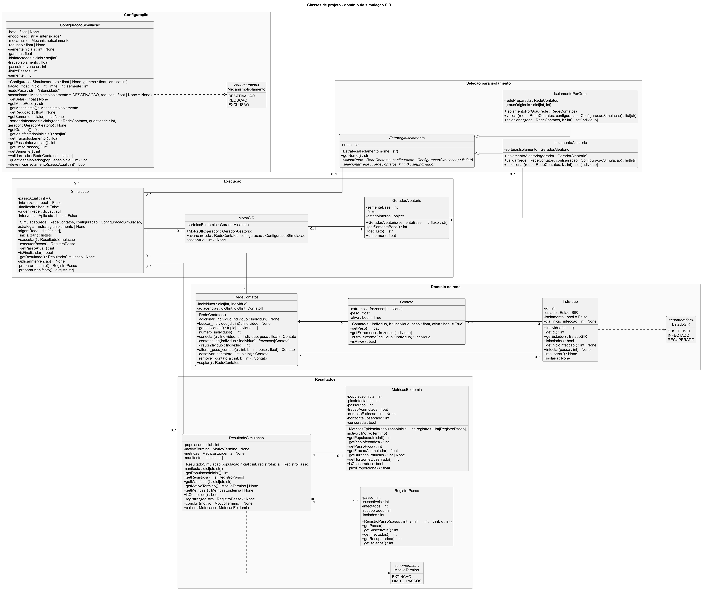

# Modelagem de classes do simulador de epidemias

> **Consulta da implementação atual (22/11/2026):** este documento e o diagrama registram o projeto da Etapa 1. A [conferência da modelagem com o código](revisao-modelagem-implementacao.md) distingue suas assinaturas propostas dos contratos atuais usados no relatório SBC. As responsabilidades descritas como propostas abaixo pertencem ao registro histórico.

> **Detalhamento de projeto.** O [PDF da Etapa 1](../../Artefatos/Etapa1-Problema-Modelagem-Plano.pdf), seções 2.5 e 2.6, apresenta as responsabilidades dos componentes e sua relação com a implementação.

## 1. Escopo, status e configuração de referência

Este é um diagrama de classes de projeto para uma execução SIR, não uma declaração de implementação concluída. A estrutura consultada utiliza RedeContatos, Contato e Individuo; os nomes correspondem à estrutura atual, evitando manter uma cópia paralela do mesmo domínio. Configuração, motor, execução, estratégias e resultados permanecem responsabilidades propostas.

A configuração de referência é **proposta, sujeita à confirmação coletiva**: grafo simples, não direcionado, ponderado e estático; população fechada; peso como intensidade normalizada em [0,1]; um passo como dia do modelo sem calibração real; recuperação probabilística; isolamento único por orçamento, lógico total e permanente até o término. Ausência de intervenção usa fração zero e nenhuma estratégia. Intensidade é padrão, com probabilidade direta como alternativa de configuração. A interface prevê infectados iniciais manuais ou sorteados. Topologia dinâmica e q diário são alternativas de menor prioridade; redução parcial e exclusão continuam documentadas, mas o fluxo representado usa orçamento, com mecanismo configurado. O módulo de mecanismos existe; isso não certifica a integração completa. Dinâmica e q não são presumidos implementados. Essa delimitação não afirma que o grupo tenha aprovado todas essas escolhas.

A estrutura local consultada após a integração em Luis utiliza RedeContatos e Contato, com atividade independente e operações controladas de alteração dos contatos. O módulo isolamento.py contém os três mecanismos. A presença desses módulos não certifica correção ou conclusão do simulador. O arquivo ModelagemGrafo.md ainda descreve outra política diária e pesos acima de 1; esses pontos continuam sujeitos a alinhamento, sem misturar políticas nesta referência.

Os tipos são compatíveis com Python 3.10+: coleções parametrizadas e união com None. Construtores com nome de classe em UML correspondem a __init__. Os atributos são privados no projeto; consultas públicas retornam cópias ou coleções protegidas. Não são previstas alterações públicas arbitrárias de estado, identificador ou peso durante a execução.

## 2. Diagrama e correspondência com a API existente

O [SVG](diagramas/classes-dominio/classes-dominio.svg) permite ampliação; a [fonte PlantUML](diagramas/classes-dominio/classes-dominio.puml) é editável. A exportação afasta multiplicidades das bordas e dos traços, sem alterar as relações.

| Consulta de projeto | Correspondência na revisão Python consultada | Observação |
|---|---|---|
| Individuo.getId/getEstado/isIsolado/getInicioInfeccao | Propriedades id, estado, isolamento, dia_inicio_infeccao | São os mesmos dados, não novos estados paralelos; a notação de consulta não exige wrappers redundantes. |
| RedeContatos.getIndividuos/numero_individuos | Propriedades individuos e numero_individuos | A assinatura de consulta explicita o retorno no UML; a implementação pode manter properties. |
| RedeContatos.adicionar_individuo/buscar_individuo/conectar/contatos_de/grau | Operações correspondentes da estrutura existente | Preservar nomes e contratos, inclusive identidade dos objetos cadastrados. |
| Contato.getExtremos/getPeso/isAtiva | Propriedades extremos, peso e ativa | ativa é indicador próprio. O motor consulta esse valor e o peso atual; o mecanismo aplica o efeito do isolamento. |
| Individuo.infectar/recuperar/isolar | Operações correspondentes | Alteram somente o domínio indicado, preservando a independência entre estado e isolamento. |

O desenho usa uma estrutura especializada de domínio. RedeContatos mantém cadastro e adjacências; Individuo mantém dados epidemiológicos e Contato descreve o contato. Isso separa responsabilidades sem duplicar identidades em classes genéricas de vértice/aresta. Uma estrutura genérica só seria justificável se o projeto precisasse de outros domínios, o que não integra este recorte.

## 3. Indivíduo e contato

### Individuo e EstadoSIR

Individuo possui id inteiro único na rede, estado do enum EstadoSIR, isolamento booleano e dia_inicio_infeccao inteiro ou None. O construtor recebe id e inicia S, False e None. As consultas públicas expõem esses valores sem permitir alteração arbitrária.

infectar(passo) exige estado S e passo inteiro não negativo; aplica I e grava o instante. recuperar() exige I e aplica R, preservando histórico e isolamento. isolar() marca a condição independentemente de S,I ou R; chamadas repetidas não aumentam o orçamento. Não há liberação automática na política de referência.

EstadoSIR contém SUSCETIVEL, INFECTADO e RECUPERADO. Não há subclasses para esses estados nem isolamento como quarto estado. R é absorvente durante a execução e não exclui o indivíduo do grafo.

### Contato

Os atributos de projeto são extremos, peso e ativa. extremos é frozenset[Individuo] com exatamente dois objetos distintos cadastrados na mesma rede; a associação UML representa essa mesma referência. Não há ordem entre os participantes. peso é float finito em [0,1]. O construtor valida esses limites, os extremos e o indicador ativa booleano.

getExtremos() entrega a coleção protegida; getPeso() consulta o peso; outro_extremo() devolve o outro participante e recusa objeto externo. isAtiva() corresponde à propriedade ativa e não consulta implicitamente isolamento. O construtor aceita ativa=True por padrão. A criação pela rede usa seus defaults e as alterações são efetuadas pelas operações de RedeContatos.

O mecanismo de desativação marca contatos como inativos, a redução altera seu peso uma única vez e a remoção retira ligações. Não há isDisponivel baseado no isolamento dos extremos: esse filtro impediria a transmissão residual da redução. O indicador isolamento continua útil para condição individual, elegibilidade e Q, sem ser quarto estado SIR. Peso zero pode coexistir com ativa=True.

## 4. RedeContatos e responsabilidades estruturais

RedeContatos possui individuos: dict[int,Individuo] e adjacencias: dict[int,dict[int,Contato]]. O construtor inicia os mapas vazios. Cada Contato é compartilhada nas duas vizinhanças, sem criar dois contatos distintos. Os indivíduos sem contatos continuam cadastrados e contados em N.

| Operação | Responsabilidade e contrato |
|---|---|
| adicionar_individuo(individuo) | Validar ID único, cadastrar a referência e criar vizinhança vazia. |
| buscar_individuo(id) | Buscar no cadastro e retornar None se ausente. Não confundir com obter_individuo da API, que pode lançar erro. |
| getIndividuos() | Entregar uma coleção protegida das mesmas pessoas cadastradas. |
| numero_individuos() | Consultar o tamanho do cadastro, inclusive grau zero. |
| conectar(a,b,peso) | Exigir os próprios objetos cadastrados, extremos distintos e par não existente; criar e cadastrar um único contato nas duas vizinhanças. |
| contatos_de(individuo) | Consultar contatos estruturais, inclusive os indisponíveis pelo isolamento. |
| grau(individuo) | Contar vizinhos estruturais, sem ponderação e sem excluir isolados. |

### Por que adicionarIndividuo(), contatosDe() e grau() pertencem à rede

Esses nomes conceituais correspondem a adicionar_individuo(), contatos_de() e grau() na API Python. As três operações consultam ou alteram coleções que pertencem ao RedeContatos. Uma pessoa não tem acesso, por si só, ao cadastro global, à unicidade de IDs ou à política de contatos da rede.

Quem solicita a ação na interface não determina a classe responsável por executá-la. Assim como um usuário pode solicitar o cadastro de um objeto, a operação de domínio pertence a quem mantém seus dados e invariantes. Individuo conserva suas transições; RedeContatos conserva estrutura e cadastro.

contatosDe() e grau() poderiam ficar em Individuo se cada pessoa mantivesse sua própria vizinhança como fonte de verdade, ou conhecesse explicitamente sua rede e delegasse a consulta. Isso criaria outras responsabilidades de vínculo e sincronização. Na estrutura atual, duplicar adjacências em Individuo aumentaria o risco de inconsistência e não é necessário.

## 5. ConfiguracaoSimulacao

Os atributos mecanismo,reducao,beta,modoPeso,sementeIniciais,gamma,idsInfectadosIniciais,fracaoIsolamento,passoIntervencao,limitePassos e semente descrevem uma execução. O construtor recebe os valores de execução e inicia sementeIniciais=None; a operação de sorteio preenche esse atributo quando utilizada. Consultas públicas correspondentes permitem revisão pela interface e uso pelo domínio; coleções retornadas são protegidas e os valores ficam preservados durante a execução.

modoPeso admite intensidade (padrão) ou probabilidade; getModoPeso expõe o modo. No primeiro, beta é finito em [0,1]; no segundo, beta=None e p=peso, sem multiplicação adicional. gamma e fração são finitos em [0,1]. mecanismo usa MecanismoIsolamento; reducao é fração retirada em [0,1] somente em REDUCAO, e None nos outros mecanismos. getMecanismo/getReducao expõem esses valores. Os defaults propostos são DESATIVACAO e None. getBeta retorna float ou None. IDs pertencem ao cadastro, o limite é inteiro positivo e o início inteiro satisfaz 0≤início<limite. Semente e contagens inteiras não aceitam bool como substituto. O conjunto vazio de infectados é válido; duplicação digitada deve ser informada antes de converter a entrada em conjunto. A rede deve ter N>0, sem exigir conectividade ou arestas.

validar(rede) retorna list[str], vazia quando válida. Reúne mensagens por campo, por exemplo “beta deve estar entre 0 e 1”, “limitePassos deve ser positivo” ou “ID inicial 42 não encontrado”. Entradas inválidas não alteram a rede nem consomem geradores. Alterar entrada exige nova validação.

quantidadeIsolados(N) exige N>0 e calcula piso(fracaoIsolamento×N). A quantidade pertence à configuração; a estratégia escolhe quais pessoas. deveIniciarIsolamento(passoAtual) consulta igualdade com o instante agendado, mas Simulacao também verifica orçamento positivo, intervenção ainda não aplicada e existência de outra transição possível.

sortearInfectadosIniciais(rede,quantidade,gerador) é operação de preparação antes da execução: valida 0≤quantidade≤N, amostra sem reposição em ordem estável com fluxo “infectados-iniciais”, guarda os IDs e sementeIniciais, consultável por getSementeIniciais. A interface também aceita IDs manuais; o construtor inicia sementeIniciais=None. A configuração é congelada ao iniciar; não sortear novamente para cada cenário. O manifesto registra método, quantidade,semente e IDs realizados. Quantidade de repetições é parâmetro do lote, não de um passo. Formatos, famílias sintéticas e preparação dos pesos pertencem à entrada da rede e não são seletores fictícios nessa configuração.

## 6. Execução, relógio e aleatoriedade

### Simulacao

O construtor recebe RedeContatos próprio, configuração, estratégia ou None e origemRede, um mapa de metadados da entrada preparada. passoAtual=0, inicializada=False, finalizada=False e intervencaoAplicada=False. origemRede identifica fonte/arquivo ou gerador, assinatura canônica e transformação, sem reter uma rede mutável de outra execução.

inicializar() retorna erros de configuração, origem e preparo da estratégia antes de mutar a rede. None é aceito como estratégia somente quando o orçamento é zero; para k>0 exige uma estratégia válida da mesma rede. A rede deve estar em condição inicial nova. No preparo válido, inicializa os infectados, cria o gerador epidemiológico e o motor, prepara a intervenção de t=0 quando cabível e cria resultado com o registro inicial e manifesto. Se não há infectados, registra e conclui em t=0, sem intervenção.

executar() inicializa quando necessário e repete executarPasso() até a conclusão. Erros impedem a execução e são apresentados ao consumidor; chamada após conclusão devolve o mesmo resultado. executarPasso() exige inicialização válida e estado em andamento.

**MotorSIR não altera passoAtual nem registra.** executarPasso() chama o motor uma vez para t→t+1, incrementa passoAtual uma vez e chama prepararInstante(). Este método verifica término, aplica intervenção devida apenas se outra transição puder ocorrer e constrói o registro com Q após essa intervenção. O registro é adicionado exatamente uma vez; então a execução conclui quando cabível. A inicialização usa a mesma ordem para produzir t=0.

aplicarIntervencao() consulta k, solicita selecionar(rede,k), delega à função aplicar_isolamento(rede, IDs, mecanismo, orcamento=k, reducao=valor), que modifica contatos e chama isolar() nos indivíduos; depois marca intervencaoAplicada. A função já existe no módulo isolamento.py e retorna ResultadoIsolamento. O diagrama recorta as entidades da execução; não cria outra classe de serviço só para reproduzir essa função. Selecionar exatamente k pessoas é responsabilidade da estratégia/coordenador; a função aceita seleção até o orçamento, portanto o coordenador deve verificar a igualdade requerida no experimento. prepararManifesto() constrói o snapshot descritivo da execução. getPassoAtual(), isFinalizada() e getResultado() permitem consulta; resultado é None antes do preparo válido.

Extinção em t prevalece sobre coincidência com o limite. Se t=T_max e I>0, o resultado é censurado. Uma intervenção em t=5 aparece no registro de 5 e afeta a transição 5→6; se a execução termina ao chegar a 5, não é aplicada. Não há registro duplicado, alteração retroativa do histórico ou liberação de isolados.

### MotorSIR

O construtor recebe o gerador epidemiológico e o mantém em sorteiosEpidemia. avancar(rede,configuracao,passoAtual): None calcula e aplica **somente uma transição** usando valores congelados de estado/isolamento. A captura não pode ser só uma coleção de referências mutáveis.

Para cada suscetível, combina contatos disponíveis por P=1−produto(1−p), com p=βw no modo intensidade e p=w no modo probabilidade. Somente contatos existentes e ativos participam; o motor não aplica bloqueio adicional por isolamento. A redução já foi incorporada ao peso e deve permitir transmissão residual. Para cada infectado inicial do passo, sorteia recuperação com γ, inclusive isolados. Infecção e recuperação usam sorteios distintos. Guarda as decisões e só então aplica S→I e I→R; recém-infectados recebem início t+1 e não transmitem nem recuperam naquele passo. Recuperação preserva isolamento.

O retorno None torna explícito que o motor não cria RegistroPasso; só Simulacao conta e publica após preparar o novo instante. Não há segunda aplicação das transições em Simulacao.

### GeradorAleatorio

sementeBase é a condição inicial, fluxo identifica finalidade e estadoInterno: object é o estado do algoritmo que evolui. O tipo object evita atribuir uma lista de inteiros ao estado interno de um algoritmo ainda não escolhido. Uma implementação poderá encapsular geradores da biblioteca padrão, sem implementar grafo por biblioteca externa.

O construtor deriva estado inicial de sementeBase e fluxo de forma estável. uniforme() retorna float em [0,1) e avança o estado; getSementeBase/getFluxo consultam o preparo. Não reseedar a cada sorteio. Algoritmo, versão e derivação efetiva precisam ser definidos antes da implementação e registrados no manifesto; não usar hash aleatório de strings do processo para derivar sementes.

Geração da rede e sorteio de infectados iniciais ocorrem na preparação com fluxos próprios, distintos da epidemia e da seleção de isolamento. Seleção usa outra instância com fluxo “isolamento”; o motor usa “epidemia”. A ordem de consumo é estável por ID; seeds iguais só reproduzem trajetórias com rede, configuração e ambiente compatíveis. Streams separados não garantem pareamento por evento entre estratégias que consomem quantidades diferentes de sorteios.

## 7. Estratégias de isolamento

EstrategiaIsolamento é abstrata porque existem duas variações concretas. Possui nome privado, construtor e getNome(). validar(rede,configuracao): list[str] e selecionar(rede,k): set[Individuo] são abstratos e aparecem nas duas subclasses. O contrato exige 0≤k≤N, devolve exatamente k objetos distintos cadastrados e não altera seus estados ou isolamento. Simulacao aplica a intervenção.

IsolamentoAleatorio possui sorteiosIsolamento, recebido pelo construtor com fluxo correto. validar() confere semente-base/finalidade e separação da instância epidemiológica. selecionar() faz amostragem uniforme sem reposição, partindo de IDs ordenados e algoritmo registrado.

IsolamentoPorGrau mantém redePreparada e grausOriginais: dict[int,int]. O construtor preenche grau para todos os IDs, inclusive zero. validar() exige a rede preparada e mapa compatível com sua estrutura. selecionar() ordena por grau decrescente e ID crescente. Graus permanecem os da topologia inicial, sem ponderação ou recálculo após isolamento.

Essas classes selecionam vértices. Atividade própria da aresta não é outra estratégia de seleção de pessoas. Política diária de infectados e mecanismos alternativos não foram adicionados à hierarquia da referência; exigiriam outros contratos e não fazem parte do mínimo proposto.

## 8. Histórico, manifesto e métricas

### RegistroPasso

Possui passo,suscetiveis,infectados,recuperados e isolados, todos privados e inteiros não negativos. O construtor recebe t,S,I,R,Q. Cada get correspondente expõe o valor, incluindo getIsolados(). Depois da construção, os valores não mudam. Alterações posteriores dos indivíduos não modificam registros anteriores.

Q é contado após a intervenção de t e antes dos sorteios t→t+1; em instante terminal não ocorre nova intervenção. RegistroPasso valida domínios; ResultadoSimulacao verifica S+I+R=N e 0≤Q≤N. Isolados não são quarto compartimento. H transições exigem H+1 registros consecutivos, incluindo t=0.

### ResultadoSimulacao

O construtor recebe N, registroInicial e manifesto. Exige N>0, registro em t=0, conservação e R(0)=0. populacaoInicial guarda o denominador; motivoTermino e metricas começam em None. O manifesto é copiado e preservado. getPopulacaoInicial/getRegistros/getManifesto/getMotivoTermino/getMetricas/isConcluido permitem consulta; os mapas e listas retornados não permitem alterar o conteúdo interno.

O manifesto: dict[str,str] representa snapshots serializados de rede e configuração, não uma associação a objetos mutáveis. Seu contrato mínimo de chaves é:

| Chave | Conteúdo a registrar |
|---|---|
| rede | Identificador, assinatura canônica de IDs/contatos/pesos/atividade própria, origem/arquivo ou gerador, versão/janela e transformação de pesos. |
| configuracao | modo de peso, β aplicável ou None,γ, método manual/sorteado, quantidade e semente inicial, IDs iniciais ordenados, limite, política, fração,k,início e unidade temporal; parâmetros efetivamente utilizados. |
| aleatoriedade | Semente-base, sementes efetivas dos fluxos usados, algoritmo, versão, derivação e ordem de consumo. Geração da rede também deve ser identificada quando aleatória. |
| execucao | Identificação do cenário e da repetição quando em lote, mais identificação da execução individual. |
| ambiente | Revisão do projeto, versão do Python e dependências relevantes. |

Cada valor pode ser texto JSON canônico, com regras de serialização declaradas antes do uso; não é necessário criar outra entidade só para armazená-lo. A assinatura da rede deve evitar diferenças artificiais pela ordem de inserção. Esse manifesto não exige exportação ou persistência entre sessões como nova funcionalidade. Ele evita preservar uma referência ao grafo já alterado como se fosse o estado inicial.

registrar() exige execução aberta, próximo instante e invariantes S não crescente, R não decrescente, conservação e Q não decrescente somente na política permanente padrão; o protocolo diário com liberação precisaria outro contrato. concluir() fixa EXTINCAO para I=0 ou LIMITE_PASSOS para limite com I>0, conforme o instante informado pelo coordenador. O motivo não muda após conclusão.

calcularMetricas() só após conclusão cria MetricasEpidemia com o próprio N, registros e motivo; preserva e reutiliza o objeto. O atributo metricas e a associação no desenho representam a mesma referência, não dois armazenamentos.

### MetricasEpidemia

O construtor recebe N do resultado, registros e motivo. Calcula populacaoInicial,picoInfectados,passoPico,fracaoAcumulada,duracaoExtincao,horizonteObservado e censurada. As consultas públicas correspondentes e isCensurada() expõem os valores. Não há setters de métricas.

Pico é máximo I(t), incluindo isolados e t=0; passoPico é sua primeira ocorrência. fracaoAcumulada=[N−S(H)]/N=[I(H)+R(H)]/N, sob R(0)=0 e SIR fechado, incluindo iniciais. picoProporcional() usa o próprio N e não recebe denominador externo.

duracaoExtincao é primeiro instante com I=0, ou None quando censurada. horizonteObservado=H sempre existe. Se I=0 exatamente no limite, motivo é EXTINCAO; caso contrário, duração não observada é maior que H. Sem infectados iniciais, pico e instante são zero, acumulado zero e duração zero.

Comparação e estatística agregada pertencem ao executor/consumidor de coleções de resultados, não ao motor ou a esta métrica individual. Seus contratos estão no [documento epidemiológico](../../epidemiologia/problema-e-epidemiologia.md): referência sem intervenção, médias/desvios,n,censura, diferenças e redução com referência positiva. Não se criaram classes extras para antecipar a arquitetura do lote.

MotivoTermino contém EXTINCAO e LIMITE_PASSOS. None representa execução ainda aberta; não é outro motivo de término.

## 9. Valores ausentes e restrições do domínio

Usar None para início da infecção ainda inexistente, resultado antes da inicialização, motivo antes da conclusão, métricas ainda não calculadas, busca por ID ausente e duração de extinção não observada. Zero continua sendo valor válido de instante, contagem, fração ou duração; não o usar como marcador de ausência. Estratégia None é válida apenas para orçamento zero.

Cada contato possui dois extremos distintos na mesma rede, sem laço ou duplicação de par invertido. IDs e extremos não mudam após cadastro. A rede pode estar vazia durante construção, mas não ao executar. Pessoas sem contatos são válidas. N não muda por recuperação ou isolamento.

Cadastro estrutural inicial ocorre no preparo; a intervenção pode desativar, reduzir peso ou remover contatos de forma controlada. Pessoas não são removidas. Cada execução recebe indivíduos e contatos próprios; não basta copiar um mapa mantendo os mesmos objetos mutáveis de outro cenário. O snapshot inicial e o manifesto permanecem preservados; pesos/atividade/contatos operacionais podem mudar pela intervenção. Cenários novos partem de cópias independentes da condição original. As coleções retornadas preservam a estrutura interna, embora as pessoas sejam alteradas por operações legítimas de domínio.

## 10. Relações e multiplicidades

| Relação | Multiplicidade | Semântica |
|---|---|---|
| RedeContatos e Individuo | RedeContatos tem 0..* pessoas; pessoa pertence a 1 grafo neste recorte | Associação de cadastro; permite preparo com grau zero. |
| RedeContatos e Contato | RedeContatos tem 0..* arestas; cada aresta pertence a 1 grafo | Composição: contato é criado/cadastrado por uma única rede e não é compartilhado entre execuções. |
| Contato e Individuo | Contato liga exatamente 2 pessoas; pessoa participa de 0..* arestas | Associação única, sem ordem, com extremos distintos. |
| Simulacao e RedeContatos | Simulação usa 1 grafo; grafo participa de 0..1 simulação | Estado próprio por execução. |
| Simulacao e ConfiguracaoSimulacao | Simulação usa 1 configuração; configuração pode servir a 0..* execuções | Valores preservados, resultados guardam snapshots no manifesto. |
| Simulacao e MotorSIR | Simulação tem 0..1 motor; motor pertence ao contexto de 1 simulação | Criado no preparo válido; sem segundo relógio. |
| MotorSIR e GeradorAleatorio | Motor usa 1 gerador; gerador serve a 0..1 motor | Stream epidemiológico exclusivo. |
| Simulacao e EstrategiaIsolamento | Cada lado tem 0..1 | Ausência permitida só para k=0; estratégia preparada pertence a no máximo uma execução. |
| IsolamentoAleatorio e GeradorAleatorio | Estratégia usa 1 gerador; gerador serve a 0..1 estratégia | Stream distinto do motor, restrição adicional ao desenho. |
| Simulacao e ResultadoSimulacao | Cada lado tem 0..1 | Resultado aparece após preparo e pode sobreviver à execução. |
| ResultadoSimulacao e RegistroPasso | Resultado possui 1..* registros; registro pertence a 1 resultado | Composição com registro inicial obrigatório. |
| ResultadoSimulacao e MetricasEpidemia | Resultado possui 0..1 métricas; métricas correspondem a 1 resultado | Associação de indicadores calculados e preservados. |
| Estratégias concretas e abstrata | Duas generalizações | Aleatória e por grau concretizam validar e selecionar. |
| ConfiguracaoSimulacao e MecanismoIsolamento | Dependência de tipagem | Enum do mecanismo de intervenção. |
| Individuo e EstadoSIR; Resultado e MotivoTermino | Dependências de tipagem | Únicas setas tracejadas do diagrama de classes. |

Nenhuma associação implica cópia adicional de um atributo equivalente. O mesmo objeto de aresta aparece nas duas adjacências, mas pertence a um único grafo. A navegabilidade não está especificada porque não houve decisão adicional que a justifique. Não há agregação de significado indefinido.

## 11. Sequência de preparação e execução

1. Preparar dados/gerador, normalizar pesos e criar RedeContatos com todos os indivíduos, inclusive sem contatos. Registrar origem e assinatura da entrada.
2. Construir configuração com IDs explícitos e parâmetros; validar antes de iniciar qualquer execução.
3. Para k>0, preparar estratégia por grau na mesma rede ou aleatória com RNG próprio. Para k=0, usar None, sem consumir RNG de seleção.
4. Construir Simulacao com origemRede e estado novo. inicializar() valida, marca I(0), prepara intervenção de 0 se cabível e cria manifesto/resultado inicial.
5. Chamar executarPasso(): motor aplica uma transição, Simulacao incrementa t e prepara/registra o novo instante uma vez.
6. Concluir por extinção ou limite, calcular métricas com o denominador do resultado e apresentar registros/manifesto/indicadores.
7. Em lote, reconstruir estado inicial independente para cada cenário/repetição. Registrar as condições utilizadas antes da consolidação e visualização.

## 12. Decisões ainda pendentes e alcance da verificação

O grupo deverá confirmar a configuração proposta, a compatibilidade das APIs entre branches, base/arquivo, preparação dos pesos, formatos/geradores, algoritmo pseudoaleatório, derivação de sementes, serialização/assinatura canônica e parâmetros experimentais. Sua escolha não pode ser inferida apenas da presença em um arquivo ou commit.

As fontes e as imagens devem ser validadas sintaticamente e inspecionadas visualmente. Isso verifica o artefato de projeto; não executa nem valida o simulador. Correção epidemiológica, desempenho, integração e resultados experimentais continuam como trabalho futuro. As restrições descritas aqui são contratos propostos a testar, não funcionalidades já demonstradas.

## 12.1. Mecanismos e correspondência com o código atual

MecanismoIsolamento contém DESATIVACAO, REDUCAO e EXCLUSAO. O coordenador seleciona e agenda e a função aplicar_isolamento aplica o mecanismo uma vez. Antes da mutação, valida tipos, IDs, orçamento, ausência de duplicatas e preparo da rede; não aceita isolamento prévio. A UI não deve oferecer execução repetida sobre o mesmo estado já intervindo.

- DESATIVACAO: RedeContatos.desativar_contato marca o contato como inativo. O motor não transmite por ele.
- REDUCAO: RedeContatos.alterar_peso_contato aplica peso×(1−reducao) uma única vez por contato afetado, mesmo com dois extremos selecionados. Atividade é preservada. Não há multiplicação por extremo nem uso de isDisponivel para bloquear isolados.
- EXCLUSAO: RedeContatos.remover_contato retira as ligações incidentes; o indivíduo permanece cadastrado com grau zero. No texto acadêmico, denomina-se remoção dos contatos, não exclusão do vértice.

A rede também oferece copiar() para estado independente. Contatos e suas duas adjacências devem continuar consistentes após as operações. A política única permanece até o término; liberação futura exige restauração seletiva do snapshot anterior. Topologia dinâmica e q diário continuam de menor prioridade e exigem contratos próprios.

Essas operações existem no código consultado, mas seus testes não foram executados nesta revisão documental. Motor, configuração e resultados do diagrama continuam projeto a integrar. As fontes efetivamente usadas devem ser distinguidas das classes apenas propostas.

## 13. PlantUML completo

```plantuml
@startuml
left to right direction
skinparam monochrome true
skinparam dpi 170
skinparam packageBorderColor #AAAAAA
skinparam packageBorderThickness 1
skinparam packageBackgroundColor #FAFAFA
skinparam shadowing false
skinparam backgroundColor white
skinparam defaultFontName Arial
skinparam defaultFontSize 14
skinparam classAttributeIconSize 0
skinparam packageStyle rectangle
skinparam linetype ortho
skinparam nodesep 58
skinparam ranksep 105
skinparam ArrowFontSize 13
hide empty members
hide circle
title Classes de projeto - domínio da simulação SIR

package "Domínio da rede" {
  enum EstadoSIR <<enumeration>> {
    SUSCETIVEL
    INFECTADO
    RECUPERADO
  }

  class Individuo {
    - id : int
    - estado : EstadoSIR
    - isolamento : bool = False
    - dia_inicio_infeccao : int | None
    + Individuo(id : int)
    + getId() : int
    + getEstado() : EstadoSIR
    + isIsolado() : bool
    + getInicioInfeccao() : int | None
    + infectar(passo : int) : None
    + recuperar() : None
    + isolar() : None
  }

  class Contato {
    - extremos : frozenset[Individuo]
    - peso : float
    - ativa : bool = True
    + Contato(a : Individuo, b : Individuo, peso : float, ativa : bool = True)
    + getPeso() : float
    + getExtremos() : frozenset[Individuo]
    + outro_extremo(individuo : Individuo) : Individuo
    + isAtiva() : bool
  }

  class RedeContatos {
    - individuos : dict[int, Individuo]
    - adjacencias : dict[int, dict[int, Contato]]
    + RedeContatos()
    + adicionar_individuo(individuo : Individuo) : None
    + buscar_individuo(id : int) : Individuo | None
    + getIndividuos() : tuple[Individuo, ...]
    + numero_individuos() : int
    + conectar(a : Individuo, b : Individuo, peso : float) : Contato
    + contatos_de(individuo : Individuo) : frozenset[Contato]
    + grau(individuo : Individuo) : int
    + alterar_peso_contato(a : int, b : int, peso : float) : Contato
    + desativar_contato(a : int, b : int) : Contato
    + remover_contato(a : int, b : int) : Contato
    + copiar() : RedeContatos
  }

  RedeContatos "1" -- "0..*" Individuo
  RedeContatos "1" *-- "0..*" Contato
  Contato "0..*" -- "2" Individuo
  Individuo ..> EstadoSIR
}

package "Configuração" {
  enum MecanismoIsolamento <<enumeration>> {
    DESATIVACAO
    REDUCAO
    EXCLUSAO
  }
  class ConfiguracaoSimulacao {
    - beta : float | None
    - modoPeso : str = "intensidade"
    - mecanismo : MecanismoIsolamento
    - reducao : float | None
    - sementeIniciais : int | None
    - gamma : float
    - idsInfectadosIniciais : set[int]
    - fracaoIsolamento : float
    - passoIntervencao : int
    - limitePassos : int
    - semente : int
    + ConfiguracaoSimulacao(beta : float | None, gamma : float, ids : set[int],\nfracao : float, inicio : int, limite : int, semente : int,\nmodoPeso : str = "intensidade",\nmecanismo : MecanismoIsolamento = DESATIVACAO, reducao : float | None = None)
    + getBeta() : float | None
    + getModoPeso() : str
    + getMecanismo() : MecanismoIsolamento
    + getReducao() : float | None
    + getSementeIniciais() : int | None
    + sortearInfectadosIniciais(rede : RedeContatos, quantidade : int,\ngerador : GeradorAleatorio) : None
    + getGamma() : float
    + getIdsInfectadosIniciais() : set[int]
    + getFracaoIsolamento() : float
    + getPassoIntervencao() : int
    + getLimitePassos() : int
    + getSemente() : int
    + validar(rede : RedeContatos) : list[str]
    + quantidadeIsolados(populacaoInicial : int) : int
    + deveIniciarIsolamento(passoAtual : int) : bool
  }
  ConfiguracaoSimulacao ..> MecanismoIsolamento
}

package "Execução" {
  class Simulacao {
    - passoAtual : int = 0
    - inicializada : bool = False
    - finalizada : bool = False
    - origemRede : dict[str, str]
    - intervencaoAplicada : bool = False
    + Simulacao(rede : RedeContatos, configuracao : ConfiguracaoSimulacao,\nestrategia : EstrategiaIsolamento | None,\norigemRede : dict[str, str])
    + inicializar() : list[str]
    + executar() : ResultadoSimulacao
    + executarPasso() : RegistroPasso
    + getPassoAtual() : int
    + isFinalizada() : bool
    + getResultado() : ResultadoSimulacao | None
    - aplicarIntervencao() : None
    - prepararInstante() : RegistroPasso
    - prepararManifesto() : dict[str, str]
  }

  class MotorSIR {
    - sorteiosEpidemia : GeradorAleatorio
    + MotorSIR(gerador : GeradorAleatorio)
    + avancar(rede : RedeContatos, configuracao : ConfiguracaoSimulacao,\npassoAtual : int) : None
  }

  class GeradorAleatorio {
    - sementeBase : int
    - fluxo : str
    - estadoInterno : object
    + GeradorAleatorio(sementeBase : int, fluxo : str)
    + getSementeBase() : int
    + getFluxo() : str
    + uniforme() : float
  }

  Simulacao "1" -- "0..1" MotorSIR
  MotorSIR "0..1" -- "1" GeradorAleatorio
}

package "Seleção para isolamento" {
  abstract class EstrategiaIsolamento {
    - nome : str
    + EstrategiaIsolamento(nome : str)
    + getNome() : str
    {abstract} + validar(rede : RedeContatos, configuracao : ConfiguracaoSimulacao) : list[str]
    {abstract} + selecionar(rede : RedeContatos, k : int) : set[Individuo]
  }

  class IsolamentoAleatorio {
    - sorteiosIsolamento : GeradorAleatorio
    + IsolamentoAleatorio(gerador : GeradorAleatorio)
    + validar(rede : RedeContatos, configuracao : ConfiguracaoSimulacao) : list[str]
    + selecionar(rede : RedeContatos, k : int) : set[Individuo]
  }

  class IsolamentoPorGrau {
    - redePreparada : RedeContatos
    - grausOriginais : dict[int, int]
    + IsolamentoPorGrau(rede : RedeContatos)
    + validar(rede : RedeContatos, configuracao : ConfiguracaoSimulacao) : list[str]
    + selecionar(rede : RedeContatos, k : int) : set[Individuo]
  }

  EstrategiaIsolamento <|-- IsolamentoAleatorio
  EstrategiaIsolamento <|-- IsolamentoPorGrau
}

package "Resultados" {
  enum MotivoTermino <<enumeration>> {
    EXTINCAO
    LIMITE_PASSOS
  }

  class ResultadoSimulacao {
    - populacaoInicial : int
    - motivoTermino : MotivoTermino | None
    - metricas : MetricasEpidemia | None
    - manifesto : dict[str, str]
    + ResultadoSimulacao(populacaoInicial : int, registroInicial : RegistroPasso,\nmanifesto : dict[str, str])
    + getPopulacaoInicial() : int
    + getRegistros() : list[RegistroPasso]
    + getManifesto() : dict[str, str]
    + getMotivoTermino() : MotivoTermino | None
    + getMetricas() : MetricasEpidemia | None
    + isConcluido() : bool
    + registrar(registro : RegistroPasso) : None
    + concluir(motivo : MotivoTermino) : None
    + calcularMetricas() : MetricasEpidemia
  }

  class RegistroPasso {
    - passo : int
    - suscetiveis : int
    - infectados : int
    - recuperados : int
    - isolados : int
    + RegistroPasso(passo : int, s : int, i : int, r : int, q : int)
    + getPasso() : int
    + getSuscetiveis() : int
    + getInfectados() : int
    + getRecuperados() : int
    + getIsolados() : int
  }

  class MetricasEpidemia {
    - populacaoInicial : int
    - picoInfectados : int
    - passoPico : int
    - fracaoAcumulada : float
    - duracaoExtincao : int | None
    - horizonteObservado : int
    - censurada : bool
    + MetricasEpidemia(populacaoInicial : int, registros : list[RegistroPasso],\nmotivo : MotivoTermino)
    + getPopulacaoInicial() : int
    + getPicoInfectados() : int
    + getPassoPico() : int
    + getFracaoAcumulada() : float
    + getDuracaoExtincao() : int | None
    + getHorizonteObservado() : int
    + isCensurada() : bool
    + picoProporcional() : float
  }

  ResultadoSimulacao "1" *-- "1..*" RegistroPasso
  ResultadoSimulacao "1" -down- "0..1" MetricasEpidemia
  ResultadoSimulacao ..> MotivoTermino
}

Simulacao "0..1" -down- "1" RedeContatos
ConfiguracaoSimulacao "1" -left- "0..*" Simulacao
Simulacao "0..1" -down- "0..1" EstrategiaIsolamento
Simulacao "0..1" -down- "0..1" ResultadoSimulacao
GeradorAleatorio "1" -down- "0..1" IsolamentoAleatorio

@enduml
```

