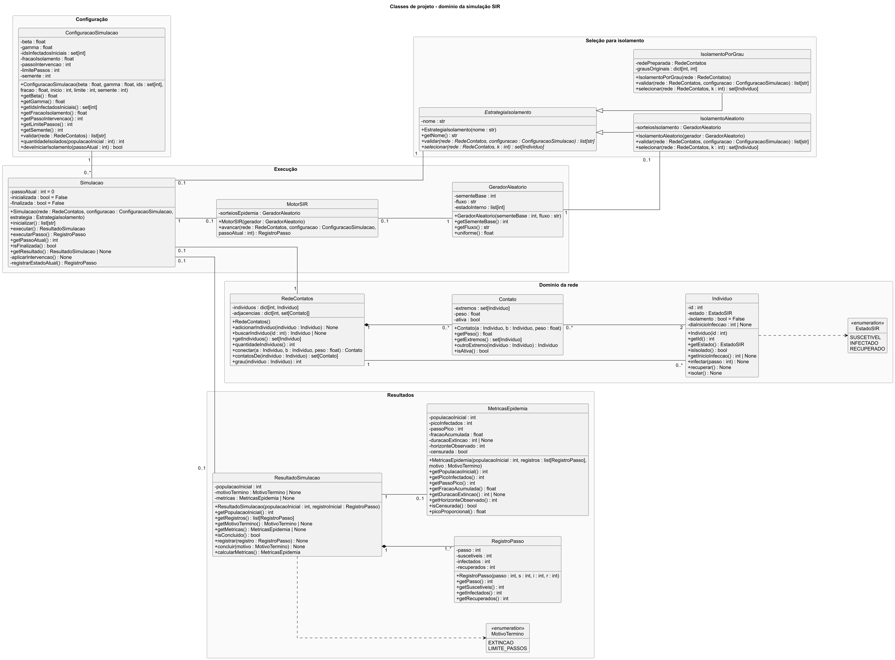
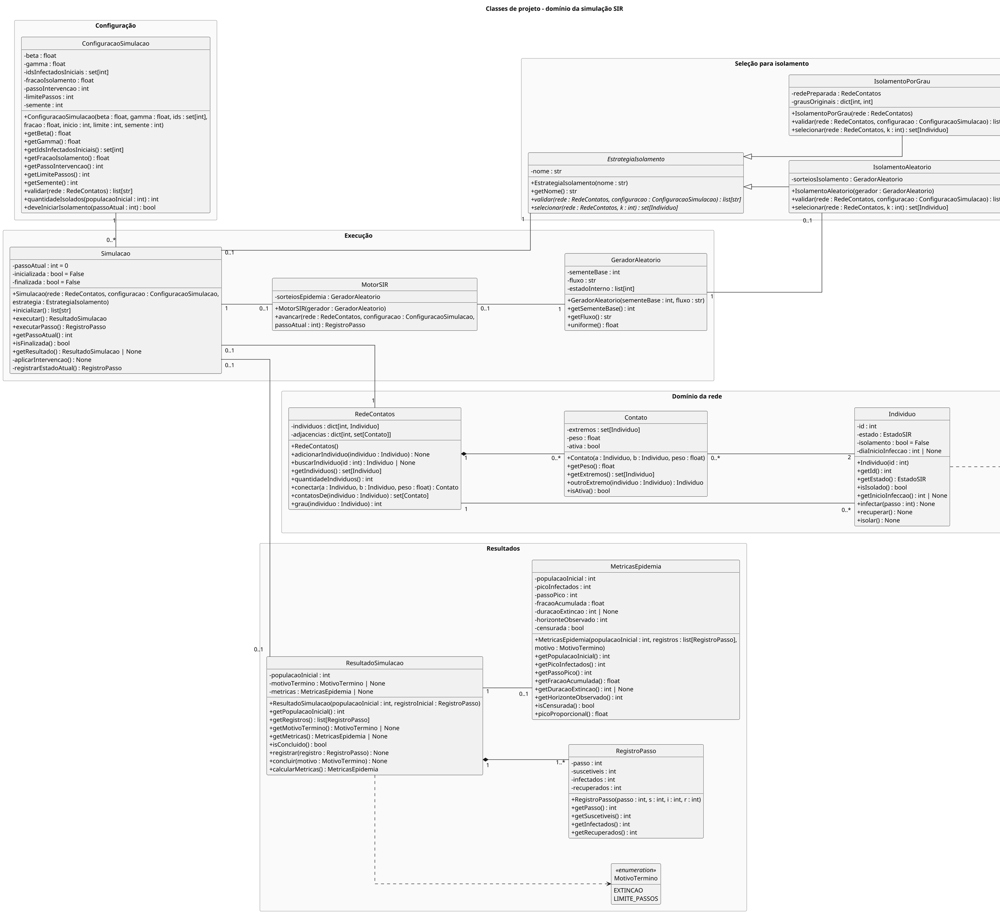

# Modelagem de classes do simulador de epidemias

> Situação no repositório: este diagrama é uma proposta de projeto anterior, ainda sujeita à compatibilização com a [modelagem do grafo vigente](../ModelagemGrafo.md). A estrutura implementada utiliza Grafo, Aresta e Individuo. As classes RedeContatos e Contato, a intervenção por orçamento e o cálculo de ativa a partir do isolamento não descrevem literalmente essa implementação. A regra vigente utiliza dias, intensidade não negativa sem limite superior de 1, probabilidade min(1, β × peso), entrada diária de infectados em isolamento com probabilidade q e liberação na recuperação; ativa é um indicador independente da aresta. Estas diferenças não foram resolvidas unilateralmente nesta importação.

## 1. Escopo, definições e premissas

A modelagem representa o domínio e as responsabilidades de uma execução SIR. As definições estabelecidas pelo grupo são o grafo simples, não direcionado e ponderado, os indivíduos como vértices, os contatos como arestas, a lista de adjacência principal e o isolamento independente do estado SIR.

O recorte operacional continua proposto para confirmação. Ele utiliza população fechada, topologia estática, intensidade normalizada nos pesos, recuperação probabilística, atualização simultânea e isolamento lógico completo, mantido até o término. Os contatos originais estão habilitados. A seleção aleatória e por grau são duas estratégias propostas para comparação.

As convenções acrescentadas nesta revisão são propostas de projeto. Incluem os construtores, os métodos de consulta, as mensagens de validação, os fluxos pseudoaleatórios identificados por nome e a preservação das métricas calculadas no resultado. Os nomes de atributos e métodos existentes foram preservados quando compatíveis com a revisão.

Os tipos seguem Python. A escrita de união com None e as coleções parametrizadas pressupõem Python 3.10 ou posterior. Construtores aparecem com o nome da classe na notação UML e correspondem a __init__ na implementação. Os atributos privados serão encapsulados e acessados pelos métodos públicos indicados. As coleções retornadas serão cópias ou visões que impeçam alteração da estrutura interna.

## 2. Diagrama

O [diagrama vetorial](diagramas/classes-dominio/classes-dominio.svg) permite ampliar o desenho. A [fonte PlantUML](diagramas/classes-dominio/classes-dominio.puml) é editável. A exportação ajusta a posição das multiplicidades para manter margem em relação às bordas dos pacotes e aos traços.

## 3. Indivíduo e estado epidemiológico

### Individuo

Representa uma pessoa identificável da população.

- id é int e identifica a pessoa de forma única na rede.
- estado é EstadoSIR.
- isolamento é bool.
- diaInicioInfeccao admite um inteiro ou None. None indica que a pessoa nunca foi infectada.

Individuo(id) começa em SUSCETIVEL, com isolamento False e início de infecção None. getId(), getEstado(), isIsolado() e getInicioInfeccao() fornecem as consultas necessárias ao motor, às estratégias e à apresentação.

infectar(passo) exige estado S e passo não negativo, muda o estado para I e registra o instante. recuperar() exige I e muda para R, preservando o início da infecção. isolar() marca o indivíduo como isolado e pode ser repetido com o mesmo efeito.

O atributo diaInicioInfeccao guarda o índice do passo abstrato, inclusive zero para os infectados iniciais. A equivalência entre um passo e um dia ainda depende de decisão do grupo.

### EstadoSIR

A enumeração contém SUSCETIVEL, INFECTADO e RECUPERADO. O ciclo é S → I → R. O estado R representa afastamento do processo de transmissão e, no recorte atual, recuperação com imunidade. A transição para R preserva o vértice. O isolamento é uma condição independente e pode coexistir com qualquer estado.

## 4. Contato e estrutura da rede

### Contato

Representa uma única ligação entre dois indivíduos. Uma associação com Individuo possui multiplicidade 2 no extremo das pessoas e 0..* no extremo dos contatos. Assim, cada contato possui exatamente duas pessoas e cada pessoa pode participar de vários contatos.

extremos é set[Individuo] com exatamente dois objetos distintos, pertencentes à mesma rede. O conjunto expressa a ausência de ordem entre os participantes e representa a mesma referência da associação UML. A validação do construtor impede que o conjunto tenha tamanho diferente de dois.

- peso é float, com 0 ≤ peso ≤ 1, e representa intensidade.
- ativa é bool e funciona como um valor privado recalculado na consulta.

Contato(a, b, peso) estabelece os extremos e valida o peso e a diferença entre os indivíduos. getPeso() consulta a intensidade. getExtremos() fornece uma cópia do conjunto de participantes. outroExtremo(individuo) retorna o outro participante e rejeita uma pessoa que não pertença ao contato.

isAtiva() recalcula ativa a partir dos extremos antes de retornar. A regra é ativa = nenhum dos extremos está isolado. Toda consulta de disponibilidade passa por esse método. Assim, mesmo que um indivíduo seja isolado depois da construção do contato, a próxima consulta já refletirá sua condição. O atributo fica privado e não possui método público de alteração.

A barra de atributo derivado foi retirada. O cálculo continua descrito por contrato do método. Peso zero produz probabilidade de transmissão zero, enquanto a disponibilidade segue a condição de isolamento.

### RedeContatos

Organiza os indivíduos e as conexões em dois mapas privados.

- individuos associa cada ID ao objeto Individuo.
- adjacencias associa cada ID ao conjunto de contatos incidentes.

RedeContatos() cria ambos vazios. adicionarIndividuo(individuo) verifica a unicidade do ID, armazena a pessoa e cria uma entrada de adjacência vazia. Pessoas sem contatos permanecem cadastradas e participam dos denominadores.

buscarIndividuo(id) retorna a pessoa cadastrada ou None. getIndividuos() retorna o conjunto de pessoas. quantidadeIndividuos() fornece N.

conectar(a, b, peso) exige que os dois objetos sejam os indivíduos cadastrados na rede, que sejam distintos e que o par ainda não possua contato. Cria um único objeto Contato e o referencia nas adjacências dos dois extremos. contatosDe(individuo) consulta os contatos incidentes. grau(individuo) conta os vizinhos distintos. IDs ou indivíduos desconhecidos são rejeitados nas operações que exigem cadastro.

### Por que esses métodos pertencem à rede

adicionarIndividuo() altera o cadastro e as adjacências da rede. contatosDe() e grau() consultam os dados estruturais que ela mantém. Quem solicita essas operações pode ser o coordenador da simulação ou a leitura de dados, enquanto a rede mantém a consistência da coleção.

As consultas poderiam ser operações de Individuo se o projeto passasse a armazenar a coleção de contatos em cada pessoa. Essa alternativa exigiria manter as coleções dos dois extremos coerentes. O desenho atual concentra essa estrutura em RedeContatos.

A estrutura especializada usa Individuo e Contato diretamente. Isso evita duplicar as mesmas identidades em uma camada paralela de vértices e arestas. As transições epidemiológicas são calculadas pelo motor, e a rede fornece consultas estruturais.

## 5. Configuração

### ConfiguracaoSimulacao

O construtor recebe beta, gamma, IDs dos infectados iniciais, fração de isolamento, instante da intervenção, limite e semente. Copia o conjunto de IDs e armazena os parâmetros. Os valores ficam fixos durante uma execução.

- beta e gamma são float com valores entre 0 e 1.
- idsInfectadosIniciais é set[int].
- fracaoIsolamento é float entre 0 e 1.
- passoIntervencao e limitePassos são int.
- semente é int e serve de base aos geradores.

getBeta(), getGamma(), getIdsInfectadosIniciais(), getFracaoIsolamento(), getPassoIntervencao(), getLimitePassos() e getSemente() expõem esses valores. A configuração é construída com os valores pretendidos e oferece consultas, preservando-os durante a execução.

validar(rede) retorna list[str]. Uma lista vazia significa configuração válida. Havendo problemas, retorna todas as mensagens identificadas antes de alterar a rede. Devem ser verificados N positivo, probabilidades e pesos finitos nos intervalos válidos, limite positivo, 0 ≤ início < limite, semente inteira e IDs iniciais existentes. A verificação dos tipos também rejeita bool em campos que exigem contagens inteiras.

Exemplos de mensagens são “beta deve estar entre 0 e 1”, “limitePassos deve ser positivo” e “infectado inicial com ID 42 não foi encontrado”. O conjunto de IDs elimina repetições e o conjunto vazio é permitido para verificar extinção no instante zero.

quantidadeIsolados(N) exige N positivo e calcula piso(fracaoIsolamento × N). O orçamento pertence à configuração. A estratégia recebe esse número e escolhe as pessoas.

deveIniciarIsolamento(passoAtual) retorna True somente quando o instante atual coincide com passoIntervencao. A simulação também verifica que a quantidade calculada é positiva. O método consulta a programação da intervenção.

## 6. Execução e geração pseudoaleatória

### Simulacao

O construtor recebe rede, configuração e estratégia. Mantém suas referências e começa com passoAtual = 0, inicializada = False e finalizada = False. Cada execução utiliza uma rede própria, sem compartilhar indivíduos mutáveis com outras execuções.

inicializar() retorna list[str]. Primeiro reúne os erros de configuração, verifica se a rede está em estado inicial e se a estratégia foi preparada para ela. Havendo erros, a execução permanece sem inicialização e a rede permanece íntegra.

Na inicialização válida, cria o gerador epidemiológico com a semente da configuração e o fluxo “epidemia”, constrói MotorSIR, marca os infectados iniciais no instante zero, registra S(0), I(0), R(0) e cria ResultadoSimulacao. O motor é criado junto da simulação, podendo aguardar esse preparo para receber um gerador compatível. A construção de um MotorSIR sempre exige seu gerador.

A estratégia aleatória já deve ter recebido outro gerador com a mesma semente-base e fluxo “isolamento”. A preparação garante que sejam objetos distintos. A estratégia por grau já deve estar vinculada à rede fornecida e ter seu mapa completo.

executar() inicializa a execução quando necessário e repete as atualizações até o término. Caso a validação falhe, informa os erros por uma exceção de configuração e não inicia as atualizações. Uma chamada após conclusão devolve o mesmo resultado. executarPasso() exige inicialização válida e execução em andamento.

aplicarIntervencao() é privado. Obtém k da configuração, solicita selecionar(rede, k) e chama isolar() nos escolhidos. registrarEstadoAtual() é privado e produz uma fotografia das contagens. getPassoAtual(), isFinalizada() e getResultado() permitem acompanhar a execução. getResultado() retorna None antes de sua criação.

Se I(0)=0, a execução conclui em t=0. Caso contrário, antes de cada atualização t → t+1, consulta o início do isolamento, aplica a intervenção quando programada e solicita o avanço ao motor. Depois registra t+1 e verifica extinção ou limite. Uma intervenção em t=5 ocorre antes de calcular os estados de t=6.

### MotorSIR

O construtor recebe GeradorAleatorio e o armazena em sorteiosEpidemia. avancar(rede, configuracao, passoAtual) captura os estados em t, sorteia as mudanças, aplica-as simultaneamente e retorna RegistroPasso de t+1.

Para cada contato ativo entre um infectado e um suscetível, p = beta × peso. Para vários infectados vizinhos, P = 1 − produto(1 − p), admitindo tentativas independentes condicionadas aos estados e contatos. O produto vazio é 1, dando P=0.

A recuperação de cada infectado existente em t ocorre com probabilidade gamma. Um infectado que recupera ao final ainda pode transmitir nesse passo. Recém-infectados passam a transmitir e a participar dos sorteios de recuperação a partir do passo seguinte.

O motor mantém temporariamente as decisões de mudança até terminar os sorteios. As duas fases evitam que a ordem de visita aos indivíduos produza transmissão adicional na mesma rodada.

### GeradorAleatorio

sementeBase guarda a origem da sequência. fluxo identifica sua finalidade. estadoInterno é list[int] e representa o estado codificado do algoritmo, que avança a cada sorteio.

GeradorAleatorio(sementeBase, fluxo) inicializa o estado usando uma derivação determinística da semente e do nome do fluxo. getSementeBase() e getFluxo() permitem verificar essa preparação. uniforme() retorna float em [0,1) e atualiza o estado.

O algoritmo pseudoaleatório e a derivação dos fluxos ainda precisam ser escolhidos e registrados, incluindo sua versão. Em Python, a implementação poderá encapsular instâncias independentes de um gerador disponível na biblioteca padrão. A lista de inteiros é uma representação conceitual do estado, sujeita ao mapeamento do algoritmo escolhido.

A semente não é reaplicada a cada sorteio. Recriar o gerador repetidamente faria a sequência recomeçar. Fluxos separados evitam que um sorteio de seleção consuma a sequência dos eventos epidemiológicos.

Mesmo com sementes iguais, o pareamento evento a evento entre cenários depende da ordem de consumo dos números. Esse controle continua uma decisão do protocolo de experimentos.

## 7. Estratégias de seleção

### EstrategiaIsolamento

É abstrata e possui nome privado, recebido pelo construtor e consultado por getNome(). Seu construtor é utilizado pelas subclasses. validar(rede, configuracao) e selecionar(rede, k) são abstratos e implementados pelas duas classes concretas. A validação retorna as mensagens de incompatibilidade de preparo para a execução.

O contrato exige 0 ≤ k ≤ N e retorna set[Individuo] com exatamente k objetos distintos cadastrados na rede. Pode incluir S, I e R. A seleção mantém os estados e a condição de isolamento dos candidatos. Quem aplica a intervenção é Simulacao.

### IsolamentoAleatorio

O construtor recebe um gerador preparado com fluxo “isolamento” e define o nome da estratégia. O atributo sorteiosIsolamento mantém essa referência.

validar() verifica a semente-base e o nome do fluxo recebido em relação à configuração. selecionar() amostra uniformemente k pessoas sem reposição. A implementação deve usar uma ordem inicial estável por ID e um algoritmo de amostragem definido para que a reprodução dependa da semente e dos dados, sem depender da ordem de iteração de set.

### IsolamentoPorGrau

O construtor recebe a rede, armazena sua referência em redePreparada e preenche grausOriginais com um grau para cada ID, inclusive zero para indivíduos sem contatos.

validar() verifica se a rede é a mesma preparada e se os IDs e os graus do mapa correspondem à topologia de entrada. selecionar() exige essa rede, ordena os candidatos por grau decrescente e desempata por ID crescente. O mapa permanece ligado à topologia inicial. Como o recorte é estático, os graus continuam válidos durante a execução.

As estratégias concretas expõem selecionar() explicitamente no desenho. Elas especializam a classe abstrata por generalização, com linha contínua e triângulo vazio.

## 8. Registros e métricas

### RegistroPasso

O construtor recebe passo, S, I e R. Valida contagens inteiras não negativas e passo não negativo. Os atributos passo, suscetiveis, infectados e recuperados são consultados por getPasso(), getSuscetiveis(), getInfectados() e getRecuperados().

O registro preserva suas contagens após a construção e possui apenas consultas públicas. Dessa forma, as mudanças posteriores dos indivíduos mantêm o histórico intacto.

### ResultadoSimulacao

ResultadoSimulacao(N, registroInicial) exige N positivo, registro em t=0, S+I+R=N e R(0)=0. Já nasce com esse registro. populacaoInicial guarda N. motivoTermino e metricas começam com None.

getPopulacaoInicial(), getRegistros(), getMotivoTermino(), getMetricas() e isConcluido() permitem consultar o resultado. A lista de registros retornada é protegida contra alterações externas.

registrar() exige execução aberta, instante imediatamente posterior e conservação de S+I+R=N. Também verifica que S não aumentou e R não diminuiu. concluir() fixa EXTINCAO quando I=0 ou LIMITE_PASSOS quando ainda houver infectados no limite definido pelo coordenador. O motivo fica fixo após a conclusão.

calcularMetricas() exige conclusão. Na primeira chamada, constrói MetricasEpidemia com a própria populacaoInicial, os próprios registros e o motivo registrado. Guarda o objeto em metricas e o devolve. Chamadas posteriores devolvem os mesmos indicadores. metricas representa essa mesma associação, com presença zero ou um.

### MetricasEpidemia

O construtor recebe N, os registros e o motivo do resultado. Valida o histórico e calcula seus atributos. A criação cabe a ResultadoSimulacao no fluxo proposto.

- populacaoInicial copia o denominador do resultado.
- picoInfectados é o maior I(t) observado, incluindo isolados.
- passoPico é o primeiro instante desse máximo.
- fracaoAcumulada é [I(H)+R(H)]/N e inclui os infectados iniciais.
- duracaoExtincao é o primeiro instante com I=0, ou None quando a extinção não foi observada.
- horizonteObservado é H, o último instante registrado.
- censurada é True quando a execução termina pelo limite ainda com infectados.

getPopulacaoInicial(), getPicoInfectados(), getPassoPico(), getFracaoAcumulada(), getDuracaoExtincao(), getHorizonteObservado() e isCensurada() expõem os valores calculados.

picoProporcional() calcula picoInfectados/populacaoInicial, sem receber outro denominador. Em execuções censuradas, pico e acumulado se referem ao horizonte observado. A duração desconhecida é maior que H. Quando a extinção ocorre exatamente no limite, o motivo é EXTINCAO.

### MotivoTermino

É a enumeração com EXTINCAO e LIMITE_PASSOS. A ausência de motivo durante a execução é representada por None no atributo do resultado, preservando a distinção entre execução aberta e causa de encerramento.

## 9. Ausência de valores em Python

A convenção é usar None e anotações de união em todos os valores que podem estar ausentes. Um exemplo é o início da infecção, anotado como inteiro ou None. Uma pessoa nunca infectada permanece com None. Um indivíduo infectado inicialmente registra 0, um instante válido.

O motivo de término fica com None até concluir(). As métricas ficam com None até serem calculadas após a conclusão. A duração até extinção fica com None quando o limite é atingido com infectados. A busca por um ID inexistente e a consulta de resultado antes da inicialização também retornam None.

O cliente deve verificar a presença do valor antes de usá-lo. Isso preserva a diferença entre ausência, zero e False.

## 10. Relações, multiplicidades e propriedade

| Relação | Multiplicidade | Justificativa |
|---|---|---|
| Rede e indivíduo | Rede possui 0..* indivíduos. Cada indivíduo pertence a 1 rede neste recorte. | Associação de cadastro. A rede pode estar vazia na preparação. |
| Rede e contato | Rede possui 0..* contatos. Cada contato pertence a 1 rede. | Composição com propriedade exclusiva e ciclo de vida dependente. |
| Contato e indivíduos | Cada contato possui exatamente 2 indivíduos. Cada indivíduo participa de 0..* contatos. | Uma associação com dois participantes distintos e sem ordem. O conjunto extremos representa essa mesma propriedade. |
| Simulação e rede | Cada simulação usa 1 rede. Cada rede está ligada a 0..1 execução. | Uma rede própria por execução. |
| Simulação e configuração | Cada simulação usa 1 configuração. Cada configuração pode servir a 0..* execuções. | Valores preservados e reutilizáveis. |
| Simulação e motor | Cada simulação possui 0..1 motor. Cada motor pertence ao contexto de 1 execução. | O motor e seu gerador são criados durante a inicialização válida. |
| Motor e gerador | Cada motor usa 1 gerador. Um gerador está associado a 0..1 motor. | Fluxo epidemiológico. |
| Simulação e estratégia | Cada execução recebe 1 estratégia. Cada estratégia pertence a 0..1 execução. | Preparo e estado específicos do contexto de execução. |
| Estratégia aleatória e gerador | Cada estratégia aleatória usa 1 gerador. Cada gerador está associado a 0..1 estratégia. | Fluxo de seleção distinto do epidemiológico. |
| Simulação e resultado | Cada lado possui multiplicidade 0..1. | O resultado surge na inicialização e pode ser preservado após a execução. |
| Resultado e registros | Cada resultado possui 1..* registros. Cada registro pertence a 1 resultado. | Composição com registro inicial obrigatório. |
| Resultado e métricas | Cada resultado possui 0..1 métricas. Cada objeto de métricas corresponde a 1 resultado. | Associação com cálculo após conclusão e preservação do objeto. |
| Estratégias e classe abstrata | Aleatória e por grau especializam EstrategiaIsolamento. | Generalização. |
| Individuo e EstadoSIR | Uso do enum no atributo estado. | Seta tracejada de tipagem. |
| Resultado e MotivoTermino | Uso do enum no atributo de término. | Seta tracejada de tipagem. |

Quando um atributo e uma associação descrevem a mesma referência, haverá um único objeto ou coleção correspondente na implementação. Isso vale para os geradores, o mapa de indivíduos, os contatos e as métricas. O atributo redePreparada da estratégia é uma referência à mesma rede recebida. Os usos temporários de parâmetros e retornos são expressos pelas assinaturas.

O mesmo objeto Contato aparece em duas listas de adjacência e pertence a uma única rede. Os indivíduos são associados à rede e preservam sua identidade. Os registros são exclusivos de seu resultado. As associações têm navegabilidade não especificada no desenho.

## 11. Sequência de preparação e execução

1. Criar RedeContatos e os indivíduos. Cadastrar todos, inclusive os que terão grau zero.
2. Criar os contatos pela rede, validando extremos, pesos e unicidade dos pares.
3. Construir ConfiguracaoSimulacao e validar seus valores antes de preparar os demais objetos. Mensagens de erro devem ser apresentadas para correção.
4. Preparar a estratégia. Por grau, construir com a rede. Aleatória, construir com gerador da semente-base e fluxo “isolamento”.
5. Construir Simulacao. inicializar() reúne os erros da configuração e da estratégia antes das alterações. No preparo válido, cria o motor e seu gerador com fluxo “epidemia” e semente da configuração e registra t=0.
6. Aplicar o isolamento no instante configurado e atualizar a epidemia em rodadas simultâneas, registrando cada instante.
7. Concluir por extinção ou limite. Calcular as métricas com a população e o histórico do próprio resultado.
8. Apresentar curvas a partir de getRegistros() e indicadores pelos métodos de consulta das métricas, identificando execuções censuradas.

## 12. Restrições e decisões pendentes

As operações estruturais da rede ocorrem na preparação. Todo contato possui extremos distintos e cadastrados, e existe no máximo um contato por par não ordenado. Os IDs de objetos recebidos precisam corresponder aos objetos cadastrados. Os pares podem ser padronizados por ID na implementação.

Todos os indivíduos da coorte continuam contados durante o isolamento. As contagens permanecem não negativas e somam N. A função getIndividuos() entrega referências às mesmas pessoas, enquanto a coleção em si permanece protegida. Os consumidores utilizam os métodos de domínio para alterações válidas.

Os valores originais da configuração, dos pesos, dos registros e das métricas são preservados por construtores e consultas. Os atributos mutáveis possuem apenas operações de alteração pertinentes, como infectar(), recuperar(), isolar(), registrar() e concluir().

Ainda precisam ser confirmados pelo grupo o recorte estático e fechado, a base de dados, os valores dos cenários, o algoritmo pseudoaleatório e a derivação das sementes. A linguagem definida para a implementação é Python. As anotações utilizadas pressupõem versão 3.10 ou posterior. A implementação das regras e as avaliações futuras permanecem como etapas posteriores.

As alternativas de topologia dinâmica, peso como probabilidade pronta, redução parcial e exclusão de vértices continuam no planejamento geral. Sua adoção exigirá revisar a transmissão, os denominadores, a conservação da população e o término.

## 13. Verificação da revisão

As treze classes têm atributos privados pertinentes e consultas públicas. O cadastro de indivíduos e a busca por ID estão explícitos. As duas estratégias concretas mostram selecionar(). Os construtores descrevem a preparação. A semente e o estado do gerador têm papéis distintos. None representa ausência. O pico proporcional utiliza o denominador do resultado. A validação fornece mensagens.

O desenho usa relações contínuas entre classes e tracejadas para os dois enums, com trajetos ortogonais. As multiplicidades exibem apenas números. Os cinco pacotes são blocos separados e os rótulos recebem ajuste de posição na exportação.

## 14. PlantUML completo

